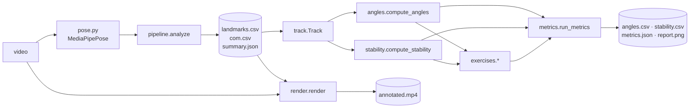

# ClimbVision — The Complete Guide

*For users who want to analyse videos, and for developers who want to change the code.*

ClimbVision turns an ordinary phone video of one person moving into numbers about
how that body moves: a 33-point skeleton, the whole-body centre of mass, joint angles,
what is touching the floor or a bar, how stable the person is, and exercise-specific
results such as squat depth, plank form, jump height or pull-up range of motion.

The long-term goal is climbing analysis on a wall. The current version deliberately
works **off the wall first** (floor exercises and bar exercises), so that every
measurement can be checked on simple movements before it is trusted on a climb.

---

## Contents

1. [Quick start](#1-quick-start)
2. [Recording videos that work](#2-recording-videos-that-work)
3. [Commands](#3-commands)
4. [What you get: output files](#4-what-you-get-output-files)
5. [Reading the results](#5-reading-the-results)
6. [The science](#6-the-science)
7. [Architecture and design philosophy](#7-architecture-and-design-philosophy)
8. [Developing ClimbVision](#8-developing-climbvision)
9. [Known limitations](#9-known-limitations)
10. [Glossary](#10-glossary)
11. [References](#11-references)

---

## 1. Quick start

### 1.1 Install (once)

You need Python 3.10–3.12. With Anaconda / Miniconda:

```bash
cd ClimbVision
conda create -n climbvision python=3.11 -y
conda activate climbvision
pip install -e ".[dev]"
```

`pip install -e` installs the package in *editable* mode: changes you make to the code
under `src/` take effect immediately, without reinstalling. `[dev]` adds the test and
lint tools (`pytest`, `ruff`).

The pose model (a ~10 MB file from Google) downloads automatically the first time you
analyse a video and is cached in `~/.cache/climbvision/models/`.

### 1.2 Analyse a video

```bash
conda activate climbvision
climbvision analyze data/videos/squat_side.MOV
```

This creates `outputs/squat_side/` with an annotated video, a report image and data
files (section 4). Analyse several at once:

```bash
climbvision analyze data/videos/*.MOV data/videos/*.mov
```

### 1.3 Look at the results

1. Open `outputs/<clip>/annotated.mp4` — does the skeleton follow the body? If not,
   no number from this clip can be trusted (see section 2).
2. Open `outputs/<clip>/report.png` — angles, the exercise result, stability and
   contacts over time.
3. Open `outputs/<clip>/metrics.json` — the numbers.

### 1.4 The commands in one sentence each

| Command | What it does | Speed |
|---|---|---|
| `climbvision analyze VIDEO` | Runs pose estimation (slow), then metrics and the annotated video | a few × the clip length |
| `climbvision metrics outputs/CLIP` | Recomputes everything except pose from the saved CSVs | seconds |
| `climbvision render outputs/CLIP` | Redraws `annotated.mp4` from saved results | about the clip length |
| `climbvision summary outputs/*` | One line per clip (table + `outputs/summary.csv`) | instant |

The split matters: pose estimation is the only slow step, so it runs once. When you
change an algorithm or a threshold, re-run `metrics` (and `render`) on existing results.

---

## 2. Recording videos that work

Almost every bad result traced back to the recording, not the code. These rules come
from the test clips:

| Rule | Why |
|---|---|
| **Fixed camera** (tripod or propped phone), never handheld | The floor line, scale and sway all assume the image doesn't move. |
| **Whole body in frame, including feet, plus some floor** | Contacts and stability need visible feet. Clips with feet cut off are flagged "feet out of frame". |
| **Camera at about hip height, roughly level** | A low camera looking up tilts "vertical", distorts trunk lean and the 3D estimate. |
| **One person in frame** | The pose model tracks one person. |
| **Side view for squats, planks, pike push-ups, lunges** | Their movement happens front-to-back; a side view sees it at full size. |
| **Front view for jumping jacks, left/right balance** | Their movement happens left-to-right. |
| **2 s standing still before you start** | Gives a clean baseline (standing knee angle, starting position). |
| **Bar exercises: bar and whole body in frame; if possible, start standing on the floor** | The floor can only be learned from frames where the hands are not on the bar. |
| **Good light, plain clothes contrasting with the background** | Fewer pose errors. |

### 2.1 Naming files so the exercise is recognised

`analyze` and `metrics` guess the exercise from the file name (first match wins):

| File name contains | Exercise |
|---|---|
| `toes_to_bar`, `t2b`, `leg_raise`, `knee_raise` | `leg_raise` |
| `pullup`, `pull_up`, `chinup`, `muscle_up` | `pullup` |
| `dead_hang`, `hang` | `dead_hang` |
| `pistol` | `pistol_squat` |
| `squat` | `squat` |
| `pike` | `pike_pushup` |
| `plank` | `plank` |
| `jumping_jack`, `jacks` | `jumping_jacks` |
| `tree`, `crow`, `onefoot`, `single_leg`, `balance`, `stork` | `balance` |
| anything else | `none` (angles, stability and jumps only) |

Recommended pattern: `<movement>_<view>.mov`, e.g. `squat_side.mov`, `pullup_front.mov`.
You can always override with `--exercise`.

---

## 3. Commands

### 3.1 `climbvision analyze`

```
climbvision analyze VIDEO [VIDEO ...] [--out DIR] [--exercise NAME] [--sex male|female]
                    [--model lite|full|heavy] [--no-video] [--max-frames N]
```

| Option | Default | Meaning |
|---|---|---|
| `--out` | `outputs` | Results go to `OUT/<video file name without extension>/` |
| `--exercise` | `auto` | One of `squat, pistol_squat, plank, pike_pushup, jumping_jacks, balance, pullup, dead_hang, leg_raise, none`; `auto` = from the file name |
| `--sex` | `male` | Which body-segment table to use for the centre of mass (section 6.3) |
| `--model` | `full` | MediaPipe model size. `lite` is ~2× faster and less accurate; `heavy` is ~2× slower and slightly more accurate |
| `--no-video` | off | Skip `annotated.mp4` (faster) |
| `--max-frames` | all | Only process the first N frames (quick tests) |

### 3.2 `climbvision metrics`

```
climbvision metrics outputs/CLIP [outputs/CLIP2 ...] [--exercise NAME]
climbvision metrics outputs/*
```

Reads `landmarks.csv` (+ `com.csv`, `summary.json`) and rewrites `angles.csv`,
`stability.csv`, `metrics.json` and `report.png`. Folders without `landmarks.csv`
are skipped.

### 3.3 `climbvision render`

```
climbvision render outputs/CLIP [--video PATH]
```

Redraws `annotated.mp4`. The source video path is read from `summary.json`; pass
`--video` if it moved. If the results were computed on a resized copy of the video,
the original is resized to match before drawing.

### 3.4 `climbvision summary`

```
climbvision summary outputs/* [--csv PATH]
```

Prints one line per clip — exercise, view, the headline result ("4 reps, 4 below
parallel, knee 36°", "10.6 s on L foot, sway sd 0.9 cm", …) and any warnings — and
writes the same as `summary.csv` (default: next to the result folders). Use it to
compare sessions or to spot clips that need a look.

### 3.5 Using it from Python

Everything the CLI does is a normal function call:

```python
from climbvision.pose import MediaPipePose
from climbvision.pipeline import analyze
from climbvision.metrics import run_metrics
from climbvision.render import render

with MediaPipePose(model_size="full") as est:
    analyze("data/videos/squat_side.MOV", "outputs/squat_side", est)
m = run_metrics("outputs/squat_side", exercise="squat")
print(m["reps"], m["min_thigh_deg_mean"])
render("data/videos/squat_side.MOV", "outputs/squat_side")
```

And to work with the data directly (e.g. in a Jupyter notebook):

```python
from climbvision.track import Track
from climbvision.angles import compute_angles
from climbvision.stability import compute_stability

tr = Track.from_csv("outputs/squat_side/landmarks.csv")   # arrays, shape (frames, 33, 2|3)
ang = compute_angles(tr)
knee = ang.primary("knee")                                  # degrees per frame
st = compute_stability(tr, ang.view, frame_size=(1080, 1920))
st.margin_cm, st.contacts.group["left_foot"]                # per-frame arrays
```

---

## 4. What you get: output files

Every clip gets a folder `outputs/<clip>/`:

| File | Made by | Contents |
|---|---|---|
| `landmarks.csv` | `analyze` | The raw pose: one row per landmark per frame |
| `com.csv` | `analyze` | Centre of mass per frame |
| `summary.json` | `analyze` | Video info and detection summary |
| `angles.csv` | `metrics` | All joint angles per frame |
| `stability.csv` | `metrics` | Contacts, support, margin, swing per frame |
| `metrics.json` | `metrics` | All clip-level results |
| `report.png` | `metrics` | Four-panel plot |
| `annotated.mp4` | `render` | The video with everything drawn on it |

### 4.1 `landmarks.csv`

| Column | Meaning |
|---|---|
| `frame`, `time_s` | Frame index and time (from the video's own timestamps) |
| `landmark` | One of 33 names, e.g. `left_knee` (the **person's** left) |
| `x_px`, `y_px` | Position in the image, pixels. x to the right, **y downwards** |
| `x_m`, `y_m`, `z_m` | MediaPipe's 3D estimate in metres, origin at the centre of the hips, y down, z towards/away from the camera |
| `visibility` | 0–1, the model's confidence that the point is visible (not occluded) |

Frames where no person was found have no rows (they do appear in `com.csv` with
`detected = 0`).

### 4.2 `com.csv`

`frame, time_s, detected, com_x_px, com_y_px, com_x_m, com_y_m, com_z_m, confidence`.
`com_*_m` is relative to the hip centre: it describes body shape, **not** where the body
is in the room (section 6.2). `confidence` is explained in 6.3.

### 4.3 `angles.csv`

`time_s` plus one column per angle, side and method, e.g. `knee_l_2d`, `knee_r_3d`,
`trunk_lean_2d`. Joints: `ankle, knee, hip, thigh, body_line, elbow, shoulder`
(left/right, 2D/3D) and `trunk_lean` (2D/3D). Definitions in 6.4.

### 4.4 `stability.csv`

| Column | Meaning |
|---|---|
| `stance` | Short label of what supports the body: `both feet`, `L foot`, `feet + forearms`, `bar`, `none` (airborne) … |
| `left_foot … right_knee` | 1 when that body part touches the floor |
| `left_hand_on_bar`, `right_hand_on_bar` | 1 when gripping (bar exercises only) |
| `com_x_px` | COM horizontal position in the image |
| `support_lo_px`, `support_hi_px` | Extent of the base of support along the image x axis |
| `margin_cm` | Stability margin: + inside the support, − outside (NaN with no floor contact) |
| `swing_cm` | Bar only: COM x minus grip x |
| `feet_out_of_frame` | 1 when a heel or toe is outside the image |

### 4.5 `summary.json`

`video, sex_model, frame_size, frames, fps, duration_s, frames_with_pose,
detection_rate, com_px {mean, std, range}, mean_confidence, com_world_m`.
`detection_rate` below ~0.95 means the person was lost in part of the clip.

### 4.6 `metrics.json`

Always present:

| Key | Meaning |
|---|---|
| `exercise` | Which analysis ran |
| `view` | `side` or `front` (6.4.3) |
| `body_yaw_deg` | How far the body is turned from facing the camera, 0–90° |
| `near_side` | `left`/`right`: the side facing the camera |
| `angle_ranges` | min / median / max of the main angles |
| `stability` | See 5.2 |

Plus the exercise block (5.3).

---

## 5. Reading the results

### 5.1 The annotated video

| Drawing | Meaning |
|---|---|
| White lines, yellow dots | Skeleton. Grey = low visibility (the model is guessing) |
| Pink dot + light trail | Centre of mass and its last 2 s |
| Thin grey line | The floor as the system estimated it |
| Cyan rings | Points touching the floor |
| Thick bar on the floor | Base of support; **green** = COM above it, **red** = outside |
| Dashed line + triangle | The COM's plumb line to the floor |
| Purple squares + line | Hands on a bar |
| Top-left box | Time, stance, margin (or swing on a bar), warnings |

**Always watch the video before trusting numbers.** If the skeleton jumps, swaps legs
or misplaces a hidden limb, the numbers for those frames are wrong too.

### 5.2 `stability` in metrics.json

| Key | Meaning |
|---|---|
| `support_axis` | `front-back` (side view) or `left-right` (front view) |
| `scale_px_per_m` | Image pixels per metre at the person (6.5) |
| `floor_tilt_deg`, `camera_height_m` | Floor model (6.6); camera height only when the person moved towards/away from the camera |
| `contact_pct` | % of the clip each body part touched the floor |
| `stance_time_s` | Seconds in each stance |
| `margin_cm` | Stability margin: median, minimum, % of time inside |
| `com_sway` | COM movement along the support axis: `sd_cm` (spread), `range_cm`, `mean_speed_cm_s` |
| `sway_by_stance` | The same, for the longest ≥2 s run of each stance |
| `jumps` | `count`, flight times, `height_cm_mean` (from flight time) |
| `bar` | Bar exercises: `on_bar_s`, `hanging_s`, `longest_hang_s`, `swing {sd_cm, range_cm}` |
| `warnings` | Feet out of frame, no contact found, floor unknown |

Typical values on the test clips: quiet standing sway sd ≈ 0.5 cm; one-leg standing
0.6–1.3 cm; tree pose ≈ 0.9 cm; crow pose ≈ 1.6 cm with the COM within ~1 cm of the
hands.

### 5.3 Exercise results

Keys ending in `_mean` / `_sd` are the mean / standard deviation over reps; `reps_detail`
lists every rep.

**squat / pistol_squat**

| Key | Meaning |
|---|---|
| `reps` | Repetitions |
| `standing_knee_deg` | Knee angle at the top (≈ 175–180 side view; ≈ 163 front view, a 3D bias) |
| `min_knee_deg`, `min_hip_deg` | Deepest knee / hip angle per rep |
| `min_thigh_deg` | Thigh vs horizontal at the bottom: **< 0 = below parallel** |
| `hip_below_knee_cm` | Same idea from the 3D estimate (+ = hip below knee) |
| `max_trunk_lean_deg` | Forward lean of the torso |
| `descent_s`, `ascent_s` | Tempo |
| `reps_below_parallel` | Count |
| `reps_by_leg`, `leg` | Pistol only: which leg worked |

**plank**: `hold_s`, `body_line_deg_mean/min`, `hip_offset_pct_mean/sd` (+ sag, − pike,
% of body length), `pct_time_straight/sag/pike` (±5 % = straight),
`hip_offset_drift_pct` (last third minus first third: did the hips drop?).

**pike_pushup**: `reps` (push-ups done while piked), `min_elbow_deg`,
`hip_deg_at_bottom`, `plank_s`, `pike_straight_arms_s`.

**jumping_jacks**: `reps`, `reps_per_min`, `max_arm_deg` (180 = arms straight
overhead), `max_feet_width` (ankle distance ÷ shoulder width). Jumps (two per rep) are in
`stability.jumps`.

**balance**: `balance {stance, hold_s, sd_cm, range_cm, mean_speed_cm_s,
margin_cm_median, margin_cm_min, pct_inside}` — the longest hold on a reduced base
(one foot, hands only…).

**pullup**: `reps`; per rep (and mean/sd): `pull_cm` (how far the shoulders rose
towards the bar), `top_gap_cm` (shoulders below the bar at the top), `com_rise_cm`,
`chin_clearance_cm` and `chin` (`over` / `at bar` / `under`, see 6.12),
`top_elbow_deg`, `start_elbow_deg` (straightness before pulling, ≈ 155–180),
`up_s`, `down_s`, `swing_cm`, `hip_range_deg`, `kipping` (hip angle changed > 40°).
Summary counts: `reps_chin`, `reps_kipping`; `chin_above_shoulders_cm` is the
body-proportion estimate used.

**leg_raise**: `reps`, `min_hip_deg` (90 = legs horizontal), `min_knee_deg` (≈180 =
straight-leg raise, small = knee raise), `reps_toes_to_bar`, and `raised_hold` when the
legs stay up ≥ 3 s (`hold_s`, `hip_deg_start`, `hip_deg_end`, `hip_drop_deg` = how much
the legs sank, `knee_deg_median`).

**dead_hang**: `dead_hang {hold_s, elbow_deg_median, swing_sd_cm, swing_range_cm}`.

### 5.4 report.png

1. **Angles over time**: knee, hip, trunk lean, body line.
2. **Exercise panel**: the signal reps are counted on, reps shaded and numbered (or
   plank hip offset, or COM sway with the longest hold for balance/hang).
3. **Stability**: margin over time, green inside / red outside; purple swing on a bar;
   grey bands where feet were out of frame.
4. **Contacts**: a timeline bar per body part (blue feet, orange hands/forearms/knees,
   purple bar grips).

---

## 6. The science

This section explains *what* is computed and *why it is valid*, in plain terms first and
then precisely. Each subsection names the code that implements it.

### 6.1 Pose estimation (`pose.py`)

**Plain terms.** A neural network looks at each frame and marks 33 points on the
body: nose, eyes, ears, mouth corners, shoulders, elbows, wrists, three hand points,
hips, knees, ankles, heels and toes.

**Precisely.** We use Google's MediaPipe Pose Landmarker (the BlazePose GHUM model) in
`VIDEO` running mode, which tracks between frames rather than detecting from scratch
each frame — smoother and faster. For each frame it returns:

- **image landmarks**: (x, y) normalised to the image; we convert to pixels.
- **world landmarks**: (x, y, z) in metres, origin at the midpoint of the hips. This is
  a *learned estimate* from a single image — useful, but noisy in depth (z).
- **visibility**: probability the landmark is not occluded.

Important properties to remember:

- *Left/right are the person's*, not the image's. Facing the camera, the person's left
  appears on the image's right.
- Hidden landmarks are still predicted (the model guesses); low visibility warns you.
- The model has never seen your body: it can mis-place a limb that points at the camera
  (e.g. a raised knee in a front view) or is hidden behind the body.

`MediaPipePose` is one implementation of the `PoseEstimator` protocol
(`estimate(frame_bgr, time_ms) -> Skeleton | None`); swapping the model means writing
another class with that method (8.4).

### 6.2 Coordinate systems and conventions

| System | Origin | Axes | Units | Used for |
|---|---|---|---|---|
| Image | top-left pixel | x right, **y down** | pixels | Everything measured in the picture: 2D angles, floor, contacts, support, COM path |
| World (MediaPipe) | hip centre, *moves with the person* | x right, y down, z depth (camera axes) | metres | 3D angles, scale, depth-dependent quantities |

Consequences:

- "Up" in the image is −y. Heights above the floor are computed as `floor_y − y`.
- The world frame moves with the hips, so world COM shows *posture* (where the COM is
  relative to the hips), never how far the person travelled.
- World axes follow the camera, not gravity. A tilted camera tilts "vertical".
- All angles are in degrees, times in seconds, distances in cm or m as named.
- Missing data is `NaN` everywhere, never 0.

### 6.3 Centre of mass (`com.py`)

**Plain terms.** The body is split into 14 segments (head, trunk, upper arms,
forearms, hands, thighs, shanks, feet). Each has a known share of body weight and a
known balance point along its length. The whole-body centre of mass (COM) is the
weighted average of the segments' balance points.

**Precisely.** For segment *i* with proximal end **P**ᵢ, distal end **D**ᵢ, mass
fraction *mᵢ* and COM ratio *rᵢ*:

  **c**ᵢ = **P**ᵢ + rᵢ (**D**ᵢ − **P**ᵢ),   **COM** = Σ mᵢ **c**ᵢ   (Σ mᵢ = 1)

Parameters are De Leva (1996), the standard adjustment of Zatsiorsky–Seluyanov's
cadaver/gamma-scan data to joint-centre landmarks:

| Segment | Endpoints (MediaPipe) | Mass % ♂ / ♀ | COM from proximal % ♂ / ♀ |
|---|---|---|---|
| Head | ear midpoint (see below) | 6.94 / 6.68 | at ear midpoint |
| Trunk | mid-shoulders → mid-hips | 43.46 / 42.57 | 44.86 / 41.51 |
| Upper arm | shoulder → elbow | 2.71 / 2.55 | 57.72 / 57.54 |
| Forearm | elbow → wrist | 1.62 / 1.38 | 45.74 / 45.59 |
| Hand | wrist → mid(index, pinky) | 0.61 / 0.56 | 79.00 / 74.74 |
| Thigh | hip → knee | 14.16 / 14.78 | 40.95 / 36.12 |
| Shank | knee → ankle | 4.33 / 4.81 | 44.59 / 44.16 |
| Foot | heel → toe | 1.37 / 1.29 | 44.15 / 40.14 |

Approximations forced by the landmark set: no skull vertex (head COM placed at the
ear midpoint, close to the true head COM); C7 replaced by mid-shoulders; hip joint centres
by MediaPipe's hip points; 3rd knuckle by the index/pinky midpoint. These cause a few
cm of *constant* offset, which barely affects *changes* of the COM — what most metrics use.

The formula is linear, so it works the same on pixels (2D) and on metres (3D);
`whole_body_com` accepts `(33, D)` or `(frames, 33, D)` arrays.

**Sanity check.** Standing adult COM ≈ 55–57 % of height above the floor; on the test
clips it measured 58–60 % of heel-to-nose height (equivalent).

**COM confidence** = Σ mᵢ × (lowest visibility among segment *i*'s landmarks). A hidden
foot costs ~1.4 %; a hidden trunk ~43 %.

### 6.4 Joint angles (`angles.py`)

#### 6.4.1 Definitions

The angle at a joint between three points A–V–B is
θ = arccos( (A−V)·(B−V) / (|A−V| |B−V|) ).

| Angle | Points | Reading |
|---|---|---|
| knee | hip–knee–ankle | 180 straight, smaller = more bent |
| hip | shoulder–hip–knee | 180 straight, ~90 seated/piked |
| ankle | knee–ankle–toe | ~90–110 standing |
| elbow | shoulder–elbow–wrist | 180 straight |
| shoulder | hip–shoulder–elbow | 0 arm by the side, 180 overhead |
| body_line | shoulder–hip–ankle | 180 = straight body (plank) |
| thigh | hip→knee vs horizontal | +90 standing, 0 parallel, < 0 hip below knee |
| trunk_lean | hip→shoulder vs vertical | 0 upright, 90 horizontal |

#### 6.4.2 2D or 3D?

A 2D angle measured in the image equals the true angle **only if the limb moves in a
plane parallel to the image**. A squat seen from the side does; seen from the front, the
thighs point at the camera and look short, so 2D angles are wrong. 3D angles from the
world landmarks work from any view but inherit depth noise. Both are stored; the
**primary** angle uses 2D on the near side for side views and 3D (mean of both sides)
for front views. Front-view 3D readings are biased: a straight knee reads ~163°, trunk
lean reads ~20° when it is really ~32°.

#### 6.4.3 View and near side

- **Body yaw** = median over the clip of atan(|Δz| / |Δx|) between the left and right
  shoulders (and hips) in world coordinates. Facing the camera: both sides at the same
  depth → 0°. Side-on: one side behind the other → 90°. Test clips: front 3–11°,
  side 78–88°. Rule: < 30° front, > 60° side, otherwise fall back to the image shoulder
  width ÷ torso length (< 0.3 = side).
- **Near side** = the side whose limbs have higher average visibility.

### 6.5 Scale: pixels per metre (`stability.estimate_scale`)

To report centimetres we need to know how many pixels one metre is at the person.

**Idea.** For each body segment, divide its length in the image (pixels) by its length
in the world estimate (metres). A segment pointing at the camera looks *shorter* in the
image, never longer, so the **largest** ratios are the trustworthy ones. Per frame we
take the 80th percentile over 12 segments, then a ~1 s rolling median.

If the floor model (6.6) finds no evidence that the person moved towards or away from
the camera, per-frame changes in this ratio are treated as pose noise and one value
(the clip median) is used for the whole clip.

### 6.6 The floor (`stability.estimate_floor`)

The floor is a line in the image: **y = slope·x + y₀(frame)**.

1. **Candidates**: in every frame, the lowest point of each body part (each foot, hand,
   forearm, knee).
2. **RANSAC**: try many candidate lines — horizontal ones through single points, tilted
   ones (≤ 10°) through pairs, and depth-varying ones (below). Score =
   (points within tolerance of the line) − 3 × (points clearly *below* it). Nothing rests
   below the floor, so the penalty stops the line settling on resting hands or knees.
3. **Refine** by least squares on the inliers, adding a tilt term only if the inliers span
   enough of the image, and a depth term only if the person's scale changed enough.

**Depth term (pinhole camera).** A level camera at height *H* sees the floor under a
person at distance *d* at *f·H/d* pixels below the horizon. The scale *ppm* (6.5) is
*f/d*, so y₀ = a + H·(ppm − ppm_ref): linear in the scale, with slope = the camera height
in metres. This keeps the floor correct when someone walks towards or away from the
camera, and gives `camera_height_m` as a free sanity check.

**Bar mode.** Frames where the hands grip a bar are excluded. With less than 1 s of
other frames the floor is *unknown* (all heights NaN, no floor contacts) and a warning is
written — hanging feet would otherwise be mistaken for the floor.

### 6.7 Contacts (`stability.detect_contacts`)

A landmark touches the floor when it is **near** the floor (height < 5 % of body length)
**and still** (speed < 0.6 body lengths per second). Both thresholds scale with the
person's distance from the camera. Body parts are grouped (heel or toe → foot, etc.);
gaps and blips shorter than 0.15 s are cleaned up.

"Body length" throughout means trunk + leg length in pixels (≈ 0.55 × stature), measured
robustly from the clip.

### 6.8 Base of support and stability margin

**Plain terms.** You are balanced when your centre of mass is above the area you are
standing on. The *stability margin* is how far the COM's plumb line is from the edge of
that area: big and positive = stable, near zero = on the edge, negative = falling or
moving (fine during a jump or a step, alarming in a hold).

**Precisely.** With one camera we measure the support along the image's horizontal
axis: `[min x, max x]` of the contact points (front view: each point padded by half a
foot/hand width, because there the image shows width, not length). Margin =
min(COM_x − lo, hi − COM_x), converted to cm. Side view → front–back balance; front
view → left–right balance.

*Why not a full 2D support polygon?* It needs depth for every contact point. With
MediaPipe's 3D estimate the polygon put the COM *outside* both feet during quiet
standing even after correcting for camera tilt, so it was removed. Two cameras or a depth
camera would make it possible.

**Sway** (posturography): over a window, the COM's standard deviation (`sd_cm`),
total excursion (`range_cm`) and mean speed (path length ÷ time). These are the
standard balance measures used with force plates, here measured from video.

### 6.9 Jumps (`stability.flight_phases`)

An airborne phase is a stretch with no contact, between two contacts, lasting
0.06–1.2 s. To reject contact "flicker" on a planted foot it must also look like a jump:
feet leave the floor, the COM rises by > 1.5 % body length, and (for flights > 0.3 s)
comes back down by at least 40 % of the rise.

**Jump height from flight time.** A body in free flight rises for *t/2* and falls for
*t/2*: h = ½ g (t/2)² = **g t² / 8**. A 0.2 s flight ≈ 5 cm; 0.4 s ≈ 20 cm. This is the
same method jump mats use, and it is independent of the camera scale.

### 6.10 Counting repetitions (`exercises.find_cycles`)

Every rep counter uses one function. Take a signal that dips during a rep (knee angle in
a squat, elbow in a pull-up, hip in a leg raise). Its resting level is the 90th
percentile. A rep **starts** when the signal drops more than `start_drop` below rest
(then walks back to where the drop began) and **ends** when it returns within `end_drop`
of rest. Two thresholds (hysteresis) stop noise near one threshold from counting twice.
Reps shorter than `min_s` are ignored.

| Exercise | Signal | start / end drop | Extra rules |
|---|---|---|---|
| squat | knee (smoothed) | 35° / 15° | pistol: the more-bent leg per frame |
| pike push-up | elbow | 45° / 25° | rest level taken while piked; bottom must be piked (hip < 120°) |
| jumping jacks | 180° − arm elevation | 80° / 40° | front view, 2D arms |
| pull-up | shoulders below the bar ÷ body length | 0.12 / 0.05 | top must be on the bar |
| leg raise | hip | 40° / 20° | on the bar |

### 6.11 Plank form (`exercises.plank_metrics`)

The hold is the longest ≥ 1 s stretch with the torso 60–120° from vertical. **Hip offset**
= signed perpendicular distance of the hip from the shoulder–ankle line, as % of that
line's length; + = below (sag), − = above (pike); within ±5 % counts as straight.

### 6.12 Bars: grips, hanging, swing (`stability.detect_grips`)

Only in bar mode (bar exercises). A hand is **gripping** when it is above its shoulder
and nearly still (< 0.35 body lengths/s) for ≥ 0.3 s; the grip then extends forwards and
backwards as long as the hand stays within 8 % body length of that spot — this keeps the
grip through the top of a pull-up, when the shoulders reach the hands. **Hanging** =
gripping with nothing on the floor. **Swing** = COM x − grip x in cm: how far the body
hangs off the vertical below the bar. Judge swing by its spread (`sd_cm`, `range_cm`):
a constant `offset_median_cm` while hanging still comes from the camera angle, not a lean.

**Pull-up reps** are counted on how far the shoulders hang below the bar, in body
lengths (~0.4 in a dead hang, ~0.05 at the top). Unlike the elbow angle this works from
any view: with a narrow or chin-up grip seen from the front, the elbows travel towards
the camera and look folded flat in the image (2D elbow ≈ 5° when it is really ≈ 80°), so
the reported elbow angle uses the 3D estimate in front views.

**Chin over bar** is estimated from the body, not the face, because the face is often
hidden at the top (by the bar, the hands, or a door frame) while the pose model still
"sees" a face with full confidence. Chin height = shoulder height + 0.095 body lengths,
from standard proportions (chin ≈ 0.870 × stature, shoulder ≈ 0.818 × stature,
trunk + leg ≈ 0.55 × stature; Drillis & Contini). The face isn't used even when visible:
while hanging the shoulders shrug up towards the ears, which biases a face-based
measurement. Shoulder landmarks and proportions are each good to a few cm, so a chin
within ±5 cm of the bar is reported as `at bar` rather than guessed.

Why not detect grips in every clip? From pose alone, "arms overhead and still" (tree
pose) looks the same as "hanging from a bar". The exercise type supplies that context.

---

## 7. Architecture and design philosophy

### 7.1 Principles

1. **One slow pass, then cheap re-analysis.** Pose estimation is the only expensive
   step. It writes `landmarks.csv`, and everything else (angles, contacts, metrics,
   plots, video) is recomputed from it in seconds. The CSV is the contract between the
   two halves.
2. **Backend-independent data model.** Nothing after `pose.py` knows about MediaPipe.
   Code works on `Skeleton` / `Track` arrays with fixed landmark indices (`LM`).
3. **Explainable geometry before machine learning.** Every metric is a formula or a
   threshold you can state in one sentence (sections 6.x). ML comes later, only when
   there is labelled data to justify it.
4. **Every threshold is named, documented and in one place**, as a function argument
   with a default (table in 8.7).
5. **Arrays in, arrays out.** Functions take whole clips as NumPy arrays (frames first)
   and return arrays/dicts; no hidden state. This makes them easy to test and to use in
   notebooks.
6. **Measure honestly.** When something can't be measured (feet out of frame, floor
   not visible, hidden limbs), say so in `warnings`, return NaN, never invent a number.
7. **Validate on real clips, lock in with synthetic tests.** Each feature is checked by
   eye on real videos, then protected by a test on a synthetic skeleton whose correct
   answer is known exactly.

### 7.2 Data flow



In words: **video → pose → CSVs → Track → (angles, stability) → exercises → metrics
files**, and **video + CSVs → annotated video**.

### 7.3 Modules

| Module | Responsibility | Key items |
|---|---|---|
| `skeleton.py` | Landmark names and per-frame data model | `LM`, `BONES`, `Skeleton`, `Frame` |
| `pose.py` | Pose backends | `PoseEstimator` protocol, `MediaPipePose`, `ensure_model` |
| `video.py` | Read/write video, real timestamps | `VideoReader`, `VideoWriter` |
| `com.py` | Segment model and COM | `SEGMENTS`, `whole_body_com`, `com_confidence` |
| `pipeline.py` | The slow pass: video → pose → CSVs | `analyze` |
| `track.py` | A clip as arrays; load from CSV; smoothing | `Track`, `Track.from_csv`, `smooth` |
| `angles.py` | Joint angles, view, near side | `compute_angles`, `Angles.primary`, `detect_view` |
| `stability.py` | Scale, floor, contacts, grips, support, margin, sway, jumps | `compute_stability`, `stability_summary`, `Stability` |
| `exercises.py` | Exercise-specific analysis | `find_cycles`, `squat_reps`, `plank_metrics`, `pullup_reps`, … |
| `metrics.py` | Orchestrates analysis, writes files, plots | `run_metrics`, `guess_exercise`, `NAME_PATTERNS` |
| `draw.py` | Drawing primitives | `draw_skeleton`, `draw_support`, `draw_grips`, … |
| `render.py` | Annotated video from results | `render` |
| `cli.py` | Command line | `main` |

Dependency direction (no cycles): `skeleton ← com, track ← angles ← stability ←
exercises ← metrics ← render ← cli`; `pose, video, pipeline` sit beside them.

### 7.4 Key data structures

```python
Track          # one clip
  .time_s      (n,)          seconds
  .image       (n, 33, 2)    pixels, NaN where no pose
  .world       (n, 33, 3)    metres, hip-centred
  .visibility  (n, 33)
  .detected    (n,) bool     .fps  float

Angles
  .view "side"|"front"   .yaw_deg   .side (near side)
  .values {"knee_l_2d": (n,), ...}
  .primary("knee", side=None) -> (n,)   # best angle for this view

Stability
  .scale  Scale(body_px, px_per_m, ppm (n,))
  .floor  Floor(slope, a, depth_m, ...)   .y0 (n,)  .height(points)
  .contacts Contacts(point (n,33), group {part: (n,)}, height_px,
                     grip {"left"/"right": (n,)}, hand_px {...})
  .com_px (n,2)  .com_x_cm (n,)  .support_lo_px/.support_hi_px (n,)
  .margin_cm (n,)  .on_bar/.hanging (n,)  .swing_cm (n,)  .feet_out_of_frame (n,)
```

---

## 8. Developing ClimbVision

### 8.1 Daily workflow

```bash
conda activate climbvision
pytest                       # all tests, ~5–10 s, no video or model needed
pytest -m "not regression"   # only the fast synthetic tests
pytest -m regression         # only the real-clip regression tests
ruff check src tests
climbvision metrics outputs/*     # re-run analysis on all saved clips after a change
```

Use git: commit after every working change (`git add -A && git commit -m "..."`).
Results, data and models are git-ignored.

### 8.2 Project layout

```
ClimbVision/
  src/climbvision/   the package (section 7.3)
  tests/             pytest tests on synthetic skeletons
  tests/regression/  real-clip fixtures (pose data, .gz) + expected.json
  docs/GUIDE.md      this file
  PLAN.md            milestones and findings per round of testing
  README.md          short overview
  data/videos/       your clips (git-ignored)
  outputs/           results (git-ignored)
  pyproject.toml     package metadata, dependencies, ruff/pytest settings
```

### 8.3 Adding a new exercise — step by step

Example: **push-ups** (side view), counted on the elbow.

1. **Write the analysis** in `exercises.py`. Reuse `find_cycles`:

   ```python
   @dataclass
   class PushupRep:
       rep: int
       start_s: float
       end_s: float
       min_elbow_deg: float
       body_line_deg: float

   def pushup_reps(track: Track, ang: Angles) -> tuple[list[PushupRep], dict]:
       win = max(1, int(track.fps / 6))
       t = track.time_s
       elbow = smooth(ang.primary("elbow"), win)
       line = smooth(ang.primary("body_line"), win)
       reps = []
       for s, b, e in find_cycles(elbow, t, start_drop=50, end_drop=25, min_s=0.6):
           reps.append(PushupRep(len(reps) + 1, round(float(t[s]), 2),
                                 round(float(t[e]), 2), round(float(elbow[b]), 1),
                                 round(float(np.nanmin(line[s:e + 1])), 1)))
       summary = {"reps": len(reps)}
       if reps:
           summary.update(_stats(reps, ("min_elbow_deg", "body_line_deg")))
       summary["series"] = {"signal": elbow, "label": "elbow angle (deg)",
                            "cycles": [(r.start_s, r.end_s) for r in reps]}
       return reps, summary
   ```

   Return a list of per-rep dataclasses plus a summary dict; put plot data under
   `summary["series"]` (it is removed before saving JSON). `signal/label/cycles` makes the
   standard rep plot work with no plotting code.

2. **Register it** in `metrics.py`: add `"pushup"` to `Exercise` and `EXERCISE_NAMES`,
   a pattern to `NAME_PATTERNS` (order matters: put it *before* broader patterns),
   a dispatch branch in `run_metrics`, and add it to the tuple of exercises that use the
   generic cycle plot in `_plot`. Add it to `EXERCISES` in `cli.py`. If it involves a
   bar, add it to `BAR_EXERCISES`.

3. **Test it** with a synthetic skeleton (8.5): generate N reps, assert N are counted
   and the depth is right.

4. **Validate on a real clip**, watch `annotated.mp4` and `report.png`, then write the
   findings in `PLAN.md`.

5. **Document it** in sections 2.1, 5.3 and 6.10 of this guide.

### 8.4 Adding a pose backend

Write a class with the `PoseEstimator` methods:

```python
class MyPose:
    def estimate(self, frame_bgr: np.ndarray, time_ms: int) -> Skeleton | None:
        ...  # return Skeleton(image=(33,2) px, world=(33,3) m or NaN, visibility=(33,))
    def close(self) -> None: ...
```

If the model uses a different landmark set, map it onto the 33 `LM` indices (fill
missing ones with NaN). Nothing else needs to change. If it gives no 3D, set `world`
to NaN: 2D angles, floor and contacts still work; 3D angles and scale won't (you'd need
another way to get pixels per metre, e.g. the person's known height).

### 8.5 Testing with synthetic skeletons

Real videos have no ground truth; synthetic skeletons do. The tests build poses with
simple geometry (see `tests/test_stability.py::standing`, `tests/test_bar.py::hanging`,
`tests/test_angles_exercises.py::side_pose`), wrap them in a `Track`, and check the
answer:

```python
poses = [standing()] * 30 + [standing(raise_right_px=150)] * 60
tr = make_track(poses)                 # adds a little noise, builds world coords
st = compute_stability(tr, "side")
assert not st.contacts.group["right_foot"][35:85].any()
```

Guidelines: add a little noise (real data has some); make `world` consistent with the
view (for a side view, left and right at different depths, otherwise the yaw says
"front"); test the *behaviour* ("3 reps", "below parallel"), not internal numbers.

### 8.6 Regression tests on real clips

Synthetic tests prove the logic; they can't tell you that a change made results on
real people worse. For that, `tests/regression/` holds **20 real clips** — the pose
data only (`landmarks.csv.gz`, `com.csv.gz`, `summary.json`; ~6 MB in total, no
video) — and `expected.json` says what the analysis must produce for each.

Pose data is the input of everything after the slow pass (7.1), so `pytest` re-runs
all of angles, contacts, stability and the exercise analysis on real data in seconds,
without MediaPipe or video files.

Each clip in `expected.json` has a `verified` note (what was checked by watching the
video) and a list of checks on paths into `metrics.json`:

| Check | Meaning | Example |
|---|---|---|
| `eq` | A verified fact: must match exactly | squat_side: `reps` = 4, `reps_below_parallel` = 4 |
| `approx` + `tol` | A snapshot of the current result: must stay within `tol` | plank_side: `hold_s` 16.64 ± 1.0 |
| `contains` | Text that must appear (usually a warning) | standing_still_side: warnings contain "feet outside the frame" |

**When a regression test fails:**

1. Read the message — it names the clip, the value and what was expected.
2. Watch that clip's `annotated.mp4` / `report.png` (re-run `metrics` on its outputs).
3. If the new result is **worse**, fix the code.
4. If it is **better** (you've checked against the video), refresh the snapshots:
   `python tests/regression/build_fixtures.py --update-snapshots`, and review the diff
   of `expected.json` before committing. Never change an `eq` value unless the video
   shows it was wrong; write why in the `verified` note.

**Adding a clip:** analyse it, check it by eye, then

```bash
python tests/regression/build_fixtures.py outputs/new_clip
```

and add an entry to `expected.json` (exercise, `verified` note, checks — `approx`
values can be `null` and filled by `--update-snapshots`). Good candidates are clips
that once failed: they keep the fix from silently breaking again.

### 8.7 Thresholds — where to tune

| What | Value | Where |
|---|---|---|
| Contact height / speed | 5 % body / 0.6 body·s⁻¹ | `detect_contacts(height_tol, speed_tol)` |
| Contact min duration | 0.15 s | `detect_contacts(min_s)` |
| Floor inlier tolerance, max tilt | 3 % body, 10° | `estimate_floor` |
| Floor needs | ≥ 1 s of usable frames | `estimate_floor` |
| Grip speed / min time / drift | 0.35 body·s⁻¹ / 0.3 s / 8 % body | `detect_grips` |
| Jump flight | 0.06–1.2 s, rise > 1.5 % body | `flight_phases` |
| View from yaw | < 30° front, > 60° side | `detect_view` |
| Rep thresholds | table 6.10 | each `*_reps` function |
| Plank straight band, hold | ±5 %, torso 60–120°, ≥ 1 s | `plank_metrics` |
| Balance hold minimum | 1 s | `balance_hold` |
| Kipping | hip range > 40° | `pullup_reps(kip_deg)` |
| Pull-up rep / chin tolerance | 0.12 / 0.05 body; ±5 cm | `pullup_reps(start_drop, end_drop, chin_tol_cm)` |
| Raised-leg hold | hip < 120° for ≥ 3 s | `leg_raise_reps` |
| Smoothing | angles fps/6, positions fps/10 frames | throughout |

Change one and run `pytest`: the regression tests show which real clips it affects.

### 8.8 Debugging a bad result

1. Watch `annotated.mp4`. Is the skeleton right? If not, it's the video (section 2) or
   the pose model (`--model heavy` may help).
2. Look at `report.png`: which panel looks wrong?
3. Load the clip in Python (3.5) and plot the raw signal, e.g. contact heights:
   ```python
   st.contacts.height_px[:, LM.LEFT_HEEL] / st.scale.body_px   # vs the 0.05 threshold
   ```
4. Turn the failure into a synthetic test (or add the clip to the regression set),
   fix, run `pytest`.

### 8.9 Code style

- Type hints everywhere; `from __future__ import annotations` at the top.
- Docstrings say *what and why*, with units and sign conventions.
- `ruff` enforces formatting/imports (line length 100).
- No global state; pass arrays and parameters explicitly.
- NumPy vectorised over frames where possible; plain loops are fine when clearer.

---

## 9. Known limitations

| Limitation | Effect | Workaround / future |
|---|---|---|
| Single camera | Stability only along one axis; depth from a learned estimate | Two cameras or a depth camera |
| Hidden limbs (far side, behind hips) | Mis-placed landmarks, lost contacts (e.g. pistol squat bottom) | Choose the view that shows the working limb |
| Limbs pointing at the camera | Wrong 2D angles, mis-placed raised knee in front view | Use the side view; 3D angles are a rough fallback |
| Front-view 3D bias | Straight knee ≈ 163°, trunk lean under-read | Judge sagittal form from the side |
| Camera tilt | "Vertical" tilts; trunk lean and margins shift | Level camera at hip height |
| Person turning mid-clip | View/near side fixed per clip | Keep orientation constant |
| Arms overhead vs hanging | Indistinguishable from pose alone | Bar mode set by the exercise |
| Hanging whole clip | Floor unknown | Start standing on the floor |
| Face hidden at the top of a pull-up | Pose model still predicts a face | Chin estimated from the body; ±5 cm reported as `at bar` |
| Camera at an angle to the bar | Constant swing offset of a few cm | Use swing sd/range |
| COM model | Population averages, few-cm offset | Fine for changes; calibrate for absolute work |
| One person | Multiple people confuse tracking | One person per clip |

---

## 10. Glossary

| Term | Meaning |
|---|---|
| **Landmark** | One of the 33 tracked body points |
| **COM** | Centre of mass: the average position of the body's mass |
| **Segment** | A body part treated as rigid (thigh, forearm…) |
| **Base of support** | The area (here: span) enclosed by what touches the floor |
| **Stability margin** | Distance from the COM's plumb line to the edge of the base of support |
| **Sway** | How much the COM moves during a hold |
| **Near side** | The side of the body facing the camera |
| **Yaw** | Rotation of the body about the vertical axis relative to the camera |
| **2D / 3D angle** | Measured in the image / in MediaPipe's 3D estimate |
| **Primary angle** | The best available angle for the clip's view |
| **Sagittal plane** | Front-back plane (seen from the side) |
| **Frontal plane** | Left-right plane (seen from the front) |
| **Foreshortening** | A segment looks shorter when it points towards the camera |
| **RANSAC** | Fitting a model by trying many random candidates and keeping the one most data agrees with |
| **Hysteresis** | Using two thresholds (start/end) so noise doesn't toggle a state |
| **Flight phase** | Time with no contact at all (airborne) |
| **Grip** | A hand holding a fixed bar |
| **Swing** | Horizontal COM offset from the grip when hanging |
| **Body length** | Trunk + leg length in pixels; the unit for most tolerances |
| **px/m (ppm)** | Pixels per metre at the person's distance |

---

## 11. References

- De Leva, P. (1996). Adjustments to Zatsiorsky–Seluyanov's segment inertia
  parameters. *Journal of Biomechanics*, 29(9), 1223–1230. — segment table (6.3)
- Winter, D. A. (2009). *Biomechanics and Motor Control of Human Movement* (4th ed.).
  Wiley. — segment method, COM, balance
- Bazarevsky, V. et al. (2020). BlazePose: On-device Real-time Body Pose Tracking.
  arXiv:2006.10204. — the pose model (6.1)
- Google AI Edge, *MediaPipe Pose Landmarker* documentation. — landmarks, world
  coordinates, running modes
- Fischler, M. A. & Bolles, R. C. (1981). Random sample consensus. *Communications of
  the ACM*, 24(6), 381–395. — RANSAC (6.6)
- Hartley, R. & Zisserman, A. (2004). *Multiple View Geometry in Computer Vision*.
  Cambridge University Press. — pinhole camera model (6.6)
- Bosco, C., Luhtanen, P. & Komi, P. V. (1983). A simple method for measurement of
  mechanical power in jumping. *European Journal of Applied Physiology*, 50, 273–282.
  — jump height from flight time (6.9)
- Drillis, R. & Contini, R. (1966). *Body segment parameters*. Technical report
  1166-03, New York University. — body proportions (6.12)
- Prieto, T. E. et al. (1996). Measures of postural steadiness. *IEEE Transactions on
  Biomedical Engineering*, 43(9), 956–966. — sway measures (6.8)
- Hof, A. L., Gazendam, M. G. J. & Sinke, W. E. (2005). The condition for dynamic
  stability. *Journal of Biomechanics*, 38(1), 1–8. — margins of stability
