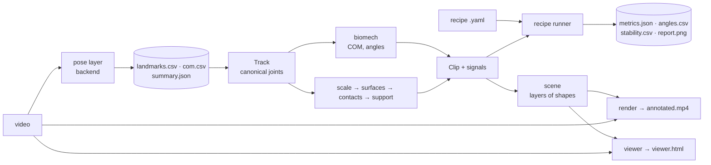

# ClimbVision — The Complete Guide

*For users who want to analyse videos, and for developers who want to change the code.*

ClimbVision turns an ordinary phone video of one person moving into numbers about
how that body moves: a skeleton of the main joints, the whole-body centre of mass, joint
angles, what is touching the floor, a bar or the wall, how stable the person is, and
movement-specific results. On the wall: holds and smears, the route move by move,
balance, technique, the load on each hand and foot, move phases, the deadpoint, swing
and joint effort — shown in an interactive viewer where every overlay can be switched
on and off, and exported as video.

It is built as a **generic movement-analysis engine** (layers that measure the body)
plus **recipes** (small YAML files that say what to measure for one kind of movement).
Adding an exercise or a climbing analysis means writing a recipe, not engine code.

It started **off the wall** (floor and bar exercises), so that every measurement could
be checked on simple movements before it was trusted on a climb; since 1.0 the climbing
layers have been built on that base and checked against real clips, a tape measure
(§6.22) and — next — a bathroom scale. Each estimate's reliability is stated where it is
described, and summarised in section 9.

---

## Contents

1. [Quick start](#1-quick-start)
2. [Recording videos that work](#2-recording-videos-that-work)
3. [Commands](#3-commands)
4. [What you get: output files](#4-what-you-get-output-files)
5. [Reading the results](#5-reading-the-results)
6. [The science](#6-the-science)
7. [Architecture and design philosophy](#7-architecture-and-design-philosophy)
8. [Developing ClimbVision](#8-developing-climbvision)
9. [Known limitations](#9-known-limitations)
10. [Glossary](#10-glossary)
11. [References](#11-references)

---

## 1. Quick start

### 1.1 Install (once)

You need Python 3.10–3.12. With Anaconda / Miniconda:

```bash
cd ClimbVision
conda create -n climbvision python=3.11 -y
conda activate climbvision
pip install -e ".[dev]"
```

`pip install -e` installs the package in *editable* mode: changes you make to the code
under `src/` take effect immediately, without reinstalling. `[dev]` adds the test and
lint tools (`pytest`, `ruff`).

The MediaPipe pose model (a ~10 MB file from Google) downloads automatically the first
time you analyse a video and is cached in `~/.cache/climbvision/models/`.

**For climbing videos** install the whole-body model too (it finds hands and feet far
better on the wall, see 6.1):

```bash
pip install -e ".[dev,rtm]"     # adds rtmlib + onnxruntime
```

and download these two zips from OpenMMLab into a folder `models/` in the project
(zipped or unzipped; they are found by name):

- person detector: <https://download.openmmlab.com/mmpose/v1/projects/rtmposev1/onnx_sdk/yolox_m_8xb8-300e_humanart-c2c7a14a.zip>
- RTMW-x whole body: <https://download.openmmlab.com/mmpose/v1/projects/rtmw/onnx_sdk/rtmw-dw-x-l_simcc-cocktail14_270e-384x288_20231122.zip>

Optional, faster: RTMPose-m Halpe-26
(<https://download.openmmlab.com/mmpose/v1/projects/rtmposev1/onnx_sdk/rtmpose-m_simcc-body7_pt-body7-halpe26_700e-256x192-4d3e73dd_20230605.zip>).
`$CLIMBVISION_MODELS` can point to another folder.

Optional, **hold detection** (§6.20): put a YOLOv8 climbing-hold detector in ONNX form in
`models/` with "hold" or "climb" in its name, e.g. `yolov8n-freeclimbs-detect-2-fp32.onnx`
from <https://huggingface.co/jwlarocque/yolov8n-freeclimbs-detect-2> (AGPL-3.0: keep it
out of git; `models/` is ignored). Without it every rest counts as a hold, as before.

### 1.2 Analyse a video

```bash
conda activate climbvision
climbvision analyze data/videos/squat_side.MOV
```

This creates `outputs/squat_side/` with an annotated video, a report image and data
files (section 4). Analyse several at once:

```bash
climbvision analyze data/videos/*.MOV data/videos/*.mov
```

**Tell it who is climbing** (once): copy `climbers.example.yaml` to
`data/climbers.yaml` and fill in your height (and mass, arm span). Every distance,
height and speed is then in your real units instead of an average adult's. The file is
git-ignored: it never leaves your computer. Name the climber per clip with
`--climber NAME` (`analyze` or `metrics`); without it the file's `default` is used.
Clips of someone else: `--climber unknown` (an average adult), so your default doesn't
apply to them.

### 1.3 Look at the results

1. Open `outputs/<clip>/viewer.html` (or `annotated.mp4`) — does the skeleton follow
   the body? If not, no number from this clip can be trusted (see section 2). The viewer
   switches overlays on and off, plays in slow motion and steps frame by frame (§5.1).
2. Open `outputs/<clip>/report.png` — angles, the exercise result, stability and
   contacts over time.
3. Open `outputs/<clip>/metrics.json` — the numbers.

### 1.4 The commands in one sentence each

| Command | What it does | Speed |
|---|---|---|
| `climbvision analyze VIDEO` | Runs pose estimation (slow), then the analysis and the annotated video | a few × the clip length |
| `climbvision metrics outputs/CLIP` | Re-runs the analysis (everything except pose) from the saved CSVs | seconds |
| `climbvision view outputs/CLIP` | Writes the interactive viewer, `viewer.html` + `viewer.mp4` | about the clip length |
| `climbvision render outputs/CLIP` | Redraws `annotated.mp4` from saved results (`--preset`, `--layers`) | about the clip length |
| `climbvision camera outputs/CLIP` | Camera layer: lines every frame up with the wall (handheld video); `wall.jpg`, `wall_view.mp4` | about 1–2 × the clip length |
| `climbvision summary outputs/*` | One line per clip (table + `outputs/summary.csv`) | instant |
| `climbvision recipes` / `signals` | List the recipes, or the signals recipes can use | instant |
| `climbvision --version` | The version, and where the code is loaded from | instant |

Every command takes folders too: `analyze data/videos` runs every video in the folder;
`metrics outputs`, `render outputs`, `camera outputs`, `summary outputs` run on every
results folder in it (folders starting with `_` are skipped).

**A replaced video.** Results remember the video they came from (file size, frames,
fps; `video_fingerprint` in `summary.json`). If the file has changed since, `metrics`,
`render` and `camera` print a warning: the skeleton would no longer line up, so re-run
`analyze` on it. (Results from before 1.0 are checked on fps and frame count.)

If results look like an older version made them, `climbvision --version` shows which
code runs: it should be the `src/climbvision` folder of this project
(`pip install -e .` makes it so).

The split matters: pose estimation is the only slow step, so it runs once. When you
change an algorithm or a threshold, re-run `metrics` (and `render`) on existing results.

---

## 2. Recording videos that work

Almost every bad result traced back to the recording, not the code. These rules come
from the test clips:

| Rule | Why |
|---|---|
| **Off the wall: fixed camera** (tripod or propped phone) | The floor line, scale and sway are measured in the image, so they assume it doesn't move. |
| **On the wall: handheld is fine** — pan smoothly, keep plenty of wall in view, don't walk around | The camera layer (6.13) removes the camera motion using the wall. It needs wall texture (holds) around the climber, and works best when the filmer stays in one place and turns the phone. |
| **Whole body in frame, including feet, plus some floor** | Contacts and stability need visible feet. Clips with feet cut off are flagged "feet out of frame". |
| **Camera at about hip height, roughly level** | A low camera looking up tilts "vertical", distorts trunk lean and the 3D estimate. |
| **One person in frame** | The pose model tracks one person. |
| **Side view for squats, planks, pike push-ups, lunges** | Their movement happens front-to-back; a side view sees it at full size. |
| **Front view for jumping jacks, left/right balance** | Their movement happens left-to-right. |
| **2 s standing still before you start** | Gives a clean baseline (standing knee angle, starting position). |
| **Bar exercises: bar and whole body in frame; if possible, start standing on the floor** | The floor can only be learned from frames where the hands are not on the bar. |
| **Good light, plain clothes contrasting with the background** | Fewer pose errors. |

### 2.1 Naming files so the movement is recognised

`analyze` and `metrics` pick a recipe from the file name (each recipe's `match`
patterns, checked in `priority` order; first match wins):

| File name contains | Recipe |
|---|---|
| `toes_to_bar`, `t2b`, `leg_raise`, `knee_raise` | `leg_raise` |
| `pullup`, `pull_up`, `chinup`, `muscle_up` | `pullup` |
| `dead_hang`, or a word starting with `hang` (not `overhang`) | `dead_hang` |
| `pistol` | `pistol_squat` |
| `squat` | `squat` |
| `pike` | `pike_pushup` |
| `plank` | `plank` |
| `jumping_jack`, `jacks` | `jumping_jacks` |
| `tree`, `crow`, `onefoot`, `single_leg`, `balance`, `stork` | `balance` |
| `climb`, `traverse`, `boulder`, `moonboard`, `overhang`, `coordination`, `route`, `slab`, `crimp`, `dyno` | `climb` |
| `lunge`, `standing_still`, `walk`, `stretch` | `none` (angles, stability and jumps only) |
| anything else | `climb` (the default: `recipes.DEFAULT_RECIPE`) |

Recommended pattern: `<movement>_<view>.mov`, e.g. `squat_side.mov`, `pullup_front.mov`.
You can always override with `--recipe NAME` (or `--recipe my_recipe.yaml`).

---

## 3. Commands

### 3.1 `climbvision analyze`

```
climbvision analyze VIDEO [VIDEO ...] [--out DIR] [--recipe NAME|FILE] [--recipes DIR]
                    [--sex male|female] [--backend NAME] [--model lite|full|heavy]
                    [--no-camera] [--no-video] [--max-frames N]
```

| Option | Default | Meaning |
|---|---|---|
| `--out` | `outputs` | Results go to `OUT/<video file name without extension>/` |
| `--recipe` | `auto` | A recipe name (`climbvision recipes` lists them: `squat, pistol_squat, plank, pike_pushup, jumping_jacks, balance, pullup, dead_hang, leg_raise, none`), a path to a `.yaml` recipe, or `auto` = from the file name. `--exercise` still works as an alias |
| `--recipes` | – | An extra folder of your own recipes (repeatable); same name overrides a shipped one |
| `--backend` | `auto` | Pose backend (6.1): `auto` = `rtmw_wholebody133` for climbing recipes when its models are installed, otherwise `mediapipe_pose33`; or name one: `mediapipe_pose33`, `rtmpose_halpe26`, `rtmw_wholebody133` |
| `--sex` | `male` | Which body-segment table to use for the centre of mass (section 6.3) |
| `--fast` | off | RTMPose / RTMW: skip flip averaging (§6.21) — about 2x faster pose, a bit less steady |
| `--model` | per backend | Model size. MediaPipe: `lite`, `full` (default), `heavy`; RTMPose: `m` (default), `x`; RTMW: `x` |
| `--no-camera` | off | Skip the camera layer (6.13); the camera is then assumed fixed |
| `--no-video` | off | Skip `annotated.mp4` and `wall_view.mp4` (faster) |
| `--max-frames` | all | Only process the first N frames (quick tests) |

### 3.2 `climbvision metrics`

```
climbvision metrics outputs/CLIP [outputs/CLIP2 ...] [--recipe NAME|FILE] [--recipes DIR]
climbvision metrics outputs/*
```

Reads `landmarks.csv` (+ `com.csv`, `summary.json`) and rewrites `angles.csv`,
`stability.csv`, `metrics.json` and `report.png`. Folders without `landmarks.csv`
are skipped.

### 3.3 `climbvision render`

```
climbvision render outputs/CLIP [--video PATH] [--preset NAME] [--layers a,b,...] [--out FILE]
```

Redraws `annotated.mp4` with the chosen overlays (§5.1): `--preset` clean, balance
(default), load, dynamics or all; `--layers` adds single layers (skeleton, arms,
contacts, support, com, trail, forces, velocity, info, timeline). With `--preset` the
file is `annotated_<preset>.mp4` unless `--out` names it. The source video path is read
from `summary.json`; pass `--video` if it moved. If the results were computed on a
resized copy of the video, the original is resized to match before drawing. Videos are
H.264 (they play in browsers and on phones) when ffmpeg is available — `imageio-ffmpeg`,
a dependency, brings its own — and keep the original clip's **sound** (AAC; a clip
without sound stays silent).

### 3.3a `climbvision view`

```
climbvision view outputs/CLIP [--video PATH] [--open] [--keep-video]
```

Writes `viewer.html` and `viewer.mp4` (the clip without drawings) in the results
folder; `analyze` writes them too. Open the HTML file in any browser — it works
offline, keep it next to `viewer.mp4`. `--open` serves it on this computer
(`http://127.0.0.1:…`, nothing leaves the machine) and opens it in the browser, until
Ctrl+C; `--keep-video` reuses `viewer.mp4` and only redoes the overlays (after `metrics`).

**Export MP4** (button under the video): saves the clip with exactly the layers you have
on, as an H.264 MP4 in your downloads — a range (from / to, or "now" for the current
frame), size (original, 1080p, 720p), speed (real time, or 0.5× / 0.25× slow motion:
the same frames played slower) and the timeline strip underneath. It draws frame by
frame in the browser (WebCodecs: Chrome, Edge, Safari 16.4+; ~10–30 frames/s), so the
export is exact, not a screen recording. A page opened straight from disk may not be
allowed to read its own video: the dialog then asks you to pick `viewer.mp4` once;
`climbvision view … --open` avoids that. The dialog also shows the equivalent
`climbvision render` command.

### 3.3b `climbvision pose`

```
climbvision pose VIDEO --out DIR [--backend NAME] [--model SIZE] [--model-path FILE]
                 [--step N] [--budget SECONDS]
```

Only the pose pass (writes `landmarks.csv`, `com.csv`, `summary.json`), in pieces if
needed: with `--budget` it stops after that many seconds, saves its progress
(`pose_partial.npz`) and carries on where it stopped the next time you run the same
command. `--step 2` uses every other frame (half the frame rate; fine for the wall
analysis). Used for the backend comparison (E5); then run `climbvision camera` and
`climbvision metrics` on the folder.

### 3.4 `climbvision camera`

```
climbvision camera outputs/CLIP [outputs/CLIP2 ...] [--video PATH] [--no-video]
```

Runs the camera layer (6.13) on existing results — e.g. clips analysed before the camera
layer existed — and writes `camera.csv`, `camera.json`, `wall.jpg`, `wall.json` and
`wall_view.mp4`. Needs the source video (path from `summary.json`, or `--video`).
`analyze` runs it automatically unless `--no-camera`.

### 3.5 `climbvision summary`

```
climbvision summary outputs/* [--csv PATH]
```

Prints one line per clip — exercise, view, the headline result ("4 reps, 4 below
parallel, knee 36°", "10.6 s on L foot, sway sd 0.9 cm", …) and any warnings — and
writes the same as `summary.csv` (default: next to the result folders). Use it to
compare sessions or to spot clips that need a look.

### 3.6 Using it from Python

Everything the CLI does is a normal function call:

```python
from climbvision.engine.pose import make_estimator, run_pose
from climbvision.analysis import run_analysis
from climbvision.output.render import render

est = make_estimator(model_size="full")            # MediaPipe by default
run_pose("data/videos/squat_side.MOV", "outputs/squat_side", est)
est.close()
m = run_analysis("outputs/squat_side", recipe="squat")
print(m["reps"], m["min_thigh_deg_mean"])
render("data/videos/squat_side.MOV", "outputs/squat_side")
```

And to work with the data directly (e.g. in a Jupyter notebook):

```python
from climbvision.analysis import load_clip
from climbvision.engine.skeleton import J

clip = load_clip("outputs/squat_side")     # all engine layers for one clip
tr = clip.track                            # arrays (frames, 23 joints, 2|3)
tr.image[:, J.L_KNEE]                      # left knee in pixels per frame
knee = clip.signal("knee")                 # any named signal (climbvision signals)
st = clip.stability
st.margin_cm, st.contacts.group["left_foot"]   # per-frame arrays

from climbvision.recipes import load_recipes, run_recipe
res = run_recipe(load_recipes()["squat"], clip)
res.metrics["reps"]
```

---

## 4. What you get: output files

Every clip gets a folder `outputs/<clip>/`:

| File | Made by | Contents |
|---|---|---|
| `landmarks.csv` | `analyze` | The raw pose: one row per backend point per frame |
| `com.csv` | `analyze` | Centre of mass per frame |
| `summary.json` | `analyze` | Video info and detection summary |
| `angles.csv` | `metrics` | All joint angles per frame |
| `stability.csv` | `metrics` | Contacts, support, margin, swing per frame |
| `metrics.json` | `metrics` | All clip-level results |
| `report.png` | `metrics` | Four-panel plot |
| `annotated.mp4` | `render` | The video with the `balance` overlays drawn on it, with the clip's sound; `annotated_<preset>.mp4` with `render --preset` (5.1) |
| `viewer.html`, `viewer.mp4` | `analyze`, `view` | The interactive viewer: the clip (with sound) and every overlay layer, switched on and off live; Export MP4 (5.1, 3.3a) |
| `holds_detected.json`, `holds_detected.jpg` | `metrics` (wall scene, with the hold model) | Holds found in `wall.jpg` and a picture of them (§6.20) |
| `camera.csv`, `camera.json` | `camera` | The camera layer: one homography per frame (frame → wall) and its quality (4.7) |
| `wall.jpg`, `wall.json` | `camera` | The wall without the climber, in wall coordinates; `wall.json` holds the mapping from wall coordinates to its pixels |
| `wall_view.mp4` | `camera` | The video in wall coordinates: the wall stands still, hands/feet leave trails; with the wall layer also holds, limbs on holds, the COM, and the route building up move by move |
| `wall.csv` | `metrics` (wall scene) | Per frame: limbs on holds, hold ids, limb and COM positions on the wall, margins (5.5) |
| `moves.csv` | `metrics` (wall scene) | One row per move: limb, from/to hold, times, distance, direction, what the other limbs did, balance before/after, tags (5.6); technique (§6.18), catch load, push time and power, deadpoint timing (§6.23) |
| `holds.csv` | `metrics` (wall scene) | One row per hold: position, used as hand/foot hold, first use, time per limb, matched (5.6) |
| `route.png` | `metrics` (wall scene) | The route map: holds numbered in order of use and every move as an arrow, on the wall image (5.6) |
| `forces.csv` | `metrics` (wall scene) | Per frame: force on each hand and foot (body weights, x right, y up; % body weight; newtons when the mass is known), hands' share (§6.19) |

### 4.1 `landmarks.csv`

| Column | Meaning |
|---|---|
| `frame`, `time_s` | Frame index and time (from the video's own timestamps) |
| `landmark` | The pose backend's own point name, e.g. `left_knee` (the **person's** left); MediaPipe has 33 |
| `x_px`, `y_px` | Position in the image, pixels. x to the right, **y downwards** |
| `x_m`, `y_m`, `z_m` | The backend's 3D estimate in metres, origin at the centre of the hips, y down, z towards/away from the camera |
| `visibility` | 0–1, the model's confidence that the point is visible (not occluded) |

Frames where no person was found have no rows (they do appear in `com.csv` with
`detected = 0`). The file keeps the backend's raw points (face and fingers included) so
nothing is lost; loading maps them onto the canonical skeleton (6.1), which has no face.

### 4.2 `com.csv`

`frame, time_s, detected, com_x_px, com_y_px, com_x_m, com_y_m, com_z_m, confidence`.
`com_*_m` is relative to the hip centre: it describes body shape, **not** where the body
is in the room (section 6.2). `confidence` is explained in 6.3.

### 4.3 `angles.csv`

`time_s` plus one column per angle, side and method, e.g. `knee_l_2d`, `knee_r_3d`,
`trunk_lean_2d`. Joints: `ankle, knee, hip, thigh, body_line, elbow, shoulder`
(left/right, 2D/3D) and `trunk_lean` (2D/3D). Definitions in 6.4.

### 4.4 `stability.csv`

| Column | Meaning |
|---|---|
| `stance` | Short label of what supports the body: `both feet`, `L foot`, `feet + forearms`, `bar`, `none` (airborne) … |
| `left_foot … right_knee` | 1 when that body part touches the floor |
| `left_hand_on_bar`, `right_hand_on_bar` | 1 when gripping (bar exercises only) |
| `com_x_px` | COM horizontal position in the image |
| `support_lo_px`, `support_hi_px` | Extent of the base of support along the image x axis |
| `margin_cm` | Stability margin: + inside the support, − outside (NaN with no floor contact) |
| `swing_cm` | Bar only: COM x minus grip x |
| `feet_out_of_frame` | 1 when a heel or toe is outside the image |

### 4.5 `summary.json`

`video, backend, sex_model, frame_size, frames, fps, duration_s, frames_with_pose,
detection_rate, com_px {mean, std, range}, mean_confidence, com_world_m`.
`detection_rate` below ~0.95 means the person was lost in part of the clip.

### 4.6 `metrics.json`

Always present:

| Key | Meaning |
|---|---|
| `exercise` | Which recipe ran |
| `view` | `side` or `front` (6.4.3) |
| `body_yaw_deg` | How far the body is turned from facing the camera, 0–90° |
| `near_side` | `left`/`right`: the side facing the camera |
| `angle_ranges` | min / median / max of the main angles |
| `stability` | See 5.2 (floor and bar scenes) |
| `wall` | Instead of `stability` for wall scenes (the `climb` recipe), see 5.5 |
| `route`, `technique`, `forces`, `dynamics` | Wall scenes: the route (5.6), technique (§6.18), forces (§6.19), dynamics — move phases, power, deadpoint, swing, joint effort (§6.23) |
| `scale` | Who climbed, the height used, perspective correction (§6.17) |
| `pose_cleanup`, `pose_smoothing` | Climbing models: what the clean-up (§6.15) and smoothing (§6.21) layers changed |

Plus the recipe's results (5.3), and `camera` when the camera layer ran: `static`,
`registered_pct` (frames lined up with the wall), `keyframes`, `pan_px` / `pan_m`
(how far the view travelled over the wall, x and y) and `lost_frames`.

### 4.7 `camera.csv`

| Column | Meaning |
|---|---|
| `frame`, `time_s` | Frame index and time |
| `status` | 0 = lost (no H), 1 = tracked, 2 = anchored to a keyframe this frame |
| `inliers` | Points that agree with H (more = more reliable) |
| `h00 … h22` | The 3×3 homography, row by row: frame pixels → wall coordinates |

`camera.json` has the frame size, `static`, the working scale, number of keyframes and
`registered_pct`. To map a point (x, y) of frame *i*: (u, v, w) = H·(x, y, 1), wall
position = (u/w, v/w). In Python: `CameraTrack.load(path).to_wall(points)`.

---

## 5. Reading the results

### 5.1 The annotated video and the viewer

Everything drawn on the video is organised in **layers**, and the viewer (`viewer.html`)
switches each on and off while the clip plays. **Presets** pick layers for a purpose:

| Preset | Layers | For |
|---|---|---|
| clean | skeleton | watching the climb |
| balance | skeleton, bent arms, holds, base of support, COM, trail, info text | static climbing, slabs, vertical walls — the classic annotated video |
| load | skeleton, holds, forces, joint effort, timeline | where the weight goes and which joints work: % body weight on each hand and foot, Nm/kg at each joint |
| dynamics | skeleton, COM coloured by speed, velocity, dyno arc, swing, timeline | dynos, deadpoints, cut feet: momentum instead of balance |
| form | skeleton, bent arms, joint angles | technique: straight arms, hip and knee angles |
| all | everything | |

The viewer: play / pause (space or click the video), one frame back / on (← →), one
second (shift + ← →), speed 0.1–1× ([ ]), presets 1–6. The **timeline** under the video
has one row per limb (on a hold: solid; smear: faint; ground: grey), the moves (white
ticks, red = dyno or jump, numbered; hover for duration, tags and catch load), rests
(green), feet cut (red), and the load on the hands and the feet (% body weight, 100 %
dotted). Click or drag to jump. Your layer choice is remembered in that browser.
`annotated.mp4` is the same drawing, burnt in: `climbvision render --preset dynamics`.

| Layer | Drawing | Meaning |
|---|---|---|
| forces | Disc + arrow + % on a hand or foot | Load on that limb, % body weight; on a smear the disc is hollow and the number has a "~" (an estimate, §6.19) (disc size and colour: green light → yellow half → red all of it); the arrow is the force the hold gives the body (up for a jug, sideways for a sidepull). Wall plane only (§6.19) |
| velocity | Blue arrow + m/s from the COM | Where the COM is heading: the arrow tip is where it would be 0.25 s later at this speed |
| timeline | Strip under the video | See above; the *phase* row colours each hand move: push (orange), reach (blue), catch (red) — §6.23 |
| speed | COM dot + trail coloured by speed | blue still, white 1 m/s, red 2 m/s and faster |
| angles | Degrees at elbows, hips, knees | 2D angle in the picture, 180 = straight; a bent holding elbow is orange |
| effort | Glow on shoulders, elbows, hips, knees; "core" at the hips | How hard the joint works: net joint moment, Nm/kg (bigger, redder = harder; full red at 2 Nm/kg, the core at 4). Values written next to the core and to joints above 1.2 Nm/kg (§6.23) |
| arc | Dotted blue curve, ring at its top, yellow "deadpoint", white "catch" | On a dynamic move (COM ≥ 0.6 m/s): the path the COM would fly from its peak speed with gravity alone; the ring is where that flight would peak; *deadpoint* is where the real COM stopped rising; *catch* says when the hand caught, before or after the deadpoint |
| swing | Pink curved arrow about the hands, deg/s | Feet off: how fast the body turns about the hand holds, and which way |

The other drawings (skeleton, bent arms, holds, base of support, COM, trail, info text):

| Drawing | Meaning |
|---|---|
| White lines, yellow dots | Skeleton. The trunk is the shoulder bar, the hip bar and the spine between them (§6.21): the bars turning against each other show the twist, the spine's curve the side bend. Grey = low visibility: the model is guessing, or (climbing models) the joint was hidden and filled in from the frames around it |
| Dot + trail | Centre of mass and its path over the last 2 s. **Green** = inside the base of support, **red** = outside, pink = no base to judge (on the wall: the hull of the limbs on holds, needs 3+ limbs; on the floor: the support span). The trail is coloured the same way, frame by frame, so it shows how balance changed along the way (older parts fade); on the wall it is kept in wall coordinates, so it stays put when the camera pans |
| Thin grey line | The floor as the system estimated it |
| Cyan rings | Points touching the floor |
| Thick bar on the floor | Base of support; **green** = COM above it, **red** = outside |
| Dashed line + triangle | The COM's plumb line to the floor |
| Purple squares + line | Hands on a bar |
| Yellow outline, lightly filled (wall) | Base of support on the wall: the hull of the limbs on holds (a line for two) |
| Dashed line from the COM (wall) | Its plumb line down the wall; **green** = COM over the feet on holds, **red** = not (on the wall only) |
| Red joint dots | Repaired or doubtful points from the clean-up layer (§6.15) |
| Yellow line under the label (wall) | The latest move for 1.2 s after it lands, e.g. `move 12: R hand 9 -> 13 (deadpoint)`; `rest 2.1 s` while resting; `feet cut` |
| Orange arm (wall) | A hand on a hold with its arm bent (elbow < 150° in the picture); straight holding arms stay white |
| Top-left box | Time, stance, margin (or swing on a bar), warnings |

**Always watch the video before trusting numbers.** If the skeleton jumps, swaps legs
or misplaces a hidden limb, the numbers for those frames are wrong too. With the
climbing models the clean-up layer (§6.15) repairs most of these; what it changed is
in `pose_cleanup` in metrics.json.

### 5.2 `stability` in metrics.json

| Key | Meaning |
|---|---|
| `support_axis` | `front-back` (side view) or `left-right` (front view) |
| `scale_px_per_m` | Image pixels per metre at the person (6.5) |
| `floor_tilt_deg`, `camera_height_m` | Floor model (6.6); camera height only when the person moved towards/away from the camera |
| `contact_pct` | % of the clip each body part touched the floor |
| `stance_time_s` | Seconds in each stance |
| `margin_cm` | Stability margin: median, minimum, % of time inside |
| `com_sway` | COM movement along the support axis: `sd_cm` (spread), `range_cm`, `mean_speed_cm_s` |
| `sway_by_stance` | The same, for the longest ≥2 s run of each stance |
| `jumps` | `count`, flight times, `height_cm_mean` (from flight time) |
| `bar` | Bar exercises: `on_bar_s`, `hanging_s`, `longest_hang_s`, `swing {sd_cm, range_cm}` |
| `warnings` | Feet out of frame, no contact found, floor unknown |

Typical values on the test clips: quiet standing sway sd ≈ 0.5 cm; one-leg standing
0.6–1.3 cm; tree pose ≈ 0.9 cm; crow pose ≈ 1.6 cm with the COM within ~1 cm of the
hands.

### 5.3 Recipe results

Each recipe adds its own keys; the exact definition of every key is in the recipe file
(`src/climbvision/recipes/library/<name>.yaml`), next to a description. Keys ending in
`_mean` / `_sd` are the mean / standard deviation over reps; `reps_detail` lists every rep.

**squat / pistol_squat**

| Key | Meaning |
|---|---|
| `reps` | Repetitions |
| `standing_knee_deg` | Knee angle at the top (≈ 175–180 side view; ≈ 163 front view, a 3D bias) |
| `min_knee_deg`, `min_hip_deg` | Deepest knee / hip angle per rep |
| `min_thigh_deg` | Thigh vs horizontal at the bottom: **< 0 = below parallel** |
| `hip_below_knee_cm` | Same idea from the 3D estimate (+ = hip below knee) |
| `max_trunk_lean_deg` | Forward lean of the torso |
| `descent_s`, `ascent_s` | Tempo |
| `reps_below_parallel` | Count |
| `reps_by_leg`, `leg` | Pistol only: which leg worked |

**plank**: `hold_s`, `body_line_deg_mean/min`, `hip_offset_pct_mean/sd` (+ sag, − pike,
% of body length), `pct_time_straight/sag/pike` (±5 % = straight),
`hip_offset_drift_pct` (last third minus first third: did the hips drop?).

**pike_pushup**: `reps` (push-ups done while piked), `min_elbow_deg`,
`hip_deg_at_bottom`, `plank_s`, `pike_straight_arms_s`.

**jumping_jacks**: `reps`, `reps_per_min`, `max_arm_deg` (180 = arms straight
overhead), `max_feet_width` (ankle distance ÷ shoulder width). Jumps (two per rep) are in
`stability.jumps`.

**balance**: `balance {stance, hold_s, sd_cm, range_cm, mean_speed_cm_s,
margin_cm_median, margin_cm_min, pct_inside}` — the longest hold on a reduced base
(one foot, hands only…).

**pullup**: `reps`; per rep (and mean/sd): `pull_cm` (how far the shoulders rose
towards the bar), `top_gap_cm` (shoulders below the bar at the top), `com_rise_cm`,
`chin_clearance_cm` and `chin` (`over` / `at bar` / `under`, see 6.12),
`top_elbow_deg`, `start_elbow_deg` (straightness before pulling, ≈ 155–180),
`up_s`, `down_s`, `swing_cm`, `hip_range_deg`, `kipping` (hip angle changed > 40°).
Summary counts: `reps_chin`, `reps_kipping`; `chin_above_shoulders_cm` is the
body-proportion estimate used.

**leg_raise**: `reps`, `min_hip_deg` (90 = legs horizontal), `min_knee_deg` (≈180 =
straight-leg raise, small = knee raise), `reps_toes_to_bar`, and `raised_hold` when the
legs stay up ≥ 3 s (`hold_s`, `hip_deg_start`, `hip_deg_end`, `hip_drop_deg` = how much
the legs sank, `knee_deg_median`).

**dead_hang**: `dead_hang {hold_s, elbow_deg_median, swing_sd_cm, swing_range_cm}`.

**climb** (wall scene, 6.14): `climb_s` (time on the wall), `pct_4_contacts`,
`pct_3_contacts`, `pct_2_or_fewer` (share of the climb with that many limbs on holds),
`feet_on_holds_pct`, `com_over_feet_pct` (share of the time, with a foot on a hold,
that the COM was over the feet), `height_gain_m`, `longest_4_point {start_s, hold_s,
com_over_feet_cm}` (usually a rest or a set-up). The engine's `wall` block (5.5) has
the holds and moves.

### 5.4 report.png (5.5 for wall scenes)

1. **Angles over time**: knee, hip, trunk lean, body line.
2. **Exercise panel**: the signal reps are counted on, reps shaded and numbered (or
   plank hip offset, or COM sway with the longest hold for balance/hang).
3. **Stability**: margin over time, green inside / red outside; purple swing on a bar;
   grey bands where feet were out of frame.
4. **Contacts**: a timeline bar per body part (blue feet, orange hands/forearms/knees,
   purple bar grips).

In wall scenes panel 3 shows the COM over the feet and the polygon margin (grey = not
on the wall), and panel 4 one bar per limb while it is on a hold, numbered with the hold
id (grey = on the ground).

### 5.5 `wall` in metrics.json and `wall.csv`

| Key | Meaning |
|---|---|
| `on_wall_s` | Time on the wall (from the first to the last foot on a hold or hand hanging on one, minus time on the ground) |
| `ground` | `stood on` (feet on the floor at some point), `in view, not stood on`, or `not seen` |
| `holds_used`, `hand_holds`, `foot_holds` | Distinct holds (a matched hold counts for both) |
| `on_hold_pct` | Per limb, % of the climb on a hold |
| `contacts_pct` | % of the climb with 4 / 3 / 2 / 1 / 0 limbs on holds |
| `contact_time_s` | Seconds in each combination, e.g. `2 hands + R foot` |
| `com_height_gain_m` | How far the COM rose on the wall |
| `com_over_feet_cm`, `polygon_margin_cm` | median / min / % inside (6.14) |
| `moves` | Number of hand and foot moves, median move time (details: `route`, 5.6) |
| `holds` | Every hold: `id`, `x_m` (right of the first hold), `y_m` (above the ground, or above the lowest hold), which limbs used it, when first, total time on it |
| `warnings` | e.g. on the wall only a small part of the clip |

Next to it, `climb` (6.14a): `start_s`, `end_s`, `duration_s`, `end` (touchdown, end of
the clip, or what ended it: the camera lost the wall, the pose was lost, the person's
size changed, left the wall), `frames_used_pct` (share of the clip measured), and
`attempts` when there were several. And `checks` (6.14b): `passed`, `failed` (names),
`items` (each with `ok`, `value`, `expected`, `note`).

`wall.csv` has, per frame: the contacts label, number of limbs on holds, `on_wall`,
`on_ground`, each limb's hold id (−1 = none) and position on the wall, the COM, and both
margins.

### 5.6 The route: `route` in metrics.json, `moves.csv`, `holds.csv`, `route.png`

| Key | Meaning |
|---|---|
| `moves`, `hand_moves`, `foot_moves` | Moves on the wall (a limb leaving a hold and landing on another ≥ 0.1 body lengths away) |
| `moves_per_min` | Pace, per minute on the wall |
| `foot_moves_per_hand_move` | Footwork: how many foot placements per hand move |
| `tags` | How many moves got each tag (table below) |
| `hand_move_time_s_median`, `foot_move_time_s_median` | Time the limb was off holds |
| `hand_move_cm_median`, `foot_move_cm_median` | Typical move length |
| `longest_hand_move` | Which move, how far, when |
| `rests` | Count, total and longest rest (4 limbs on holds, COM still, ≥ 1 s) |
| `feet_cut` | Count and total time with a hand on and both feet off |
| `holds_matched`, `feet_on_handholds` | Holds held by both hands (or feet) at once; holds used as hand and foot holds |
| `moves_detail` | Every move, as in `moves.csv` |

`moves.csv` columns: `n` (in the order moves land), `limb`, `kind`, `from_hold`,
`to_hold`, `release_s`, `catch_s`, `time_s`, `distance_cm`, `direction_deg` (0 = right,
90 = up, 180 = left, −90 = down), `others` (the other limbs on holds at the weakest
moment of the move, e.g. `L hand + 2 feet`), `com_over_feet_before_cm` /
`_after_cm`, `com_speed_peak_ms`, `com_speed_catch_ms`, `limb_speed_peak_ms`,
`pause_before_s`, `cycle_s`, `com_path_efficiency`, `com_pushes` (technique, below),
`tags`.

**`technique`** in metrics.json (§6.18), also on the last line of `route.png`:

| Key | Meaning |
|---|---|
| `quiet_feet_pct` | Foot placements that needed no re-placement (the foot lifted ≥ 9 cm and put back on the same hold) |
| `foot_placements`, `foot_replacements`, `hand_regrips` | The counts behind it; re-grips are the same for hands |
| `straight_arms_pct` | While a hand is on a hold, % of time that arm is straight (elbow ≥ 150° in the picture) |
| `pause_before_hand_move_s_median` | Time from the last limb landing to the next hand move: reading, setting up, hesitating |
| `time_per_hand_move_s` | Median time from one hand move landing to the next |
| `com_path_efficiency_median` | COM straight-line distance / path length over each hand move's cycle (1 = straight) |
| `com_pushes_median` | Separate COM speed peaks per cycle: 1 = one smooth movement, 3+ = stop-and-go |
| `feet_stayed_on_pct` | Hand moves with both feet on holds all the way |

**`forces`** in metrics.json (§6.19), and the "load on hands and feet" panel of
`report.png`:

| Key | Meaning |
|---|---|
| `hands_share_pct_median` | Typical share of the load carried by the hands (rest by the feet) |
| `hands_load_pct_bw_median`, `_peak` | Both hands together, % body weight (peak: catches, dynamic moves) |
| `one_hand_load_pct_bw_peak` | Highest load on each hand |
| `time_hands_over_50pct_bw_s` | Time with the hands carrying more than half the body weight |
| `hands_load_n_peak`, `mass_kg` | The peak in newtons, when the climber's mass is in the profile |

`moves.csv` adds `catch_load_pct_bw`: the peak load on the hand in the 0.3 s after it
caught the hold.

| Tag | When |
|---|---|
| `match` | a hand lands on the hold the other hand is on (within 0.5 s), or a foot on the other foot's hold |
| `cross` | a hand lands on the far side of the other hand |
| `dyno` | during a hand move (≤ 1.5 s) both hands are off holds at some moment and the COM moves ≥ 0.8 m/s |
| `jump` | as dyno, but nothing at all is on a hold (also a foot move with nothing else on) |
| `feet cut` | during a hand move both feet are off holds for ≥ 0.3 s |
| `high step` | a foot lands at or above the COM |
| `foot on handhold` | a foot lands on a hold a hand used before |
| `deadpoint` | the body rose (COM ≥ 0.3 m/s up) during a hand move and the hand caught the hold with the COM (nearly) still vertically (≤ 0.15 m/s): the moment the hold takes least load |

`route.png`: the wall image (dimmed), cropped to the climb. Holds are numbered in the
order they were first used (white ring = hand hold, green = foot hold, both = double
ring); every move is an arrow in the limb's colour (thick = hands, thin = feet, white edge
= dyno/jump, `m` = match) with its number; the COM's path in pink; START (first hand
holds) and TOP (highest hand hold). Left and right limbs are drawn slightly apart so a
matched move doesn't hide the other hand's.

`report.png` (wall scene): the bottom panel is the timeline — a bar per limb for each
hold (with its id), the move numbers where each move lands (red = dyno/jump), rests
shaded green and feet cuts red.

---

## 6. The science

This section explains *what* is computed and *why it is valid*, in plain terms first and
then precisely. Each subsection names the code that implements it.

### 6.1 Pose estimation and the canonical skeleton (`engine/pose.py`, `engine/backends/`, `engine/skeleton.py`)

**Plain terms.** A neural network (the *pose backend*) looks at each frame and marks
points on the body. The engine then maps the backend's points onto its own fixed set of
joints — the **canonical skeleton** — so nothing downstream depends on which network
was used. MediaPipe, the current backend, marks 33 points: nose, eyes, ears, mouth
corners, shoulders, elbows, wrists, three hand points, hips, knees, ankles, heels, toes.

**The canonical skeleton** (`J` in `engine/skeleton.py`, 23 joints): `HEAD` (centre of
the head), optional `HEAD_TOP` and `NECK`, and per side `SHOULDER, ELBOW, WRIST, HAND`
(knuckles), `HIP, KNEE, ANKLE, HEEL, TOE`, optional `SMALL_TOE`. There are **no face
points**: for movement analysis the head is one joint, and a climber usually has their
back to the camera — MediaPipe still "sees" a face there, with full confidence, so face
points are worse than useless. Fingers are reduced to one `HAND` point, because finger
estimates are often off. Joints a backend doesn't provide are `NaN` everywhere.

| Canonical joint | from MediaPipe (33 points) |
|---|---|
| `HEAD` | midpoint of the ears |
| `HAND` | midpoint of index and pinky knuckles |
| `TOE` | `foot_index` |
| others | the point of the same name |
| `HEAD_TOP`, `NECK`, `SMALL_TOE` | not provided (NaN) |

**The backends.**

| Backend | Points | 3D | Hands / feet | Speed (Linux VM on your Mac, CPU, 1080p) | Use |
|---|---|---|---|---|---|
| `mediapipe_pose33` (MediaPipe Pose Landmarker, full / heavy) | 33 | yes | index + pinky; heel + toe | 48 / 98 ms per frame | off the wall (needs the 3D) |
| `rtmpose_halpe26` (RTMPose m / x, Halpe-26) | 26 | no | wrist only (hand extrapolated); big + small toe, heel | 70 / 190 ms | fast climbing option |
| `rtmw_wholebody133` (RTMW-x, COCO-WholeBody) | 133 | no | 21 per hand (HAND = middle knuckle); big + small toe, heel | 190 ms | **climbing (default when installed)** |

*MediaPipe* (BlazePose GHUM) runs in `VIDEO` mode, tracking between frames. Per frame
it returns image points, *world* points ((x, y, z) in metres around the hips — a learned
estimate from one image, noisy in depth) and a visibility per point.

*RTMPose / RTMW* (OpenMMLab) are *top-down*: a person detector (YOLOX) finds the
climber's box, then the pose model places the points inside it. To stay on **one**
person, the box for the next frame comes from the current points; the detector runs
again every 15 frames (keeping the detection that overlaps the tracked person most) and
whenever the pose looks lost. These models give 2D points and a confidence per point
(stored as visibility), no 3D. The engine then:

- takes the body size from the image (90th percentile of trunk + leg length, since
  foreshortening only shortens) and assumes trunk + leg = 1.36 m (a 1.75 m adult) for
  centimetres — so cm values are ±~10 % unless you are that size;
- uses 2D angles in every view (front-view angles are less reliable than with 3D);
- extrapolates `HAND` from the forearm when the backend has no hand point (Halpe-26).

**Which one is best on the wall (E5).** All five variants ran on the five wall clips;
30 random frames were then judged blind (the five skeletons side by side in random
order, each hand and foot point right or wrong, ~110 points per model). Errors: MediaPipe
full 25, heavy 17, RTMPose-m 4, RTMPose-x 4, RTMW-x 1. Most MediaPipe errors came from
losing or jumping off the climber (`coordination`) and feet on the knee or swapped. The
RTM models also swap left/right feet less (mostly 0–2 per minute, at most 5, vs up to 13
for MediaPipe full), and with RTMPose-x and RTMW-x the feet wobble least while on a hold. Full numbers in PLAN.md (E5); the comparison tool is
`tools/compare_pose.py` (8.5).

Important properties to remember:

- *Left/right are the person's*, not the image's. Facing the camera, the person's left
  appears on the image's right.
- Hidden points are still predicted (the model guesses); low visibility warns you.
- A model can mis-place a limb that points at the camera (e.g. a raised knee in a front
  view) or is hidden behind the body.

Every backend implements the `PoseEstimator` protocol
(`estimate(frame_bgr, time_ms) -> RawPose | None`); adding a model means one module with
its point names and a mapping onto `J` (8.5). `landmarks.csv` stores the backend's
**raw** points, so a better mapping can be applied to old results without re-running pose.

### 6.2 Coordinate systems and conventions

| System | Origin | Axes | Units | Used for |
|---|---|---|---|---|
| Image | top-left pixel | x right, **y down** | pixels | Everything measured in the picture: 2D angles, floor, contacts, support, COM path |
| Wall | top-left pixel of the first registered frame | x right, **y down** | pixels of that frame | Positions with the camera motion removed (6.13): hands and feet on holds |
| World (backend 3D) | hip centre, *moves with the person* | x right, y down, z depth (camera axes) | metres | 3D angles, scale, depth-dependent quantities |

Consequences:

- "Up" in the image is −y. Heights above the floor are computed as `floor_y − y`.
- The world frame moves with the hips, so world COM shows *posture* (where the COM is
  relative to the hips), never how far the person travelled.
- World axes follow the camera, not gravity. A tilted camera tilts "vertical".
- All angles are in degrees, times in seconds, distances in cm or m as named.
- Missing data is `NaN` everywhere, never 0.

### 6.3 Centre of mass (`engine/biomech.py`)

**Plain terms.** The body is split into 14 segments (head, trunk, upper arms,
forearms, hands, thighs, shanks, feet). Each has a known share of body weight and a
known balance point along its length. The whole-body centre of mass (COM) is the
weighted average of the segments' balance points.

**Precisely.** For segment *i* with proximal end **P**ᵢ, distal end **D**ᵢ, mass
fraction *mᵢ* and COM ratio *rᵢ*:

  **c**ᵢ = **P**ᵢ + rᵢ (**D**ᵢ − **P**ᵢ),   **COM** = Σ mᵢ **c**ᵢ   (Σ mᵢ = 1)

Parameters are De Leva (1996), the standard adjustment of Zatsiorsky–Seluyanov's
cadaver/gamma-scan data to joint-centre landmarks:

| Segment | Endpoints (canonical joints) | Mass % ♂ / ♀ | COM from proximal % ♂ / ♀ |
|---|---|---|---|
| Head | `HEAD` (see below) | 6.94 / 6.68 | at `HEAD` |
| Trunk | mid-shoulders → mid-hips | 43.46 / 42.57 | 44.86 / 41.51 |
| Upper arm | shoulder → elbow | 2.71 / 2.55 | 57.72 / 57.54 |
| Forearm | elbow → wrist | 1.62 / 1.38 | 45.74 / 45.59 |
| Hand | wrist → `HAND` | 0.61 / 0.56 | 79.00 / 74.74 |
| Thigh | hip → knee | 14.16 / 14.78 | 40.95 / 36.12 |
| Shank | knee → ankle | 4.33 / 4.81 | 44.59 / 44.16 |
| Foot | heel → toe | 1.37 / 1.29 | 44.15 / 40.14 |

Approximations forced by the joint set: no skull vertex (head COM placed at `HEAD`, the
ear midpoint with MediaPipe, close to the true head COM); C7 replaced by mid-shoulders;
hip joint centres by the backend's hip points; 3rd knuckle by `HAND`. These cause a few
cm of *constant* offset, which barely affects *changes* of the COM — what most metrics use.

The formula is linear, so it works the same on pixels (2D) and on metres (3D);
`whole_body_com` accepts `(23, D)` or `(frames, 23, D)` canonical arrays.

**Sanity check.** Standing adult COM ≈ 55–57 % of height above the floor; on the test
clips it measured 58–60 % of heel-to-nose height (equivalent).

**COM confidence** = Σ mᵢ × (lowest visibility among segment *i*'s landmarks). A hidden
foot costs ~1.4 %; a hidden trunk ~43 %.

### 6.4 Joint angles (`engine/biomech.py`)

#### 6.4.1 Definitions

The angle at a joint between three points A–V–B is
θ = arccos( (A−V)·(B−V) / (|A−V| |B−V|) ).

| Angle | Points | Reading |
|---|---|---|
| knee | hip–knee–ankle | 180 straight, smaller = more bent |
| hip | shoulder–hip–knee | 180 straight, ~90 seated/piked |
| ankle | knee–ankle–toe | ~90–110 standing |
| elbow | shoulder–elbow–wrist | 180 straight |
| shoulder | hip–shoulder–elbow | 0 arm by the side, 180 overhead |
| body_line | shoulder–hip–ankle | 180 = straight body (plank) |
| thigh | hip→knee vs horizontal | +90 standing, 0 parallel, < 0 hip below knee |
| trunk_lean | hip→shoulder vs vertical | 0 upright, 90 horizontal |

#### 6.4.2 2D or 3D?

A 2D angle measured in the image equals the true angle **only if the limb moves in a
plane parallel to the image**. A squat seen from the side does; seen from the front, the
thighs point at the camera and look short, so 2D angles are wrong. 3D angles from the
world landmarks work from any view but inherit depth noise. Both are stored; the
**primary** angle uses 2D on the near side for side views and 3D (mean of both sides)
for front views. Front-view 3D readings are biased: a straight knee reads ~163°, trunk
lean reads ~20° when it is really ~32°.

#### 6.4.3 View and near side

- **Body yaw** = median over the clip of atan(|Δz| / |Δx|) between the left and right
  shoulders (and hips) in world coordinates. Facing the camera: both sides at the same
  depth → 0°. Side-on: one side behind the other → 90°. Test clips: front 3–11°,
  side 78–88°. Rule: < 30° front, > 60° side, otherwise fall back to the image shoulder
  width ÷ torso length (< 0.3 = side).
- **Near side** = the side whose limbs have higher average visibility.

### 6.5 Scale: pixels per metre (`engine/scale.py`)

To report centimetres we need to know how many pixels one metre is at the person.

**Idea.** For each body segment, divide its length in the image (pixels) by its length
in the world estimate (metres). A segment pointing at the camera looks *shorter* in the
image, never longer, so the **largest** ratios are the trustworthy ones. Per frame we
take the 80th percentile over 12 segments, then a ~1 s rolling median.

If the floor model (6.6) finds no evidence that the person moved towards or away from
the camera, per-frame changes in this ratio are treated as pose noise and one value
(the clip median) is used for the whole clip.

### 6.6 The floor (`engine/surfaces.py`)

The floor is a line in the image: **y = slope·x + y₀(frame)**.

1. **Candidates**: in every frame, the lowest point of each body part (each foot, hand,
   forearm, knee).
2. **RANSAC**: try many candidate lines — horizontal ones through single points, tilted
   ones (≤ 10°) through pairs, and depth-varying ones (below). Score =
   (points within tolerance of the line) − 3 × (points clearly *below* it). Nothing rests
   below the floor, so the penalty stops the line settling on resting hands or knees.
3. **Refine** by least squares on the inliers, adding a tilt term only if the inliers span
   enough of the image, and a depth term only if the person's scale changed enough.

**Depth term (pinhole camera).** A level camera at height *H* sees the floor under a
person at distance *d* at *f·H/d* pixels below the horizon. The scale *ppm* (6.5) is
*f/d*, so y₀ = a + H·(ppm − ppm_ref): linear in the scale, with slope = the camera height
in metres. This keeps the floor correct when someone walks towards or away from the
camera, and gives `camera_height_m` as a free sanity check.

**Bar mode.** Frames where the hands grip a bar are excluded. With less than 1 s of
other frames the floor is *unknown* (all heights NaN, no floor contacts) and a warning is
written — hanging feet would otherwise be mistaken for the floor.

### 6.7 Contacts (`engine/contacts.py`)

A joint touches the floor when it is **near** the floor (height < 5 % of body length)
**and still** (speed < 0.6 body lengths per second). Both thresholds scale with the
person's distance from the camera. Joints are grouped into parts (heel or toe → foot,
wrist or hand → hand, elbow → forearm, knee);
gaps and blips shorter than 0.15 s are cleaned up.

"Body length" throughout means trunk + leg length in pixels (≈ 0.78 × stature), measured
robustly from the clip.

### 6.8 Base of support and stability margin (`engine/support.py`)

**Plain terms.** You are balanced when your centre of mass is above the area you are
standing on. The *stability margin* is how far the COM's plumb line is from the edge of
that area: big and positive = stable, near zero = on the edge, negative = falling or
moving (fine during a jump or a step, alarming in a hold).

**Precisely.** With one camera we measure the support along the image's horizontal
axis: `[min x, max x]` of the contact points (front view: each point padded by half a
foot/hand width, because there the image shows width, not length). Margin =
min(COM_x − lo, hi − COM_x), converted to cm. Side view → front–back balance; front
view → left–right balance.

*Why not a full 2D support polygon?* It needs depth for every contact point. With
MediaPipe's 3D estimate the polygon put the COM *outside* both feet during quiet
standing even after correcting for camera tilt, so it was removed. Two cameras or a depth
camera would make it possible.

**Sway** (posturography): over a window, the COM's standard deviation (`sd_cm`),
total excursion (`range_cm`) and mean speed (path length ÷ time). These are the
standard balance measures used with force plates, here measured from video.

### 6.9 Jumps (`engine/support.flight_phases`)

An airborne phase is a stretch with no contact, between two contacts, lasting
0.06–1.2 s. To reject contact "flicker" on a planted foot it must also look like a jump:
feet leave the floor, the COM rises by > 1.5 % body length, and (for flights > 0.3 s)
comes back down by at least 40 % of the rise.

**Jump height from flight time.** A body in free flight rises for *t/2* and falls for
*t/2*: h = ½ g (t/2)² = **g t² / 8**. A 0.2 s flight ≈ 5 cm; 0.4 s ≈ 20 cm. This is the
same method jump mats use, and it is independent of the camera scale.

### 6.10 Counting repetitions (`engine/events.find_cycles`, a recipe's `reps:`)

Every rep counter uses one function, through the `reps:` section of a recipe. Take a signal that dips during a rep (knee angle in
a squat, elbow in a pull-up, hip in a leg raise). Its resting level is the 90th
percentile. A rep **starts** when the signal drops more than `start_drop` below rest
(then walks back to where the drop began) and **ends** when it returns within `end_drop`
of rest. Two thresholds (hysteresis) stop noise near one threshold from counting twice.
Reps shorter than `min_s` are ignored.

| Recipe | Signal | start / end drop | Extra rules (`require`, `rest`) |
|---|---|---|---|
| squat | knee (smoothed) | 35° / 15° | pistol: the more-bent leg per frame |
| pike push-up | elbow | 45° / 25° | rest level taken while piked; bottom must be piked (hip < 120°) |
| jumping jacks | 180° − arm elevation | 80° / 40° | front view, 2D arms |
| pull-up | shoulders below the bar ÷ body length | 0.12 / 0.05 | top must be on the bar |
| leg raise | hip | 40° / 20° | on the bar |

### 6.11 Holds and plank form (a recipe's `holds:`)

A *hold* is the longest stretch where a condition is true (`when:`), or where one label
stays the same (`by: stance`, used for balance). The plank hold is the longest ≥ 1 s stretch with the torso 60–120° from vertical. **Hip offset**
= signed perpendicular distance of the hip from the shoulder–ankle line, as % of that
line's length; + = below (sag), − = above (pike); within ±5 % counts as straight.

### 6.12 Bars: grips, hanging, swing (`engine/contacts.detect_grips`)

Only in bar scenes (recipes with `scene: bar`). The hand's grip point is 2/3 of the way
from `WRIST` to `HAND` (the bar sits in the fingers). A hand is **gripping** when it is above its shoulder
and nearly still (< 0.35 body lengths/s) for ≥ 0.3 s; the grip then extends forwards and
backwards as long as the hand stays within 8 % body length of that spot — this keeps the
grip through the top of a pull-up, when the shoulders reach the hands. **Hanging** =
gripping with nothing on the floor. **Swing** = COM x − grip x in cm: how far the body
hangs off the vertical below the bar. Judge swing by its spread (`sd_cm`, `range_cm`):
a constant `offset_median_cm` while hanging still comes from the camera angle, not a lean.

**Pull-up reps** are counted on how far the shoulders hang below the bar, in body
lengths (~0.4 in a dead hang, ~0.05 at the top). Unlike the elbow angle this works from
any view: with a narrow or chin-up grip seen from the front, the elbows travel towards
the camera and look folded flat in the image (2D elbow ≈ 5° when it is really ≈ 80°), so
the reported elbow angle uses the 3D estimate in front views.

**Chin over bar** is estimated from the body, not the face, because the face is often
hidden at the top (by the bar, the hands, or a door frame) while the pose model still
"sees" a face with full confidence. Chin height = shoulder height + 0.067 body lengths,
from standard proportions (chin ≈ 0.870 × stature, shoulder ≈ 0.818 × stature,
trunk + leg ≈ 0.78 × stature; Drillis & Contini). The face isn't used even when visible:
while hanging the shoulders shrug up towards the ears, which biases a face-based
measurement. Shoulder landmarks and proportions are each good to a few cm, so a chin
within ±5 cm of the bar is reported as `at bar` rather than guessed.

Why not detect grips in every clip? From pose alone, "arms overhead and still" (tree
pose) looks the same as "hanging from a bar". The recipe (`scene: bar`) supplies that
context. On the wall the same idea becomes *anchors*: a hand or foot still on the wall for
~0.5 s is on a hold (milestone E4).

### 6.13 Camera motion: wall coordinates (`engine/camera.py`)

**Plain terms.** In a handheld video the whole picture moves, so a foot resting on a
hold still moves *in the image*. The camera layer works out, for every frame, how the
picture has to be shifted, rotated and stretched to line up with the first frame. Undo
that and the wall stands still: the foot on the hold stops moving. Positions measured
this way are in **wall coordinates**.

**Why one homography per frame is enough.** A homography is a 3×3 matrix that maps one
image of a *plane* onto another image of it, whatever the camera's position and angle.
A climbing wall panel is close to a plane, and a handheld camera filmed by someone
standing still mostly *rotates*; for a pure rotation a homography is exact for
everything in view. So H[i] (frame *i* → wall) captures the camera motion. Parts that
stick out of the plane (big volumes, a roof seen from below while the filmer walks) show
small errors (parallax); those are the main limit (section 9).

**How H[i] is found** (at ~960 px working resolution):

1. *Only the wall votes.* Pixels on the climber (capsules around the bones from the pose
   layer, torso, head, hands and feet) and a thin image border are masked out.
2. *Tracking.* Corners on the wall are followed frame to frame with pyramidal
   Lucas–Kanade optical flow, kept only if tracking backwards returns to the start
   (< 1 px). Each point carries the wall position it had when it was first seen, so H[i]
   is fitted **directly from frame *i* to the wall** with robust RANSAC (MAGSAC++), not
   by chaining frame-to-frame motions (chaining lets small errors add up: drift).
3. *New points* are added when fewer than 250 survive (the climber covers them, the view
   moves on); they get wall positions through the current H.
4. *Keyframes and loop closure.* When the view has moved on (less than 75 % overlap with
   the last keyframe) the frame is stored as a keyframe (ORB features with their wall
   positions). Every 5th frame, the current frame is matched against keyframes at least
   1 s old that see the same part of the wall; those matches join the fit and re-anchor
   the tracked points. Points that disagree with the anchored fit (e.g. sliding along
   the edge of another person) are dropped.
5. *Lost tracking* (camera covered, extreme blur, climber filling the frame): the frame
   gets no H (NaN, status 0) until it can be matched against the keyframes again.

**Wall coordinates** are the pixel coordinates of the first registered frame, extended
past its edges as the camera pans. A fixed camera gives H ≈ identity and `static: true`.

**The wall image** (`wall.jpg`): every 0.5 s (at most 40 frames, spread over the clip) a
frame is warped into wall coordinates with the climber masked out; the per-pixel
**median** over those frames is the wall without the climber. It is the background
needed to separate the climber from the wall (E3) and to find holds (E4).

**How we know it works.** Two independent checks:

- *Synthetic video* (`tests/test_camera.py`): a textured wall filmed by a camera with
  known motion (pan up and back, shake, roll, zoom, a large moving "climber"): the frame
  corners land within ~1–2 px of the truth, also after panning away and back.
- *Real clips*: textured patches of `wall.jpg` (holds, mostly) are searched for in every
  3rd frame after warping the frame into wall coordinates; the offset of the best match
  is the registration error at that spot and time. On the five handheld wall clips
  (PLAN.md, E2): 100 % of frames registered; median error 0.06–0.15 cm, 90 % of checks
  under 0.5 cm; the worst clip (`coordination_failed`, where the pose sometimes sits on
  a volume so the climber isn't masked) has 1.4 % of checks over 2 cm.

### 6.14 On the wall: anchors, holds, support (`engine/wall.py`)

**Plain terms.** On a wall there is no floor to stand on, so "touching" means something
else: a hand or foot that **stays still for about half a second** — on the wall, with the
camera motion removed (6.13) — is resting on a hold. From those *anchors* the system
works out which holds were used, each move from one hold to the next, how many limbs
were on holds at every moment, and whether the centre of mass was over the feet.

**The anchor rule, precisely.** The hand point is the grip point (2/3 from wrist to
knuckles), the foot point is the toe (climbers stand on the front of the shoe). Positions
first go through a 0.2 s running median (removes one-frame pose spikes but keeps the
moment a limb leaves sharp).

1. *Seed*: a frame is still when, in the 0.5 s window around it, 80 % of the positions
   are within 0.05 body lengths (~6 cm) of the window's median. A still stretch is split
   where that median moves on by more than the same amount (a slow slide to the next
   hold).
2. *Grow*: the anchor extends forwards and backwards while the limb stays within 0.06
   body lengths of the spot; brief excursions (≤ 0.25 s, never further than 0.08 body
   lengths) are bridged as jitter.
3. *Merge*: the same limb back at the same spot within 0.4 s is one anchor.
4. *Brief grips* (with detected holds): a hand still for 0.2 s (`hand_window_s`) **on a
   detected hold, while the body moves fast** (COM ≥ 0.25 body lengths/s over ±0.5 s,
   `brief_pace`) is anchored too; otherwise 0.5 s stays. Fast climbing has real grips
   this short (iman3: a match and a catch of 0.4-0.5 s each); in slow climbing a brief
   stop is a hand hovering, waiting (traverse: four in a row). Annotated: brief grips
   came at a pace of 0.3-1.5, hovering hands at 0.07-0.17.
5. *Pieces of one grip* (`merge_fragments`): a hand on a hold is often hidden for a
   moment behind the body, the other arm or a volume; the pose then loses it, guesses
   it elsewhere or puts it on the other hand, and one grip reads as several (in the
   annotated clips most brief "touches" were exactly that). Joined into one anchor:
   - the same limb back at the same place (the same detected hold, ~7 cm, or ~30 cm
     when either piece was hidden) within 1 s, if in the gap the limb was hidden or
     never left (a hand seen lifting off and coming back is a re-grip: two anchors);
   - for hands, A then a short B (≤ 1.5 s) then A again within 2.5 s, where B sat on the
     other hand (both wrists put on one spot), was hidden, or was a brief stop kept only
     because it was on a detected hold (a tap, not two moves).

   Scored against hand-annotated grips (iman3, iman5, iman6, moonboard2, radmehr2:
   18 grips): found 67 % -> 100 %, pieces per grip 1.39 -> 1.22, share of each grip
   covered 48 % -> 90 %. With radmehr1, traverse and iman2 added (48 grips, 10 places
   with no grip): 98 % found, 1.17 pieces, 90 % covered; grips reported where the hand
   was in the air 10 -> 5 with the pace rule. See §8.7b.

   Left: a hand held still in the air near a hold (hovering, shaking out) looks like a
   grip in 2D (radmehr1, traverse: 4 of the 5). Telling them apart needs the hand's
   distance from the wall: depth.

**Holds** are places where a limb rested: anchors (of any limb) within 0.09 body lengths
(~11 cm) of each other are one hold. A hand and a foot using the same hold (a hand-foot
match) share an id. The system does not yet detect holds in the image; where a hold
shows in `wall.jpg`, the anchor lands on it to within the pose accuracy.

**Moves** are a limb leaving one hold and anchoring on another at least 0.1 body
lengths (~12 cm) away; `time_s` is the time between leaving and arriving (from when the
limb is a few cm off the first hold until it is within a few cm of the next).

**Ground.** At the start and end of a clip the climber usually stands on the floor —
those foot anchors must not count as footholds. Two cues, either is enough:

1. *The floor in the wall image.* The bottom band of `wall.jpg` shows the floor; its
   main colours (k-means, so concrete *and* a mat both count) are the floor colours. The
   floor is every **flat** pixel (little local texture) of those colours **connected** to
   the bottom band; things lying on it (a towel) are filled in. Walls have texture
   (holds, bolt holes, grain), so a wall panel of the floor's colour doesn't leak in. A
   foot anchor is on the ground when the area just below the toe is floor.
2. *Standing.* At the very start or end of the clip (2 s), both feet anchored at the
   same moment, level (within 0.06 body lengths), and no higher than any other foot
   anchor of the clip. This catches a mat whose colour isn't in the bottom band.

A region that is really a wall panel full of holds is not a floor: when the camera is
close to the wall, the bottom band of `wall.jpg` is wall. Two tests, either is enough:

- **detected holds** (when the hold detector ran): 5 or more inside the region;
- **hold-sized objects**: 8 or more separate things inside the region, each at least
  0.1 % of the image. Only hold-sized things count: concrete and speckled mats have
  hundreds of small patches that fail the flatness test (before 1.5.1 every patch
  counted, so the concrete floor of the steep-overhang session and iman3's orange mat
  were taken for walls, and a foot on the floor read as a smear). In the test clips real
  floors have 0–6 such objects (shoes, bags, mat seams); the traverse panel has 12.

Footholds have wall below them. The climb (`on_wall`) runs from the first to the last
moment with a foot on a hold — or a hand on a hold above the shoulders (hanging with the
feet off: campusing, a cut, kicking for a heel hook) — and none on the ground. (Before
1.5 only feet counted, so a clip starting in a hang, like iman6's first 12 s, had no
forces or balance until a foot settled.)

**Support on the wall** (gravity = "down" in the first registered frame; hold the phone
upright at the start):

| Measure | Meaning |
|---|---|
| contacts | limbs on holds: 4 = two hands + two feet ("2 hands + R foot", …) |
| COM over the feet (cm) | horizontal distance from the COM to the nearest edge of the span of the feet on holds (padded by half a shoe width); + = the COM is above the feet. The climbing version of the floor stability margin: a COM outside the feet has to be held by the arms |
| polygon margin (cm) | distance from the COM to the edge of the convex hull of all limbs on holds (≥ 3 limbs); + inside |
| COM height (m) | how high the COM is on the wall |

**How good is it (traverse, 720p copy)?** 30 foot anchors, checked by eye on the middle
frame of each: about 7 in 10 sit on the shoe on a hold; the rest come from pose errors
(the "foot" point lying on the shin or the hip while the body is still). Of the moments
on the wall when a foot was *not* anchored (sampled every second), about half were the
foot moving and half pose errors. Foot accuracy is therefore now limited by the pose
model, which is what E5 (a better pose backend) addresses.

### 6.14a The climb window (`engine/climb.py`)

A clip holds more than the climb: walking up, standing below the wall, the drop and,
often, walking back to the camera or the camera turning to the floor. Those frames
must not shape the measurements. A person walking towards the camera looks two or three
times bigger than on the wall, and with the body as the ruler that shrinks every height
and distance on the wall by as much: arya2's highest COM read 1.08 m above the floor
before 1.5.1 (3.19 m after), gardash3's rise 4.28 m (2.37 m: the "rise" was a lost pose
after the top).

**The climb** runs from the moment both feet leave the ground to the touchdown. The
wall layer runs twice: the first pass finds the climb, the scale is then learnt from
the climb's frames only, and the second pass measures only the climb.

- *Start*: the first frame on the wall (6.14: a foot on a hold, or a hand on a hold
  above the shoulders, and no foot on the ground).
- *End*: the touchdown. When the camera doesn't see it, the first sign that the climb
  is over, lasting 0.5 s or more: the camera loses the wall; the pose is lost (mean
  visibility < 0.3); the person's size leaves 0.55-1.6 x their size on the wall (walking
  towards the camera, or someone else); or no limb on a hold for 2 s (a dyno or a cut
  lasts well under a second). The end is then the last contact + 0.5 s (the drop).
- A shorter break (a camera glitch under 1 s) doesn't end the climb, but its frames
  count for nothing.
- *Attempts*: each stretch on the wall between touchdowns (2 s or longer) is one. One
  is measured, the one whose COM rose most (the one that got highest); the others are
  listed in `metrics.json` (`climb.attempts`) with a warning. Best practice: one
  attempt per clip.

Frames outside the climb keep their video and pose (drawn, labelled "outside the
climb" or "on the ground") but count for nothing: not on the wall, no holds, no part
in the scale. Standing on the floor up to 3 s before or after the climb still sets the
floor height.

A foot off any hold with no hand on a hold is standing on the floor (6.20) only near
the bottom: within 0.3 body lengths of the lowest foot position of the clip. High on
the wall it is a smear with the hands on something the detector missed (radmehr1's top
section, on a volume, read as 8 s "on the ground" before 1.5.1).

### 6.14b Plausibility checks (`engine/checks.py`)

Ground truth (a tape measure, a scale) is the real benchmark; until then, every
climbing clip checks things the system measured that physics or anatomy tie together.
A failed check doesn't say which number is wrong, only that the clip's metres
shouldn't be trusted as they are. In `metrics.json` (`checks`):

| Check | Expected | Fails when |
|---|---|---|
| `floor_vs_rise` | highest COM above the floor ≥ its rise during the climb | the floor reference is wrong |
| `standing_com` | standing upright on the floor (knees > 150°): COM at 0.45-0.75 x stature (true: ~0.55) | scale or floor off |
| `com_vs_top_hold` | highest hand hold minus highest COM: -0.3 to 1.0 x stature (hanging straight-armed: ~0.65) | heights off (or a top-out) |
| `body_size` | body segments agree across the wall (spread ≤ 0.10) | perspective not fully corrected: distances uncertain by ~10 % or more |
| `pose_quality` | mean joint visibility in the climb ≥ 0.6 | the pose model was guessing much of the time |
| `attempts` | one attempt in the clip | several: one measured |

**The floor is one camera's depth blind spot.** Everything is measured on the wall
plane. Someone standing on the mat 1 m in front of the wall is nearer the camera: with
the camera 5 m away they project onto the wall plane ~1.25x bigger, and their feet
*below* the real floor. The floor height comes from those feet, so heights above the
floor read high. Taking all the standing feet, that was 0.0-0.8 m on the test clips
(judged against where the floor meets the wall in the wall image), and `standing_com`
sat at 0.50-0.67 x stature, above the true 0.55. Since 1.5.1 the floor comes from the
feet that push off for the climb, the ones closest to the wall (§6.14 `_floor_points`;
the landing, usually further out, only when no push-off is seen): `standing_com` now
centres on 0.56 (0.44-0.79), and up to ~0.5 m of the error is left. The rise during the climb (`com_height_gain_m`), and
distances between holds, don't depend on the floor. Fixing heights above the floor
needs depth: a wall scan (LiDAR) or a second camera, or tape-measured holds to
calibrate.

### 6.15 Cleaning the pose (`engine/cleanup.py`)

Pose models answer for every joint, even a hidden one. On the wall the typical failure is
a leg behind the body — a drop knee, a heel hook on the far side: for single frames or
short bursts the model puts the hidden knee or foot on whatever is visible (the other
leg, a hand), and the limb flickers between the two places. The clean-up layer repairs
this from what we know about bodies, in wall coordinates (camera motion removed), then
maps the result back to the image. It runs when the clip is loaded (nothing is
re-estimated, `landmarks.csv` stays raw), by default for the 2D climbing models
(RTMPose / RTMW); `load_clip(folder, clean=True/False)` forces it.

| Step | Rule | Repair |
|---|---|---|
| Swaps | exchanging the left and right limb fits the previous frame at least 2× better | exchanged back |
| Flicker | a joint (relative to its hip / shoulder) is > 0.12 body from its running median over 0.6 s | takes the median (a limb doesn't jump away and back in 0.1 s) |
| Impossible bone | longer than 1.35 × the bone's 75th-percentile length in the clip (and never shorter than the segment's share of the body length, Drillis & Contini: thigh, shank 0.31; upper arm 0.24; forearm 0.20). A picture can shorten a bone, never lengthen it | knee / elbow: two-bone IK from hip and ankle with the limb's own lengths, bent to the same side as in the nearest good frame; ankle / wrist: interpolated over ≤ 0.8 s; heel, toes, hand: carried with the ankle / wrist at their offset in the nearest good frame |
| Check | a repair must fit the limb's motion in the surrounding second (running median of the untouched frames) at least as well as the raw point did | otherwise the raw point is put back and flagged |

Repaired points get visibility 0.5, points found wrong but not repaired 0.2 (drawn as
uncertain, ignored where visibility matters). `pose_cleanup` in metrics.json counts
frames with any change, the share of limb points changed (3–7 % on the wall clips),
and swaps / flicker / repaired / not repaired / reverted frames.

What it fixes well: the hidden leg collapsing onto the other leg for a frame, a foot
flickering onto a hand, a limb wandering off for a few frames at the end of a clip. What
it can't: a limb wrong for a long stretch in a consistent way (the median then follows
the wrong position), or a body part out of the frame. The rules are deliberately
conservative: nothing is invented without good frames of the same limb on both sides.

### 6.16 The route (`engine/route.py`)

The wall layer says *when* each limb is on *which* hold. The route layer turns that into
the climb as a climber would tell it: moves in order, what each move took, rests.

**A move** is a limb leaving one hold and next resting on a different hold at least 0.1
body lengths away (shorter re-placements are adjustments). It is timed from the last
frame on the old hold to the first
frame on the new one: the time the limb was *off holds*. Because an anchor lasts as long
as the limb stays within ~7 cm of the spot, this is shorter than the whole reach
(typically 0.3–0.5 s for a hand). Moves from or to the ground (stepping on or off) don't
count.

**What the other limbs did** is the weakest moment of the move: the fewest other limbs
on holds while it travelled ("2 feet" = a hand move with the other hand off too). With
the COM over the feet before and after and the COM's peak speed this is the raw material
for the tags (5.6). The tags use only what the data shows reliably:

- *match / foot on handhold* compare hold ids — as good as the holds;
- *cross* compares the two hands' x on the wall (assumes the climber faces the wall);
- *dyno / jump* need both hands off holds **and** a fast COM (≥ 0.8 m/s): hands off
  alone also happens when a hand anchor is missed, and gave false dynos on the traverse;
- *high step* compares the foot hold with the COM height (the COM sits near the hips);
- *feet cut* is "both feet off holds", which also happens when the pose misses the feet:
  check it in the video.

**Rests**: all four limbs on holds and the COM slower than 0.12 body lengths/s for at
least 1 s. **Hold usage**: per hold, the seconds each limb spent on it, and whether it
was matched (both hands or both feet on it at once).

### 6.17 Metres on the wall (`engine/metric.py`, `engine/profile.py`, `engine/kinematics.py`)

**The scale.** Distances in pixels become metres through the climber's body: trunk + leg
length in the picture (90th percentile over the clip — a picture can shorten a body
part, never lengthen it) against the same length in metres, 0.779 × height (Drillis &
Contini: shoulder 0.818, hip 0.530, ankle 0.039 of stature; 0.778 measured on a
standing climber). Without a profile the height is an average adult's (1.75 m), so all
metres are off by your height's ratio to that.

*Fixed in 1.4.1:* the ratio was 0.531 until then, which made every metre from the
climbing models 32 % short (heights, reach, move lengths, COM speed and acceleration).
Found with tape-measured holds (§6.22).

**Perspective.** Wall coordinates are the first registered frame's view of the wall, in
perspective: the camera looks up at the wall, or the wall leans towards it. On the
handheld test clips the climber's trunk looked up to 1.6× bigger high on the wall than
low, so one pixels-per-metre for the whole wall is wrong. The correction uses the body
as a ruler that travels across the wall: a projective correction (2 parameters) is
chosen so each body segment's upper length is the same in every region the climber
visited. It is kept only if the sizes become clearly more uniform (spread down by a
quarter) and the trunk — the stiffest ruler — agrees; it is limited to the strength of
perspective seen on real clips. `scale` in metrics.json shows the spread of body sizes
before and after.

| Clip | Body-size spread before → after | Height gained (old → corrected) |
|---|---|---|
| gardash2 (handheld) | 0.147 → 0.055 | 1.43 → 1.52 m |
| esimo3 | 0.146 → 0.100 | 1.40 → 1.49 m |
| slab (fixed, off to the side) | 0.115 → 0.064 | 1.75 → 1.66 m |
| overhang | 0.078 → 0.054 | 1.84 → 1.83 m |
| traverse, moonboard2, overhang2 … | below 0.07 or no clear gain: left as is | — |

What the body can't calibrate: the **aspect ratio** (vertical vs horizontal). Climbing
postures stretch arms and legs up and down far more than sideways, which biases it, so
it stays 1 until a known length on the wall or depth (LiDAR) sets it. On steep
overhangs the body leaves the wall plane (hanging hips, legs towards the camera), so the
body ruler is weaker there.

**Height above the floor.** When the climber stands on the floor in the clip (ground
anchors), heights are measured from it: `com_height_m` and `com_top_above_floor_m`.
Otherwise from the lowest point of the climb. *The old "COM height ≈ 1.5 m" was the
height gained from the lowest point on the wall, not the height above the floor:* on
gardash2 the COM tops out 2.7 m above the floor.

**Velocity and acceleration** (`com_speed_ms`, `com_vy_ms`, `com_vx_ms`,
`com_acc_ms2`): a quadratic fitted to 0.2 s around every frame (Savitzky-Golay), in
corrected metres. Differentiating raw positions would amplify the pose jitter
(acceleration twice over); a gap in the data gives NaN, not a guess. 60 fps clips give
cleaner accelerations. Per move (`moves.csv`): COM peak speed, COM speed at the catch,
peak speed of the moving hand or foot, and the `deadpoint` tag.

### 6.18 Technique (`engine/technique.py`)

What coaches look at, from what the video shows reliably. None of it needs the scale
except the COM path (a ratio, so a uniform scale cancels out).

- **Quiet feet.** A *re-placement* is a foot landing again on the same hold (or closer
  than a move) after really leaving it: at least 0.1 body lengths (~9 cm) away in
  between. The first version also counted an anchor that restarted a frame later a few
  cm on — on the traverse and overhang these were most of the "re-placements" (a foot
  sliding or the pose wobbling, 1 frame apart, never leaving), so they're excluded.
- **Straight arms.** Elbow angle in the picture (cleaned pose) while that hand is on a
  hold. An arm pointing at the camera looks bent; with the camera behind the climber
  arms are mostly in the picture plane.
- **Hesitation.** Per move, the time since the last limb landed. Long pauses mean
  reading, resting or hesitating; the video tells which.
- **COM path.** Over each hand move's cycle (previous hand move landed → this one
  landed): COM displacement / path length, with the path from the smoothed velocity
  (jitter doesn't add length), and the number of separate speed peaks (two peaks are
  separate when the speed between them drops below half the smaller one).

First numbers on the test clips:

| Clip | Quiet feet | Straight arms | Pause before hand moves | COM path straight | Pushes per move | Feet stayed on |
|---|---|---|---|---|---|---|
| slab | 100 % | 40 % | 0.6 s | 77 % | 1 | 67 % |
| traverse | 76 % | 74 % | 0.6 s | 84 % | 1 | 62 % |
| overhang | 93 % | 59 % | 1.1 s | 53 % | 3 | 60 % |
| coordination | 100 % | 74 % | 0.6 s | 45 % | 3 | 36 % |
| coordination_failed | 88 % | 78 % | 3.9 s | 39 % | 4 | 40 % |

Not measured: how activated the core is (that needs EMG), and hips-to-wall distance
(needs depth, 1.6).

### 6.19 Forces at the hands and feet (`engine/forces.py`)

**Physics.** The holds together carry the body's weight and give it its acceleration:
the contact forces add up to m (a + g), with a the COM's acceleration (§6.17). They
also mustn't spin the body: their moments about the COM add up to (about) zero. That's
3 equations in the plane of the wall.

**The split.** With 2+ limbs on holds there are more unknowns (2 per limb) than
equations, so the model picks the split that costs least — the smallest sum of squared
forces, hand forces counting 3× foot forces (legs are stronger; climbers stand on their
feet) — within what contacts can do: a foot only pushes, and sideways at most 0.8× its
upward force (friction); a hand pulls any way (jug, undercling, sidepull). The exact
constrained optimum is found by trying each foot free, off or on either edge of its
friction cone.

The moment balance is soft: two hands on one hold (or side by side) can only stop the
body turning with huge opposing forces; real bodies swing a little instead. The first,
hard version gave 780 % body weight on coordination's matched start hold; now an
unbalanced moment costs like a force of moment / 5 cm, so levers of a hand span or more
balance it and matched hands let the body swing. Peaks came down to 110–210 % (a dyno
catch on coordination ~2× body weight).

**Smears are weak contacts.** A smear holds by friction, which depends on how hard the
foot presses into the wall — invisible in the plane of the wall. So a smear's force
costs 6x a foothold's (`smear_cost`; a hand costs 3x): it carries load only when nothing
better can. Smear loads above 30 % body weight count as `forces.smear_overloaded_s`, and
the video draws every smear load hollow with "~" (an estimate). Before this (1.5) smears
counted like footholds and took 40–60 % of the body weight on the test clips; now 4–20 % (median) on the
overhang, slab and steep-wall clips.

**No forces in impacts and dismounts.** When the COM's acceleration with gravity exceeds
2.5 g (a landing, a fall) or no hand is on a hold while the COM drops faster than
1 m/s (stepping or jumping off), no forces are computed: no climbing contact explains
those, and they read 100–1000 % on the test clips.

**What it is and isn't.** Forces *in the wall plane* (up/down, sideways). On steep walls
the hands also pull *outwards* to keep the hips in; that needs the wall angle and the
hips-to-wall distance (depth, 1.6), so on overhangs the hand loads here are too low. In
% body weight without a mass; in newtons with it. A model, not a measurement: expect
±20–30 % until checked against a scale (the dead-hang test).

First numbers (median share of the load on the hands): slab 27 %, traverse 27 %,
gardash2 33 %, moonboard2 34 % (40° board: too low, see above), overhang 49 %,
coordination_failed 50 %.

### 6.20 Holds and smears (`engine/holddetect.py`)

**Why.** The wall layer (§6.14) finds where a hand or foot *rested*. That alone also
counts a foot pressed flat on the wall for balance, a palm on the wall or a limb paused
in the air as "on a hold": extra holds on the route map, extra moves, and a base of
support built from places that aren't holds.

**Detection.** A pretrained detector finds the holds in `wall.jpg` (the wall with the
climber removed, §6.13). It runs once per clip, on the CPU (onnxruntime, ~5 s), at three
sizes of the image (the model's 2560 px, 1/2 and 5/16 of it) and merges the boxes: the
small sizes find big holds and volumes that fill the frame, the big one small crimps and
foot chips. Boxes are stored in wall coordinates in `holds_detected.json` with a picture,
`holds_detected.jpg` (look at it first when a hold seems wrong). The cache is redone
when `wall.jpg` or the model changes.

**Holds, smears and flags.** A rest whose grip point / toe is on a detected hold (box
grown by 0.05 body lengths, ~5 cm: the grip point sits at the hold's edge) is **on a
hold**. A rest with no hold under it is either:

- a **smear** — the foot (or palm) presses on bare wall and friction holds it. Proven by
  the body moving over it: while the limb stays put, the COM moves at least 10 cm
  (`smear_proof_m`) — something must have held the limb there;
- a **flag** — a limb held still in the air (counterweight, no contact). In a 2D picture it
  looks exactly like a smear until the body moves, so a still limb the body *didn't* move
  over is a flag: not a contact, it carries nothing (drawn as a small grey "flag?").
- A foot "smearing" while no hand is on a hold is **standing on the floor** (the start or
  end of a clip whose floor the camera doesn't show, a mat the floor test missed): nobody
  climbs on a single smear with no hands. Only near the bottom, though (§6.14a).
- A **hand** "smearing" above its shoulder for 1 s or more (`missed_hold_s`), with the
  body moving under it, is on a **hold the detector missed** (a volume, a big sloper,
  the top): hands don't smear up there. It becomes a hold (nearest detected hold within
  ~11 cm, else a hold of its own) and counts for moves and forces like any hold.
  `wall.holds_missed_by_detector` counts them (1.5.1: radmehr1 3, slab 2, iman2 1,
  overhang 1). A palm at the hip or below stays a smear.
- A **foot at or above the hip** (heel ≥ 0.1 body lengths above it) is **hooking**: on a
  hold if its *heel* is on a detected hold (a heel hook: the toe point is off the hold),
  or, held 1 s or more with the body moving, on a hold the detector missed (a heel or
  toe hook). `wall.foot_hooks` counts them. Annotated: the overhang's heel hooks read as
  smears before.

**Checked against annotations** (`tools/annotate.py score feet.csv`; slab, overhang,
gardash2: 46 still feet): 74 % agree (70 % before the hook rule). The rest: a foot
brushing or smearing on the wall right next to a hold reads as on it (6: whether the foot
carries weight doesn't show in 2D); a hold the detector missed (gardash2's foot rail);
smear vs flag both ways (2); the slab's yellow mat start (floor read as a smear).

| | hold | smear | flag |
|---|---|---|---|
| route map, hold ids, moves, hold usage | yes | no | no |
| technique (quiet feet, re-grips, ...) | yes | no | no |
| base of support, COM over the feet, balance colours | yes | yes | no |
| forces | yes | yes, as a weak contact (§6.19) | no |
| video | ring | dashed white ring | small grey dashed ring "flag?" |
| `report.png` contacts | solid bar | hatched bar | — |

With detected holds each detected hold is one hold id (two holds 5 cm apart stay
apart; one big volume touched in two places stays one). `metrics.json` → `wall`:
`holds_from` (`detected` or `rests`), `holds_detected`, `smears {count, time_s}`,
`flags {count}`.

**How good it is.** On the test walls: the moonboard (220 boxes), traverse and slab
are well covered. On the overhang, coordination_failed and gardash2 walls (big volumes,
colours close to the panels) the 3-size scan doubled the count, but some holds are still
missed — e.g. gardash2's long pink foot rail at the start — and a foot on a missed hold
reads as a smear. Of the 27 smears on the six wall clips, about 20 are real (palms and
feet on the wall at the start of the slab, feet on the overhang's plywood, the slab's
mantle) and ~4 are missed holds; 2 are feet on the slab's yellow mat (missed ground,
§9). The detector was trained on another gym's photos: recall varies by wall.

### 6.21 Steadier, more honest joints (`engine/backends/_topdown.py`, `engine/smoothing.py`)

Two complaints about the climbing models (RTMW, RTMPose): the skeleton shakes even when
the climber is still, and a limb behind the body comes out wrong. Four changes, three
in how the pose is taken and one after:

**1. Real confidence.** RTMPose scores aren't probabilities: a clearly visible joint
scores 4–7. They used to be clipped to 1, so every joint looked certain (mean
visibility 0.996). Measured on coordination_failed (8 500 limb joints), the score does
say how far a joint is from where its neighbouring frames put it:

| score | joints off by > 30 px |
|---|---|
| ≥ 4 | 0.2 % |
| 3–4 | 1.6 % |
| 2–3 | 11 % |
| < 2 | 26 % |

Visibility is now (score − 1) / 3, clipped to 0–1: hidden or guessed joints are drawn
grey and trusted less by everything after.

**2. Steady crop.** The pose model sees the climber through a box; a box that jumps
makes the joints jump with it. The box is smoothed: the centre follows quickly, the
size grows at once (a reach must stay inside) and shrinks slowly. ~8 % less shake.

**3. Flip averaging.** The model also looks at the mirrored frame; the two answers
(left and right swapped back) are averaged, weighted by their scores. ~15 % less
shake and slightly fewer wrong joints, for ~1.8x the pose time (`--fast` skips it).

**4. Smoothing layer** (after the clean-up, in wall coordinates so camera shake isn't
taken for motion). For every frame, each joint's position is a parabola fitted through
the frames within ±0.12 s, weighted by closeness in time and by visibility²:

- a parabola, centred, follows accelerations without lag; while a joint moves fast
  (> 1 body length/s) the window shrinks to ±0.07 s. Checked on synthetic moves of one
  body length: a 0.25 s move keeps 99 % of its peak speed and stays within 1.5 % of a
  body length; a 0.15 s move 93 %;
- a **spike** (far from the median of its 5 frames — a median follows a fast smooth move
  but ignores a 1–2 frame jump) and a **guess** (visibility < 0.4) are ignored, and the
  stretch is filled from the good frames on both sides: a smooth curve up to 0.3 s, a
  straight line up to 1 s. Longer: the model's guess is kept. Filled joints keep their
  low visibility, so they are drawn grey;
- for MediaPipe (floor recipes) it is off, like the clean-up: MediaPipe smooths its own
  output.

Result on coordination_failed (RTMW-x; shake = median frame-to-frame acceleration of a
joint relative to the hips, % body length; jumps = frames where it exceeds 10 %):

| | shake (knee / wrist) | jumps (knee / ankle / toe) |
|---|---|---|
| before (crop from joints, clipped scores, clean-up) | 1.03 / 1.29 | 4.0 / 4.3 / 6.4 % |
| after (steady crop, flip, clean-up, smoothing) | 0.22 / 0.28 | 0.0 / 0.24 / 0.12 % |

These measure steadiness and consistency, not truth: there is no ground truth for
these clips (a smoother can be steady and wrong). The hidden-leg frames below are the
proof that it isn't magic.

**What it can't do.** A limb that stays hidden — legs tucked under the body filmed from
below (coordination_failed 18.5–20.5 s) — is not in the picture: no 2D model finds it,
and after 1 s the filling stops. Those joints are grey: don't read them. Filming from
the side helps more than any model. A temporal 3D model that guesses hidden limbs from
how bodies move is the next step if needed.

**The spine.** The trunk was drawn as a box (shoulders, hips, two sides). It is now the
shoulder bar, the hip bar and a spine: a curve from the hip centre to the shoulder
centre that leaves the pelvis at right angles to the hip line and arrives at right
angles to the shoulder line, so a side bend shows as a C, and the bars turning against
each other show the twist. When a girdle is seen edge-on (body sideways) its direction
says little and the curve straightens at that end. The models have no points along the
back: the curve is a guide for the eye built from the girdles, not a measured spine.

### 6.22 Checked against a tape measure (2026-11-16)

Six holds on the steep overhang wall were measured with a tape (middle of the hold, cm
above the top of the mat) and climbed on video from the front (C4, tripod ~5 m away)
and from a diagonal (C3). ClimbVision's hold heights, after the 1.4.1 fix:

| Hold | Tape | Front view | Side view |
|---|---|---|---|
| 1 (foot, bottom) | 55.5 | 88 | reference |
| 1' | 164 | 192 | −10 vs tape |
| 2 | 240 | 271 | — |
| 3 | 290 | 334 | — |
| 4 | 368 | 424 | −28 vs tape |
| 5 | 438 | 497 | −24 vs tape |

(side view: heights relative to hold 1, no floor visible to it.)

- **Before the fix** every height was 0.68x the tape: the body-ruler constant was wrong
  (§6.17). That is the 32 % in the 1.4.1 changelog.
- **Relative heights** (hold to hold) are now within ~25 cm over 3.8 m (front: 2–27 cm, side: 10–28 cm).
  The front view over-reads the top holds by ~25 cm: the overhang leans towards the
  camera, so a single flat-wall picture can't be exact there.
- **Absolute heights** in the front view read ~30 cm high. The floor reference is the
  climber's feet standing on the floor *in front of* the wall, which the picture puts
  lower than the wall's base (parallax, worse the steeper the camera looks up). Treat
  heights above the floor as ±30 cm; differences are better.
- Fix for both: depth (1.6). The LiDAR of the same clips reached only ~35 % of the
  picture at 5 m; recordings at 3–3.5 m are needed for it.

### 6.23 Dynamics: move phases, the deadpoint, swing, joint effort (`engine/dynamics.py`)

Balance (the base of support) describes standing still. Dynamic climbing — dynos,
deadpoints, cut feet, campusing — is about momentum and effort, so these are computed
from the COM's velocity and acceleration (§6.17) and the contact forces (§6.19).

**Move phases.** Each hand move is split by the COM's speed: *push* from the slowest
moment before the hand lets go (within 1 s) to the COM's peak speed — the body is being
driven; *reach* from the peak to the catch — momentum carries it; *catch* until the
speed is down to 40 % of the peak (≤ 0.4 s) — the hand absorbs it. Per move
(`moves.csv`): `push_s`, `push_power_wkg` (peak mechanical power of the push, v·(a + g),
W/kg) and `deadpoint_to_catch_s` (below).

*Time resolution.* A phase is resolved to one frame: 33 ms at 30 fps, 17 ms at 60, 4 ms
in 240 fps slow motion. The COM velocity is smoothed over ~0.2 s (§6.17) and the pose
over ±0.07–0.12 s (§6.21), so pushes shorter than ~0.1 s are blurred into their
neighbours. Frame by frame in the viewer you see the phase change at that resolution,
not finer. For fast sequences film at 60 fps (or slow motion for single dynos): the
phases and the deadpoint sharpen accordingly.

**Deadpoint and catch.** The deadpoint is where the COM stops rising (vertical velocity
+ → −). `deadpoint_to_catch_s` = catch − deadpoint: negative = the hand caught while the
body was still rising (static-dynamic), around 0 = a deadpoint catch, positive = the
body was already falling (the hand had to catch the drop: higher catch load).

**Momentum arc.** For moves with a COM peak speed ≥ 0.6 m/s, the free-flight parabola
from the peak (position and velocity, gravity only). On a dyno it is the flight; with
the feet still pushing it shows where momentum alone would carry the body. Its top vs
the real deadpoint shows whether the push was aimed at the hold.

**Swing.** With the feet off the holds and a hand on, the COM's angular velocity about
the hand hold(s), deg/s. Per feet-cut (`dynamics.swings`): the peak and how long it
took to settle below 30 °/s (none = it didn't settle before the feet came back).

**Joint effort.** The net moment each joint must produce to hold the contact force at
the end of its limb plus the weight of the segments beyond it (quasi-static inverse
dynamics, wall plane, De Leva segment masses), in Nm per kg of body mass — the standard
proxy in sports biomechanics for how hard the muscles around a joint work. *Core* = the
moment the trunk passes between the legs and the upper body: both feet's forces and the
legs' weight about the hip centre; high when the feet push hard far from the hips (toe
hooks, high feet on steep walls). Summary: `dynamics.effort_nm_kg_median` and `_p95`
(95th percentile: single-frame spikes from a misplaced joint are common).
First numbers (iman3, steep, dynamic): medians 0.1–0.5 Nm/kg, p95 1–4 at the joints
and ~5 for the core; for reference, a static half squat is ~1 Nm/kg at the knee and
sprinting peaks ~3–4 at the hip. The core and hip values on steep walls look high:
they depend on the direction of the foot forces, which the force split (§6.19) knows
least well — the dead-hang and scale test will tell. Limits: segment inertia is
ignored (small next to the contact forces except in hard swings); out-of-plane forces
on steep walls are missing as in §6.19; it inherits every error of the pose and the
force split. Compare moves and attempts; don't read single values as measurements.


---

## 7. Architecture and design philosophy

### 7.1 Principles

1. **An engine of layers, plus recipes.** The engine measures the body (pose, centre of
   mass, angles, contacts, support). Recipes — small YAML files — say what to measure
   for one movement (a squat, a pull-up, later a climbing move). Adding a movement means
   writing a recipe, not editing engine code; improving the engine (a better pose model,
   hold detection) improves every recipe at once.
2. **One slow pass, then cheap re-analysis.** Pose estimation is the only expensive
   step. It writes `landmarks.csv`, and every layer after it is recomputed from that
   file in seconds. The CSV is the contract between the two halves.
3. **Backend-independent skeleton.** Nothing after the pose layer knows which network
   produced the points: code uses canonical joint names (`J.L_KNEE`), never a backend's
   point numbers. Swapping MediaPipe for a better model is a mapping, not a rewrite.
4. **Explainable geometry before machine learning.** Every measurement is a formula or
   a threshold you can state in one sentence (section 6). ML comes in where geometry
   can't do the job (pose itself; later hold detection and subject segmentation).
5. **Every threshold is named, documented and in one place**: an engine function
   argument with a default, or a number in a recipe (table in 8.8).
6. **Arrays in, arrays out.** Layers take whole clips as NumPy arrays (frames first)
   and return arrays/dataclasses; no hidden state. Easy to test, easy to use in notebooks.
7. **Measure honestly.** When something can't be measured (feet out of frame, floor
   not visible, hidden limbs), say so in `warnings` and return NaN; never invent a number.
8. **Validate on real clips, lock in with tests.** Each feature is checked by eye on
   real videos, then protected by a synthetic test (exact answer known) and by the
   real-clip regression suite (8.7).

### 7.2 The layers

| Layer | Module | What it produces | Status |
|---|---|---|---|
| Video | `engine/video.py` | frames with their real timestamps | ✅ |
| Camera | `engine/camera.py` | each frame registered to the wall (H per frame), the wall image | ✅ |
| Subject | `engine/backends/_topdown.py` | the climber locked: top-down tracking from the previous frame's skeleton, person detector every 15 frames | ✅ (RTMPose/RTMW) |
| Pose | `engine/pose.py`, `engine/backends/` | a backend's raw points per frame → `landmarks.csv` | ✅ MediaPipe |
| Skeleton | `engine/skeleton.py`, `engine/track.py` | canonical joints as arrays (`Track`) | ✅ |
| Clean-up | `engine/cleanup.py` | swaps, flicker and impossible limbs repaired (§6.15) | ✅ 2D backends |
| Smoothing | `engine/smoothing.py` | steady joints without lag; hidden stretches filled (§6.21) | ✅ 2D backends |
| Biomechanics | `engine/biomech.py` | centre of mass, joint angles, view, near side | ✅ |
| Scale | `engine/scale.py` | pixels per metre, body length | ✅ |
| Surfaces | `engine/surfaces.py` | the floor line (later: wall plane, holds) | floor ✅ |
| Contacts | `engine/contacts.py` | anchors: floor contacts, bar grips (later: holds), stance labels | floor/bar ✅ |
| Support | `engine/support.py` | base of support, margin, sway, flight, hanging, swing | ✅ off the wall |
| Holds | `engine/holddetect.py` | holds found in the wall image (pretrained detector) | ✅ optional model |
| Wall | `engine/wall.py` | anchors on holds, smears and flags, moves, ground, contacts, COM over the feet, support polygon | ✅ |
| Metres | `engine/metric.py`, `engine/profile.py`, `engine/kinematics.py` | perspective-corrected metres, climber profiles, COM velocity / acceleration | ✅ |
| Route | `engine/route.py` | moves in order with tags, rests, feet cuts, hold usage | ✅ |
| Technique | `engine/technique.py` | quiet feet, re-grips, straight arms, pauses, COM path | ✅ |
| Forces | `engine/forces.py` | load on each hand and foot (wall plane) | ✅ model, to validate |
| Dynamics | `engine/dynamics.py` | move phases, power, deadpoint, momentum arc, swing, joint effort | ✅ model, to validate |
| Events | `engine/events.py` | runs, cycles (reps), longest holds | ✅ |
| Signals | `engine/signals.py` | named per-frame series: the recipes' vocabulary | ✅ |
| Analyses | `recipes/` | recipe runner + `library/*.yaml` | ✅ 9 recipes |
| Output | `analysis.py`, `output/` | metrics.json, CSVs, report.png, route.png, summary | ✅ |
| Scene | `output/scene.py` | every overlay as layers of simple shapes per frame, presets | ✅ |
| Drawing | `output/render.py`, `output/viewer.py` | the same scene burnt into an MP4, or drawn live in the browser viewer (export, sound) | ✅ |

Each layer only reads the layers above it. Because recipes only see *signals*, they
don't change when a layer improves (a better pose model, the clean-up layer).

### 7.3 Data flow



In words: **video → pose → CSVs → Track → engine layers → Clip (signals) → recipe →
results**, and **Clip → scene (overlay layers) → annotated video and viewer**. The scene
is built once in Python; `render.py` draws it with OpenCV, the viewer with a canvas in
the browser — so both always show the same thing. A new overlay is a new layer in
`scene.py`, nothing else.

### 7.4 Modules

| Module | Responsibility | Key items |
|---|---|---|
| `engine/skeleton.py` | Canonical joints, bones | `J`, `N_JOINTS`, `side_joint`, `BONES`, `RawPose` |
| `engine/backends/` | Pose backends + mapping to `J` | `BACKENDS`, `to_canonical`, `mediapipe.Estimator` |
| `engine/video.py` | Read/write video, real timestamps | `VideoReader`, `VideoWriter` |
| `engine/pose.py` | The slow pass: video → CSVs | `run_pose`, `make_estimator` |
| `engine/camera.py` | Camera layer: frame → wall homographies, wall image | `estimate_camera`, `run_camera`, `CameraTrack`, `WallImage`, `CameraParams` |
| `engine/track.py` | A clip as arrays; load from CSV; smoothing | `Track.from_csv`, `Track.from_raw`, `smooth`, `window` |
| `engine/biomech.py` | Segment model, COM, angles, view | `whole_body_com`, `compute_angles`, `Angles.primary` |
| `engine/scale.py` | Pixels per metre | `estimate_scale`, `Scale` |
| `engine/surfaces.py` | Floor | `estimate_floor`, `Floor`, `FLOOR_PARTS` |
| `engine/contacts.py` | Floor contacts, grips, stance labels | `detect_contacts`, `detect_grips`, `Contacts` |
| `engine/support.py` | Support, margin, sway, jumps, bar summary | `compute_stability`, `stability_summary` |
| `engine/wall.py` | Wall layer: anchors, holds, smears / flags, moves, ground, wall support | `detect_anchors`, `compute_wall_support`, `wall_summary`, `WallParams` |
| `engine/smoothing.py` | Robust confidence-weighted smoothing of the joints | `smooth_track`, `SmoothParams` |
| `engine/holddetect.py` | Hold detector (ONNX) on the wall image | `load_or_detect`, `HoldBoxes` |
| `engine/metric.py`, `engine/profile.py`, `engine/kinematics.py` | Metres on the wall, climber profiles, derivatives | `fit_wall_metric`, `find_climber`, `derivatives` |
| `engine/route.py`, `engine/technique.py` | Moves, rests, hold usage; technique | `compute_route`, `compute_technique` |
| `engine/forces.py`, `engine/dynamics.py` | Contact forces; phases, power, swing, joint effort | `compute_forces`, `compute_dynamics` |
| `engine/events.py` | Generic event detectors | `runs`, `clean_runs`, `longest_run`, `find_cycles` |
| `engine/signals.py` | Named signals; the `Clip` bundle | `Clip.build`, `Clip.signal`, `register`, `describe` |
| `recipes/__init__.py` | Load, match and run recipes | `load_recipes`, `guess_recipe`, `run_recipe` |
| `recipes/expr.py` | The safe expression language | `evaluate` |
| `recipes/library/` | Shipped recipes | `squat.yaml`, `pullup.yaml`, … |
| `analysis.py` | Results folder → all analysis outputs | `run_analysis`, `load_clip` |
| `output/` | report.png, CSV tables, route map, wall view, summary | `plot_report`, `draw_route_map`, `render_wall_view`, `headline` |
| `output/scene.py` | Overlay layers and presets | `build_scene`, `LAYERS`, `PRESETS`, `resolve_layers` |
| `output/render.py`, `output/viewer.py` | MP4 from the scene; the browser viewer (+ export, `serve`) | `render`, `write_viewer`, `serve` |
| `cli.py` | Command line | `main` |

### 7.5 Key data structures

```python
Track          # one clip, canonical joints
  .time_s      (n,)          seconds
  .image       (n, 23, 2)    pixels, NaN where no pose / joint not provided
  .world       (n, 23, 3)    metres, hip-centred
  .visibility  (n, 23)
  .detected    (n,) bool     .fps  float
  # index with joint names: track.image[:, J.L_KNEE]

Angles
  .view "side"|"front"   .yaw_deg   .side (near side)
  .values {"knee_l_2d": (n,), ...}
  .primary("knee", side=None) -> (n,)   # best angle for this view

Stability
  .scale  Scale(body_px, px_per_m, ppm (n,))
  .floor  Floor(slope, a, depth_m, ...)   .y0 (n,)  .height(points)  .known
  .contacts Contacts(point (n,23), group {part: (n,)}, height_px,
                     grip {"left"/"right": (n,)}, hand_px {...})
  .labels [str] (n)   .com_px (n,2)  .com_x_cm (n,)  .support_lo_px/.support_hi_px (n,)
  .margin_cm (n,)  .on_bar/.hanging (n,)  .swing_cm (n,)  .feet_out_of_frame (n,)

CameraTrack    # camera layer
  .H (n,3,3) frame px -> wall coords   .status (n,)  .ok (n,) bool  .static
  .to_wall(points (n,...,2)) -> wall coords   .centre_path()

Clip           # what a recipe sees
  .track .angles .stability .camera (CameraTrack or None) .t
  .wall (n,23,2)            # joints in wall coordinates
  .wall_support             # WallSupport: anchors {limb: [Anchor]}, holds, on_hold,
                            #   on_smear, n_contacts, on_wall, com, com_m/_v/_a,
                            #   com_over_feet_cm, labels, metric
  .route .technique .forces .dynamics   # wall scenes, computed on first use
  .signal("knee") -> (n,)   # cached; `climbvision signals` lists every name
```

---

## 8. Developing ClimbVision

### 8.1 Daily workflow

```bash
conda activate climbvision
pytest                       # all tests, ~1 min, no video or model needed
pytest -m "not regression"   # only the fast synthetic tests
pytest -m regression         # only the real-clip regression tests
ruff check src tests
climbvision metrics outputs/*     # re-run analysis on all saved clips after a change
```

Use git: commit after every working change (`git add -A && git commit -m "..."`).
Results, data and models are git-ignored.

### 8.2 Project layout

```
ClimbVision/
  src/climbvision/
    engine/            the layers (7.2)
    recipes/           runner, expression language, library/*.yaml
    output/            reports, drawing, video, summary
    analysis.py cli.py
  tests/               pytest tests on synthetic skeletons (synth.py = helpers)
  tests/regression/    real-clip fixtures (pose data, .gz) + expected.json
  docs/GUIDE.md        this file
  docs/RECIPES.md      the recipe language, complete reference
  PLAN.md              milestones and findings per round of testing
  README.md            short overview
  data/videos/         your clips (git-ignored)
  outputs/             results (git-ignored)
  pyproject.toml       package metadata, dependencies, ruff/pytest settings
```

### 8.3 Adding a movement: write a recipe

Example: **push-ups** (side view), counted on the elbow. Create `pushup.yaml` — in
`src/climbvision/recipes/library/` to ship it, or in any folder you pass with
`--recipes DIR`:

```yaml
name: pushup
description: Push-ups, counted on the elbow; body line shows sagging hips.
match: ['push.?up']        # file names that select this recipe
priority: 65               # lower = checked first; after pike_pushup (60) so pike clips stay pike

signals:                   # smoothed versions of engine signals (window in seconds)
  elbow: smooth(elbow, 1/6)
  line: smooth(body_line, 1/6)

reps:
  signal: elbow            # a rep = a dip of this signal below its resting level
  start_drop: 50           # starts 50° below rest...
  end_drop: 25             # ...ends back within 25°
  min_s: 0.6
  fields:                  # per rep; [expr, 2] = round to 2 decimals (default 1)
    start_s: [t_start, 2]
    end_s: [t_end, 2]
    min_elbow_deg: at_bottom(elbow)
    body_line_deg: min(line)          # min over this rep
    full_rep: at_bottom(elbow) < 90
  stats: [min_elbow_deg, body_line_deg]     # -> *_mean, *_sd
  count: {reps_full: full_rep}

headline: >-
  f"{plural(reps, 'push-up')}, {reps_full or 0} full, elbow {min_elbow_deg_mean:.0f}°"

plot: {signal: elbow, label: elbow angle (deg)}
```

Then:

1. `climbvision metrics outputs/pushup_side --recipe pushup` (or just name the clip
   `pushup_…`), look at `report.png` and `metrics.json`.
2. Tune numbers in the YAML — no code, no reinstall.
3. Test it (8.6): a synthetic clip with N reps must give N.
4. Add a real clip to the regression set (8.7) once it is verified by eye.

Everything a recipe can say — `reps`, `holds`, `let`, `require`, `rest`, `summary`,
`categories`, `merge`, `scene: bar`, the helpers (`min`, `at_bottom`, `before`, `time`,
`pct`, `sway`, `to_cm`, …) and the expression rules — is in **docs/RECIPES.md**. The
nine shipped recipes in `recipes/library/` are worked examples of each feature.

**When a recipe isn't enough:** if you need a measurement no signal provides, add a
signal (8.4) — a few lines of engine code — then use it from the recipe. Keep the
engine generic (a "hip below knee" signal, not a "squat depth" one).

### 8.4 Adding a signal

Signals live in `engine/signals.py`. Register a function of the `Clip`:

```python
@register("wrist_above_head_cm", "how far the higher wrist is above HEAD (cm)")
def _wrist_above_head(c: Clip) -> np.ndarray:
    img = c.track.image
    wrist_y = np.fmin(img[:, J.L_WRIST, 1], img[:, J.R_WRIST, 1])
    return (img[:, J.HEAD, 1] - wrist_y) * 100 / c.signal("ppm")
```

It is computed on first use and cached. Angle signals need no registration: every
angle in `biomech.JOINT_ANGLES` is available as `knee`, `knee_l`, `knee_l_2d`, etc.
`climbvision signals` lists them all.

### 8.4b Adding an overlay layer

An overlay is a layer in `output/scene.py`: add its name to `LAYERS` (and to a preset
if it belongs there), and in `build_scene` (or `_wall_layers`) append shapes for it to
`F["<name>"][i]` for each frame — lines, polylines, circles, arrows, text (the shape
list is in the module's docstring), in image pixels, sizes in 1/1000 of the frame. Both
renderers draw it as is: add its place in `DRAW_ORDER` (render.py) and `ORDER`, a
label and a help line in `viewer.py`. Nothing else changes.

### 8.5 Adding a pose backend

A backend is one module in `engine/backends/` with:

```python
NAME = "rtmpose_halpe26"                 # stored in summary.json
POINTS = ["nose", "left_eye", ...]       # its own names, in output order
MAPPING = {J.HEAD: ("left_ear", "right_ear"), J.HEAD_TOP: ("head",), J.NECK: ("neck",),
           J.L_TOE: ("left_big_toe",), J.L_SMALL_TOE: ("left_small_toe",), ...}

class Estimator:
    backend = NAME
    def estimate(self, frame_bgr, time_ms) -> RawPose | None: ...
    def close(self): ...
```

and one line in `BACKENDS` (`engine/backends/__init__.py`). `MAPPING` says which of its
points make each canonical joint (several are averaged; visibility = the lowest).
Optional: `DERIVED = {J.L_HAND: (J.L_ELBOW, J.L_WRIST, 0.3)}` fills a joint the backend
lacks by extrapolation; `WORLD = False` for 2D-only models. Other missing joints stay NaN
and everything that needs them degrades gracefully (no 3D → 2D angles, scale from an
assumed body size). Top-down ONNX models can reuse `backends/_topdown.py` (detector,
one-person tracking, model files from `models/`). Nothing else changes: old results keep
working because `landmarks.csv` records which backend wrote it.

**Comparing backends** (how E5 was done): run each variant with `climbvision pose` into
`outputs/_bench/<clip>/<variant>/` (the clip's own folder `outputs/<clip>/` must have the
camera layer), then

```bash
python tools/compare_pose.py metrics outputs/_bench   # compare.json: automatic measures
python tools/compare_pose.py sheets  outputs/_bench   # blind side-by-side frames + key
```

The automatic measures need no ground truth (points on the climber's silhouette, L/R
swaps, wobble of feet on holds, wall-layer results); the sheets are for judging by eye
with the model names hidden (`sheets_key.json` reveals them afterwards).

### 8.6 Testing with synthetic skeletons

Real videos have no ground truth; synthetic skeletons do. The tests build poses with
simple geometry using MediaPipe point names (as a real backend outputs them; see
`tests/test_stability.py::standing`, `tests/test_bar.py::hanging`), turn them into a
canonical `Track` with `synth.mp_track`, and check the answer:

```python
from synth import analyse, mp_track

poses = [standing()] * 30 + [standing(raise_right_px=150)] * 60
tr = make_track(poses)                 # adds a little noise, builds world coords
st = compute_stability(tr, "side")
assert not st.contacts.group["right_foot"][35:85].any()

metrics, clip = analyse(tr, "squat")   # run a recipe on a synthetic clip
assert metrics["reps"] == 3
```

Guidelines: add a little noise (real data has some); make `world` consistent with the
view (for a side view, left and right at different depths, otherwise the yaw says
"front"); test the *behaviour* ("3 reps", "below parallel"), not internal numbers.

### 8.7 Regression tests on real clips

Synthetic tests prove the logic; they can't tell you that a change made results on
real people worse. For that, `tests/regression/` holds **26 real clips** (20 floor
exercises, 6 climbs) — the pose data only (`landmarks.csv.gz`, `com.csv.gz`,
`summary.json`; climbs also the camera layer: `camera.csv.gz`, `camera.json`,
`wall.jpg`, `wall.json`; ~15 MB, no video) — and `expected.json` says what the
analysis must produce for each. The climbs (traverse, slab, overhang,
coordination_failed, moonboard2, gardash2) cover a close handheld camera with no floor in
view, palming and a mantle, drop knees, a dyno start, a fixed camera and a 60 fps
undercling; their notes say which past bug each one guards against.

Pose data is the input of everything after the slow pass (7.1), so `pytest` re-runs
every engine layer and every recipe on real data in seconds, without a pose model or
video files.

Each clip in `expected.json` has a `verified` note (what was checked by watching the
video) and a list of checks on paths into `metrics.json`:

| Check | Meaning | Example |
|---|---|---|
| `eq` | A verified fact: must match exactly | squat_side: `reps` = 4, `reps_below_parallel` = 4 |
| `approx` + `tol` | A snapshot of the current result: must stay within `tol` | plank_side: `hold_s` 16.64 ± 1.0 |
| `contains` | Text that must appear (usually a warning) | standing_still_side: warnings contain "feet outside the frame" |

**When a regression test fails:**

1. Read the message — it names the clip, the value and what was expected.
2. Watch that clip's `annotated.mp4` / `report.png` (re-run `metrics` on its outputs).
3. If the new result is **worse**, fix the code (or the recipe).
4. If it is **better** (you've checked against the video), refresh the snapshots:
   `python tests/regression/build_fixtures.py --update-snapshots`, and review the diff
   of `expected.json` before committing. Never change an `eq` value unless the video
   shows it was wrong; write why in the `verified` note.

**Adding a clip:** analyse it, check it by eye, then

```bash
python tests/regression/build_fixtures.py outputs/new_clip
```

and add an entry to `expected.json` (recipe under `exercise`, `verified` note, checks —
`approx` values can be `null` and filled by `--update-snapshots`). Good candidates are
clips that once failed: they keep the fix from silently breaking again.

### 8.7b Annotation sheets: human feedback where the pose can't settle it

Some questions only a person watching the video can answer: did the hand really
grip there, or was it hidden for a moment? Was that foot on the wall or in the air?
Where does the climb start? `tools/annotate.py` turns them into spreadsheets:

```bash
python tools/annotate.py make  data/annotations/<date>  outputs_v14/iman3 ...
python tools/annotate.py score data/annotations/grips_truth.csv outputs_v14/iman3 ...
```

`make` writes four pre-filled sheets, one row per thing the system found, with empty
columns to fill (times are the viewer's clock): `grips.csv` (hands on holds: verdict
ok / partly / wrong / swap, true times; add `missed` rows), `feet.csv` (still feet:
hold / smear / air / floor / pose error), `climbs.csv` (start, end, attempts, plus
grade and sent: the labels habit) and `holds_tape.csv` (hold heights to check with a
tape). `score` compares a filled `grips.csv` with the analysis as it is now: grips
found, pieces per grip, coverage, grips reported where there was none. Re-run it after
changing the wall layer: it is the test that the change helped. Filled sheets live in
`data/annotations/` (git-ignored: they name the climbers).

### 8.8 Thresholds — where to tune

| What | Value | Where |
|---|---|---|
| Contact height / speed | 5 % body / 0.6 body·s⁻¹ | `contacts.detect_contacts(height_tol, speed_tol)` |
| Contact min duration | 0.15 s | `contacts.detect_contacts(min_s)` |
| Floor inlier tolerance, max tilt | 3 % body, 10° | `surfaces.estimate_floor` |
| Floor needs | ≥ 1 s of usable frames | `surfaces.estimate_floor` |
| Grip speed / min time / drift | 0.35 body·s⁻¹ / 0.3 s / 8 % body | `contacts.detect_grips` |
| Grip point | 2/3 from wrist to hand | `contacts.GRIP_FRACTION` |
| Jump flight | 0.06–1.2 s, rise > 1.5 % body | `support.flight_phases` |
| View from yaw | < 30° front, > 60° side | `biomech.detect_view` |
| Rep thresholds | table 6.10 | each recipe's `reps:` |
| Plank straight band, hold | ±5 %, torso 60–120°, ≥ 1 s | `plank.yaml` |
| Balance hold minimum | 1 s | `balance.yaml` |
| Kipping | hip range > 40° | `pullup.yaml` |
| Pull-up rep / chin tolerance | 0.12 / 0.05 body; ±5 cm | `pullup.yaml` |
| Raised-leg hold | hip < 120° for ≥ 3 s | `leg_raise.yaml` |
| Smoothing | angles 1/6 s (recipes), positions 0.1 s (engine) | recipes' `signals:`, engine |
| Wall anchors: window (hand on a detected hold), still / stay / jitter, merge, pieces of a grip, hold size, move, ground | 0.5 s (0.2 s); 0.05 / 0.06 / 0.08 body; 0.4 s; 1 s at the same hold or 0.06 body (0.25 hidden), A-B-A within 2.5 s; 0.09 body; 0.1 body; floor below the toe (colours of the bottom band, flat: local sd < 5, connected), standing level within 0.06 body in the first/last 2 s | `wall.WallParams`, `wall.floor_mask` |
| Route: rest, dyno, cross, feet cut, label | 4 on + COM < 0.12 body/s for ≥ 1 s; COM ≥ 0.8 m/s within ≤ 1.5 s; 0.03 body; ≥ 0.3 s; 1.2 s on the video | `route.RouteParams` |
| Wall perspective correction | used when body-size spread ≥ 0.07, drops by ≥ 25 %, trunk agrees; at most 0.3 per body length | `metric.fit_wall_metric(min_spread, max_ab)` |
| Velocity / acceleration | quadratic over 0.2 s | `kinematics.derivatives(window_s)` |
| Deadpoint | COM up ≥ 0.3 m/s during the move, ≤ 0.15 m/s at the catch | `route.RouteParams` |
| Technique: lift, straight arm, pushes | 0.1 body; elbow ≥ 150°; peaks ≥ 0.1 m/s, dip < 50 % | `technique.TechniqueParams` |
| Forces: hand cost, friction, swing | 3× foot; 0.8; 5 cm | `forces.ForceParams` |
| Floor vs wall panel | ≥ 5 detected holds, or ≥ 8 hold-sized objects (≥ 0.1 % of the image) inside = wall | `wall.floor_mask(max_holds, max_objects, object_frac)` |
| Pose clean-up: flicker, bones, check | 0.12 body from the 0.6 s median; 1.35 × 75th pct (min: segment share of body); interpolation ≤ 0.8 s; check over 1 s | `cleanup.CleanupParams`, `cleanup.MIN_REF` |
| Camera: working size, points, RANSAC, keyframes | 960 px, 250–600 points, 2.5 px, new keyframe < 75 % overlap, anchor every 5 frames to keyframes ≥ 1 s old | `camera.CameraParams` |

Change one and run `pytest`: the regression tests show which real clips it affects.

### 8.9 Debugging a bad result

1. Watch `annotated.mp4`. Is the skeleton right? If not, it's the video (section 2) or
   the pose model (`--model heavy` may help).
2. Look at `report.png`: which panel looks wrong?
3. Load the clip in Python (3.6) and plot the raw signal, e.g. contact heights:
   ```python
   clip = load_clip("outputs/clip")
   st = clip.stability
   st.contacts.height_px[:, J.L_HEEL] / st.scale.body_px   # vs the 0.05 threshold
   ```
4. A recipe error names the recipe and the expression that failed.
5. Turn the failure into a synthetic test (or add the clip to the regression set),
   fix, run `pytest`.

### 8.10 Code style

- Type hints everywhere; `from __future__ import annotations` at the top.
- Docstrings say *what and why*, with units and sign conventions.
- `ruff` enforces formatting/imports (line length 100).
- No global state; pass arrays and parameters explicitly.
- Engine code uses joint names (`J.L_KNEE`), never numbers; movement-specific logic
  goes in recipes, not the engine.
- NumPy vectorised over frames where possible; plain loops are fine when clearer.

---

## 9. Known limitations

| Limitation | Effect | Workaround / future |
|---|---|---|
| Single camera | Stability only along one axis; depth from a learned estimate | Two cameras or a depth camera |
| Hidden limbs (far side, behind hips) | Mis-placed landmarks, lost contacts (e.g. pistol squat bottom, drop knees on the wall) | On the wall the clean-up layer repairs short glitches (§6.15) and the smoothing layer fills a hidden stretch up to 1 s from both sides (§6.21), drawn grey. A limb hidden for longer (e.g. legs tucked under the body seen from below) is unknown: the model's guess is kept, grey. Film from the side rather than from below. Off the wall: choose the view that shows the working limb |
| Limbs pointing at the camera | Wrong 2D angles, mis-placed raised knee in front view | Use the side view; 3D angles are a rough fallback |
| Front-view 3D bias | Straight knee ≈ 163°, trunk lean under-read | Judge sagittal form from the side |
| Camera tilt | "Vertical" tilts; trunk lean and margins shift | Level camera at hip height |
| Person turning mid-clip | View/near side fixed per clip | Keep orientation constant |
| Arms overhead vs hanging | Indistinguishable from pose alone | Bar scene set by the recipe |
| Handheld camera, off the wall | Floor, contacts and sway are still measured in the image | Use a fixed camera for floor/bar work (the camera layer could stabilise these later) |
| 2D-only backends (RTMPose, RTMW) | cm values from an assumed body size; front-view angles in 2D | Use MediaPipe off the wall; a height option later |
| Pose errors on the feet | A "foot" point lying on the shin or hip while the body is still becomes a false anchor (~3 in 10 foot anchors on the traverse) | E5: a pose backend with better feet |
| Holds from rests | Without the hold model a hold is "where a limb rested": smears count as holds; two holds closer than ~11 cm merge. A hold touched for less than 0.5 s is skipped (with the hold model: 0.2 s for a hand on a detected hold), so a move can look longer than it was | Install the hold model (§1.1, §6.20) |
| Grips broken by hidden hands | Mostly joined since 1.5.1 (§6.14 step 5). Left: the pose swapping hands for a moment (iman5: a right-hand catch read as the left) and a big hold detected as two boxes can still split a grip | Annotate (`tools/annotate.py`, §8.7b) |
| Hands hovering near a hold | A hand held still in the air next to a hold (waiting, shaking out) reads as a grip: 5 of 10 annotated places with no grip (brief ones are filtered by pace, §6.14 step 4) | Depth (hand-to-wall distance) |
| Hold detection misses | A foot, or a hand low down, on a hold the detector missed (big volumes, holds coloured like the panel) is called a smear: one move and one hold fewer. A hand held above the shoulder is caught (a missed hold, §6.20) | Check `holds_detected.jpg`; smears still count for balance and forces |
| Forces | In the wall plane only: outward pull on steep walls missing (hand loads too low on overhangs); a model of the least-effort split, not a measurement | Wall angle + depth (1.6); check with the dead-hang test on a scale |
| Move tags | Built from anchors and the COM: a missed foot reads as "feet cut"; "cross" assumes the climber faces the wall. Chalking and shaking out aren't detected: a hand still at the chalk bag would count as on a hold (telling it from palming the wall or a mantle at the hip needs more than the hand's position) | Watch the moves in `annotated.mp4` (each move is labelled) |
| Ground from the image | The floor is recognised at the bottom of the wall image (concrete and speckled mats too, since 1.5.1); a camera that never shows the floor relies on the standing cue alone, and a climb with no standing on the floor within 3 s of it has no floor height (rise only) | Film the start from the floor |
| Heights above the floor | Measured on the wall plane: feet on the mat in front of the wall project below the real floor, so heights above the floor read high. Since 1.5.1 the floor comes from the push-off (the feet closest to the wall), which roughly halves it: up to ~0.5 m left on the test clips. Rises and distances between holds aren't affected | Tape-measured holds per wall (the benchmark); depth (1.6) |
| Several attempts in one clip | Only one is measured (the highest); the others are listed in `climb.attempts` | One attempt per clip |
| Perspective on some clips | On 6 of 23 clips body sizes still differ ~10 % across the wall (`checks.body_size`): the perspective correction found was too small to trust and was not applied. Distances there are uncertain by about as much | Waits for the tape benchmark to tell how far to trust smaller corrections |
| Smears and flags | A still limb off any hold is a smear only if the body moves ≥ 10 cm over it, else a flag (no contact). A real smear held while the body is still is missed (counted as a flag); a foot on a missed hold is a weak contact (load reads low) | Watch the viewer's "flag?" rings; depth (1.6) can tell a touching foot from one in the air |
| Joint effort, move phases | Quasi-static moments (segment inertia ignored), from the force model's split: core and hip values on steep walls look high. Phases resolve to one frame (33 ms at 30 fps); pushes shorter than ~0.1 s blur | Compare moves and attempts rather than single values; film fast moves at 60 fps |
| Viewer export | Needs WebCodecs (Chrome, Edge, Safari 16.4+); a page opened from disk may have to be pointed at `viewer.mp4` once; slow-motion exports are silent | `climbvision view … --open`, or `climbvision render --preset …` |
| COM over the feet on steep walls | On overhangs the body hangs away from the wall, so "over the feet" in the picture means little (0–5 % on the overhang clips vs 30–70 % on vertical walls and the slab) | 3D, later |
| Wall not flat | Volumes and changes of wall angle don't follow one homography: a few cm of parallax when the filmer moves sideways | Film from one spot and turn the phone; later: one plane per panel |
| Several people / wall features | MediaPipe can jump to another person or onto holds | Use the climbing models (top-down tracking locks the climber); one climber in frame |
| Hanging whole clip | Floor unknown | Start standing on the floor |
| Face hidden at the top of a pull-up | Pose model still predicts a face | Chin estimated from the body; ±5 cm reported as `at bar` |
| Camera at an angle to the bar | Constant swing offset of a few cm | Use swing sd/range |
| COM model | Population averages, few-cm offset | Fine for changes; calibrate for absolute work |
| One person | Multiple people confuse tracking | One person per clip |

---

## 10. Glossary

| Term | Meaning |
|---|---|
| **Backend** | The pose model (MediaPipe today); its own points are *landmarks* |
| **Joint / canonical skeleton** | The engine's 23 fixed body points (`J`), no face |
| **Recipe** | A YAML file describing one analysis (what to measure for a movement) |
| **Signal** | A named per-frame series the engine provides (`knee`, `com_y_px`, `on_bar` …) |
| **Anchor** | A body part held still on something: floor contact, bar grip, (later) a hold |
| **COM** | Centre of mass: the average position of the body's mass |
| **Segment** | A body part treated as rigid (thigh, forearm…) |
| **Base of support** | The area (here: span) enclosed by what touches the floor |
| **Stability margin** | Distance from the COM's plumb line to the edge of the base of support |
| **Sway** | How much the COM moves during a hold |
| **Near side** | The side of the body facing the camera |
| **Yaw** | Rotation of the body about the vertical axis relative to the camera |
| **2D / 3D angle** | Measured in the image / in the backend's 3D estimate |
| **Primary angle** | The best available angle for the clip's view |
| **Sagittal plane** | Front-back plane (seen from the side) |
| **Frontal plane** | Left-right plane (seen from the front) |
| **Foreshortening** | A segment looks shorter when it points towards the camera |
| **RANSAC** | Fitting a model by trying many random candidates and keeping the one most data agrees with |
| **Hysteresis** | Using two thresholds (start/end) so noise doesn't toggle a state |
| **Flight phase** | Time with no contact at all (airborne) |
| **Grip** | A hand holding a fixed bar (an anchor) |
| **Swing** | Horizontal COM offset from the grip when hanging |
| **Body length** | Trunk + leg length in pixels; the unit for most tolerances |
| **px/m (ppm)** | Pixels per metre at the person's distance |
| **Homography** | A 3×3 matrix mapping one picture of a plane onto another |
| **Wall coordinates** | Positions with the camera motion removed (pixels of the first frame) |
| **Anchor** (on the wall) | A hand or foot still on the wall for ~0.5 s: on a hold |
| **Move** | A limb leaving one hold and anchoring on another |
| **Keyframe** | A stored frame the camera layer re-aligns to, so errors don't build up |
| **Smear** | A foot or palm pressed on bare wall (no hold), held by friction; proven when the body moves over it |
| **Flag** | A limb held still in the air as a counterweight — no contact |
| **Deadpoint** | The moment the COM stops rising in a move; catching a hold there costs least |
| **Push / reach / catch** | The phases of a hand move: driving the body, momentum carrying it, the hand absorbing it |
| **Joint effort** | Net joint moment (Nm per kg of body mass): how hard the muscles around a joint work |
| **Layer / preset** | One kind of overlay on the video; a named set of layers (clean, balance, load, dynamics, form, all) |

---

## 11. References

- De Leva, P. (1996). Adjustments to Zatsiorsky–Seluyanov's segment inertia
  parameters. *Journal of Biomechanics*, 29(9), 1223–1230. — segment table (6.3)
- Winter, D. A. (2009). *Biomechanics and Motor Control of Human Movement* (4th ed.).
  Wiley. — segment method, COM, balance
- Bazarevsky, V. et al. (2020). BlazePose: On-device Real-time Body Pose Tracking.
  arXiv:2006.10204. — the pose model (6.1)
- Google AI Edge, *MediaPipe Pose Landmarker* documentation. — landmarks, world
  coordinates, running modes
- Fischler, M. A. & Bolles, R. C. (1981). Random sample consensus. *Communications of
  the ACM*, 24(6), 381–395. — RANSAC (6.6)
- Hartley, R. & Zisserman, A. (2004). *Multiple View Geometry in Computer Vision*.
  Cambridge University Press. — pinhole camera model (6.6)
- Lucas, B. D. & Kanade, T. (1981). An iterative image registration technique with an
  application to stereo vision. *IJCAI*, 674–679. — point tracking (6.13)
- Rublee, E. et al. (2011). ORB: an efficient alternative to SIFT or SURF. *ICCV*. —
  keyframe features (6.13)
- Barath, D. et al. (2020). MAGSAC++, a fast, reliable and accurate robust estimator.
  *CVPR*. — robust homography fitting (6.13)
- Bosco, C., Luhtanen, P. & Komi, P. V. (1983). A simple method for measurement of
  mechanical power in jumping. *European Journal of Applied Physiology*, 50, 273–282.
  — jump height from flight time (6.9)
- Drillis, R. & Contini, R. (1966). *Body segment parameters*. Technical report
  1166-03, New York University. — body proportions (6.12)
- Prieto, T. E. et al. (1996). Measures of postural steadiness. *IEEE Transactions on
  Biomedical Engineering*, 43(9), 956–966. — sway measures (6.8)
- Hof, A. L., Gazendam, M. G. J. & Sinke, W. E. (2005). The condition for dynamic
  stability. *Journal of Biomechanics*, 38(1), 1–8. — margins of stability
- Cleveland, W. S. (1979). Robust locally weighted regression and smoothing
  scatterplots. *JASA*, 74(368), 829–836. — the smoothing layer (6.21)
- Winter, D. A. (2009), chapter 5: inverse dynamics. — joint effort (6.23)
