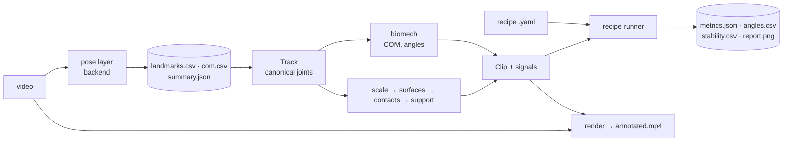

# ClimbVision — The Complete Guide

*For users who want to analyse videos, and for developers who want to change the code.*

ClimbVision turns an ordinary phone video of one person moving into numbers about
how that body moves: a skeleton of the main joints, the whole-body centre of mass, joint
angles, what is touching the floor or a bar, how stable the person is, and
movement-specific results such as squat depth, plank form, jump height or pull-up range
of motion.

It is built as a **generic movement-analysis engine** (layers that measure the body)
plus **recipes** (small YAML files that say what to measure for one kind of movement).
Adding an exercise or a climbing analysis means writing a recipe, not engine code.

The long-term goal is climbing analysis on a wall. The current version deliberately
works **off the wall first** (floor exercises and bar exercises), so that every
measurement can be checked on simple movements before it is trusted on a climb.

---

## Contents

1. [Quick start](#1-quick-start)
2. [Recording videos that work](#2-recording-videos-that-work)
3. [Commands](#3-commands)
4. [What you get: output files](#4-what-you-get-output-files)
5. [Reading the results](#5-reading-the-results)
6. [The science](#6-the-science)
7. [Architecture and design philosophy](#7-architecture-and-design-philosophy)
8. [Developing ClimbVision](#8-developing-climbvision)
9. [Known limitations](#9-known-limitations)
10. [Glossary](#10-glossary)
11. [References](#11-references)

---

## 1. Quick start

### 1.1 Install (once)

You need Python 3.10–3.12. With Anaconda / Miniconda:

```bash
cd ClimbVision
conda create -n climbvision python=3.11 -y
conda activate climbvision
pip install -e ".[dev]"
```

`pip install -e` installs the package in *editable* mode: changes you make to the code
under `src/` take effect immediately, without reinstalling. `[dev]` adds the test and
lint tools (`pytest`, `ruff`).

The pose model (a ~10 MB file from Google) downloads automatically the first time you
analyse a video and is cached in `~/.cache/climbvision/models/`.

### 1.2 Analyse a video

```bash
conda activate climbvision
climbvision analyze data/videos/squat_side.MOV
```

This creates `outputs/squat_side/` with an annotated video, a report image and data
files (section 4). Analyse several at once:

```bash
climbvision analyze data/videos/*.MOV data/videos/*.mov
```

### 1.3 Look at the results

1. Open `outputs/<clip>/annotated.mp4` — does the skeleton follow the body? If not,
   no number from this clip can be trusted (see section 2).
2. Open `outputs/<clip>/report.png` — angles, the exercise result, stability and
   contacts over time.
3. Open `outputs/<clip>/metrics.json` — the numbers.

### 1.4 The commands in one sentence each

| Command | What it does | Speed |
|---|---|---|
| `climbvision analyze VIDEO` | Runs pose estimation (slow), then the analysis and the annotated video | a few × the clip length |
| `climbvision metrics outputs/CLIP` | Re-runs the analysis (everything except pose) from the saved CSVs | seconds |
| `climbvision render outputs/CLIP` | Redraws `annotated.mp4` from saved results | about the clip length |
| `climbvision camera outputs/CLIP` | Camera layer: lines every frame up with the wall (handheld video); `wall.jpg`, `wall_view.mp4` | about 1–2 × the clip length |
| `climbvision summary outputs/*` | One line per clip (table + `outputs/summary.csv`) | instant |
| `climbvision recipes` / `signals` | List the recipes, or the signals recipes can use | instant |

The split matters: pose estimation is the only slow step, so it runs once. When you
change an algorithm or a threshold, re-run `metrics` (and `render`) on existing results.

---

## 2. Recording videos that work

Almost every bad result traced back to the recording, not the code. These rules come
from the test clips:

| Rule | Why |
|---|---|
| **Off the wall: fixed camera** (tripod or propped phone) | The floor line, scale and sway are measured in the image, so they assume it doesn't move. |
| **On the wall: handheld is fine** — pan smoothly, keep plenty of wall in view, don't walk around | The camera layer (6.13) removes the camera motion using the wall. It needs wall texture (holds) around the climber, and works best when the filmer stays in one place and turns the phone. |
| **Whole body in frame, including feet, plus some floor** | Contacts and stability need visible feet. Clips with feet cut off are flagged "feet out of frame". |
| **Camera at about hip height, roughly level** | A low camera looking up tilts "vertical", distorts trunk lean and the 3D estimate. |
| **One person in frame** | The pose model tracks one person. |
| **Side view for squats, planks, pike push-ups, lunges** | Their movement happens front-to-back; a side view sees it at full size. |
| **Front view for jumping jacks, left/right balance** | Their movement happens left-to-right. |
| **2 s standing still before you start** | Gives a clean baseline (standing knee angle, starting position). |
| **Bar exercises: bar and whole body in frame; if possible, start standing on the floor** | The floor can only be learned from frames where the hands are not on the bar. |
| **Good light, plain clothes contrasting with the background** | Fewer pose errors. |

### 2.1 Naming files so the movement is recognised

`analyze` and `metrics` pick a recipe from the file name (each recipe's `match`
patterns, checked in `priority` order; first match wins):

| File name contains | Recipe |
|---|---|
| `toes_to_bar`, `t2b`, `leg_raise`, `knee_raise` | `leg_raise` |
| `pullup`, `pull_up`, `chinup`, `muscle_up` | `pullup` |
| `dead_hang`, or a word starting with `hang` (not `overhang`) | `dead_hang` |
| `pistol` | `pistol_squat` |
| `squat` | `squat` |
| `pike` | `pike_pushup` |
| `plank` | `plank` |
| `jumping_jack`, `jacks` | `jumping_jacks` |
| `tree`, `crow`, `onefoot`, `single_leg`, `balance`, `stork` | `balance` |
| anything else | `none` (angles, stability and jumps only) |

Recommended pattern: `<movement>_<view>.mov`, e.g. `squat_side.mov`, `pullup_front.mov`.
You can always override with `--recipe NAME` (or `--recipe my_recipe.yaml`).

---

## 3. Commands

### 3.1 `climbvision analyze`

```
climbvision analyze VIDEO [VIDEO ...] [--out DIR] [--recipe NAME|FILE] [--recipes DIR]
                    [--sex male|female] [--backend NAME] [--model lite|full|heavy]
                    [--no-camera] [--no-video] [--max-frames N]
```

| Option | Default | Meaning |
|---|---|---|
| `--out` | `outputs` | Results go to `OUT/<video file name without extension>/` |
| `--recipe` | `auto` | A recipe name (`climbvision recipes` lists them: `squat, pistol_squat, plank, pike_pushup, jumping_jacks, balance, pullup, dead_hang, leg_raise, none`), a path to a `.yaml` recipe, or `auto` = from the file name. `--exercise` still works as an alias |
| `--recipes` | – | An extra folder of your own recipes (repeatable); same name overrides a shipped one |
| `--backend` | `mediapipe_pose33` | Pose backend (8.4) |
| `--sex` | `male` | Which body-segment table to use for the centre of mass (section 6.3) |
| `--model` | `full` | MediaPipe model size. `lite` is ~2× faster and less accurate; `heavy` is ~2× slower and slightly more accurate |
| `--no-camera` | off | Skip the camera layer (6.13); the camera is then assumed fixed |
| `--no-video` | off | Skip `annotated.mp4` and `wall_view.mp4` (faster) |
| `--max-frames` | all | Only process the first N frames (quick tests) |

### 3.2 `climbvision metrics`

```
climbvision metrics outputs/CLIP [outputs/CLIP2 ...] [--recipe NAME|FILE] [--recipes DIR]
climbvision metrics outputs/*
```

Reads `landmarks.csv` (+ `com.csv`, `summary.json`) and rewrites `angles.csv`,
`stability.csv`, `metrics.json` and `report.png`. Folders without `landmarks.csv`
are skipped.

### 3.3 `climbvision render`

```
climbvision render outputs/CLIP [--video PATH]
```

Redraws `annotated.mp4`. The source video path is read from `summary.json`; pass
`--video` if it moved. If the results were computed on a resized copy of the video,
the original is resized to match before drawing.

### 3.4 `climbvision camera`

```
climbvision camera outputs/CLIP [outputs/CLIP2 ...] [--video PATH] [--no-video]
```

Runs the camera layer (6.13) on existing results — e.g. clips analysed before the camera
layer existed — and writes `camera.csv`, `camera.json`, `wall.jpg`, `wall.json` and
`wall_view.mp4`. Needs the source video (path from `summary.json`, or `--video`).
`analyze` runs it automatically unless `--no-camera`.

### 3.5 `climbvision summary`

```
climbvision summary outputs/* [--csv PATH]
```

Prints one line per clip — exercise, view, the headline result ("4 reps, 4 below
parallel, knee 36°", "10.6 s on L foot, sway sd 0.9 cm", …) and any warnings — and
writes the same as `summary.csv` (default: next to the result folders). Use it to
compare sessions or to spot clips that need a look.

### 3.6 Using it from Python

Everything the CLI does is a normal function call:

```python
from climbvision.engine.pose import make_estimator, run_pose
from climbvision.analysis import run_analysis
from climbvision.output.render import render

est = make_estimator(model_size="full")            # MediaPipe by default
run_pose("data/videos/squat_side.MOV", "outputs/squat_side", est)
est.close()
m = run_analysis("outputs/squat_side", recipe="squat")
print(m["reps"], m["min_thigh_deg_mean"])
render("data/videos/squat_side.MOV", "outputs/squat_side")
```

And to work with the data directly (e.g. in a Jupyter notebook):

```python
from climbvision.analysis import load_clip
from climbvision.engine.skeleton import J

clip = load_clip("outputs/squat_side")     # all engine layers for one clip
tr = clip.track                            # arrays (frames, 23 joints, 2|3)
tr.image[:, J.L_KNEE]                      # left knee in pixels per frame
knee = clip.signal("knee")                 # any named signal (climbvision signals)
st = clip.stability
st.margin_cm, st.contacts.group["left_foot"]   # per-frame arrays

from climbvision.recipes import load_recipes, run_recipe
res = run_recipe(load_recipes()["squat"], clip)
res.metrics["reps"]
```

---

## 4. What you get: output files

Every clip gets a folder `outputs/<clip>/`:

| File | Made by | Contents |
|---|---|---|
| `landmarks.csv` | `analyze` | The raw pose: one row per backend point per frame |
| `com.csv` | `analyze` | Centre of mass per frame |
| `summary.json` | `analyze` | Video info and detection summary |
| `angles.csv` | `metrics` | All joint angles per frame |
| `stability.csv` | `metrics` | Contacts, support, margin, swing per frame |
| `metrics.json` | `metrics` | All clip-level results |
| `report.png` | `metrics` | Four-panel plot |
| `annotated.mp4` | `render` | The video with everything drawn on it |
| `camera.csv`, `camera.json` | `camera` | The camera layer: one homography per frame (frame → wall) and its quality (4.7) |
| `wall.jpg`, `wall.json` | `camera` | The wall without the climber, in wall coordinates; `wall.json` holds the mapping from wall coordinates to its pixels |
| `wall_view.mp4` | `camera` | The video in wall coordinates: the wall stands still, hands/feet leave trails |

### 4.1 `landmarks.csv`

| Column | Meaning |
|---|---|
| `frame`, `time_s` | Frame index and time (from the video's own timestamps) |
| `landmark` | The pose backend's own point name, e.g. `left_knee` (the **person's** left); MediaPipe has 33 |
| `x_px`, `y_px` | Position in the image, pixels. x to the right, **y downwards** |
| `x_m`, `y_m`, `z_m` | The backend's 3D estimate in metres, origin at the centre of the hips, y down, z towards/away from the camera |
| `visibility` | 0–1, the model's confidence that the point is visible (not occluded) |

Frames where no person was found have no rows (they do appear in `com.csv` with
`detected = 0`). The file keeps the backend's raw points (face and fingers included) so
nothing is lost; loading maps them onto the canonical skeleton (6.1), which has no face.

### 4.2 `com.csv`

`frame, time_s, detected, com_x_px, com_y_px, com_x_m, com_y_m, com_z_m, confidence`.
`com_*_m` is relative to the hip centre: it describes body shape, **not** where the body
is in the room (section 6.2). `confidence` is explained in 6.3.

### 4.3 `angles.csv`

`time_s` plus one column per angle, side and method, e.g. `knee_l_2d`, `knee_r_3d`,
`trunk_lean_2d`. Joints: `ankle, knee, hip, thigh, body_line, elbow, shoulder`
(left/right, 2D/3D) and `trunk_lean` (2D/3D). Definitions in 6.4.

### 4.4 `stability.csv`

| Column | Meaning |
|---|---|
| `stance` | Short label of what supports the body: `both feet`, `L foot`, `feet + forearms`, `bar`, `none` (airborne) … |
| `left_foot … right_knee` | 1 when that body part touches the floor |
| `left_hand_on_bar`, `right_hand_on_bar` | 1 when gripping (bar exercises only) |
| `com_x_px` | COM horizontal position in the image |
| `support_lo_px`, `support_hi_px` | Extent of the base of support along the image x axis |
| `margin_cm` | Stability margin: + inside the support, − outside (NaN with no floor contact) |
| `swing_cm` | Bar only: COM x minus grip x |
| `feet_out_of_frame` | 1 when a heel or toe is outside the image |

### 4.5 `summary.json`

`video, backend, sex_model, frame_size, frames, fps, duration_s, frames_with_pose,
detection_rate, com_px {mean, std, range}, mean_confidence, com_world_m`.
`detection_rate` below ~0.95 means the person was lost in part of the clip.

### 4.6 `metrics.json`

Always present:

| Key | Meaning |
|---|---|
| `exercise` | Which recipe ran |
| `view` | `side` or `front` (6.4.3) |
| `body_yaw_deg` | How far the body is turned from facing the camera, 0–90° |
| `near_side` | `left`/`right`: the side facing the camera |
| `angle_ranges` | min / median / max of the main angles |
| `stability` | See 5.2 |

Plus the recipe's results (5.3), and `camera` when the camera layer ran: `static`,
`registered_pct` (frames lined up with the wall), `keyframes`, `pan_px` / `pan_m`
(how far the view travelled over the wall, x and y) and `lost_frames`.

### 4.7 `camera.csv`

| Column | Meaning |
|---|---|
| `frame`, `time_s` | Frame index and time |
| `status` | 0 = lost (no H), 1 = tracked, 2 = anchored to a keyframe this frame |
| `inliers` | Points that agree with H (more = more reliable) |
| `h00 … h22` | The 3×3 homography, row by row: frame pixels → wall coordinates |

`camera.json` has the frame size, `static`, the working scale, number of keyframes and
`registered_pct`. To map a point (x, y) of frame *i*: (u, v, w) = H·(x, y, 1), wall
position = (u/w, v/w). In Python: `CameraTrack.load(path).to_wall(points)`.

---

## 5. Reading the results

### 5.1 The annotated video

| Drawing | Meaning |
|---|---|
| White lines, yellow dots | Skeleton. Grey = low visibility (the model is guessing) |
| Pink dot + light trail | Centre of mass and its last 2 s |
| Thin grey line | The floor as the system estimated it |
| Cyan rings | Points touching the floor |
| Thick bar on the floor | Base of support; **green** = COM above it, **red** = outside |
| Dashed line + triangle | The COM's plumb line to the floor |
| Purple squares + line | Hands on a bar |
| Top-left box | Time, stance, margin (or swing on a bar), warnings |

**Always watch the video before trusting numbers.** If the skeleton jumps, swaps legs
or misplaces a hidden limb, the numbers for those frames are wrong too.

### 5.2 `stability` in metrics.json

| Key | Meaning |
|---|---|
| `support_axis` | `front-back` (side view) or `left-right` (front view) |
| `scale_px_per_m` | Image pixels per metre at the person (6.5) |
| `floor_tilt_deg`, `camera_height_m` | Floor model (6.6); camera height only when the person moved towards/away from the camera |
| `contact_pct` | % of the clip each body part touched the floor |
| `stance_time_s` | Seconds in each stance |
| `margin_cm` | Stability margin: median, minimum, % of time inside |
| `com_sway` | COM movement along the support axis: `sd_cm` (spread), `range_cm`, `mean_speed_cm_s` |
| `sway_by_stance` | The same, for the longest ≥2 s run of each stance |
| `jumps` | `count`, flight times, `height_cm_mean` (from flight time) |
| `bar` | Bar exercises: `on_bar_s`, `hanging_s`, `longest_hang_s`, `swing {sd_cm, range_cm}` |
| `warnings` | Feet out of frame, no contact found, floor unknown |

Typical values on the test clips: quiet standing sway sd ≈ 0.5 cm; one-leg standing
0.6–1.3 cm; tree pose ≈ 0.9 cm; crow pose ≈ 1.6 cm with the COM within ~1 cm of the
hands.

### 5.3 Recipe results

Each recipe adds its own keys; the exact definition of every key is in the recipe file
(`src/climbvision/recipes/library/<name>.yaml`), next to a description. Keys ending in
`_mean` / `_sd` are the mean / standard deviation over reps; `reps_detail` lists every rep.

**squat / pistol_squat**

| Key | Meaning |
|---|---|
| `reps` | Repetitions |
| `standing_knee_deg` | Knee angle at the top (≈ 175–180 side view; ≈ 163 front view, a 3D bias) |
| `min_knee_deg`, `min_hip_deg` | Deepest knee / hip angle per rep |
| `min_thigh_deg` | Thigh vs horizontal at the bottom: **< 0 = below parallel** |
| `hip_below_knee_cm` | Same idea from the 3D estimate (+ = hip below knee) |
| `max_trunk_lean_deg` | Forward lean of the torso |
| `descent_s`, `ascent_s` | Tempo |
| `reps_below_parallel` | Count |
| `reps_by_leg`, `leg` | Pistol only: which leg worked |

**plank**: `hold_s`, `body_line_deg_mean/min`, `hip_offset_pct_mean/sd` (+ sag, − pike,
% of body length), `pct_time_straight/sag/pike` (±5 % = straight),
`hip_offset_drift_pct` (last third minus first third: did the hips drop?).

**pike_pushup**: `reps` (push-ups done while piked), `min_elbow_deg`,
`hip_deg_at_bottom`, `plank_s`, `pike_straight_arms_s`.

**jumping_jacks**: `reps`, `reps_per_min`, `max_arm_deg` (180 = arms straight
overhead), `max_feet_width` (ankle distance ÷ shoulder width). Jumps (two per rep) are in
`stability.jumps`.

**balance**: `balance {stance, hold_s, sd_cm, range_cm, mean_speed_cm_s,
margin_cm_median, margin_cm_min, pct_inside}` — the longest hold on a reduced base
(one foot, hands only…).

**pullup**: `reps`; per rep (and mean/sd): `pull_cm` (how far the shoulders rose
towards the bar), `top_gap_cm` (shoulders below the bar at the top), `com_rise_cm`,
`chin_clearance_cm` and `chin` (`over` / `at bar` / `under`, see 6.12),
`top_elbow_deg`, `start_elbow_deg` (straightness before pulling, ≈ 155–180),
`up_s`, `down_s`, `swing_cm`, `hip_range_deg`, `kipping` (hip angle changed > 40°).
Summary counts: `reps_chin`, `reps_kipping`; `chin_above_shoulders_cm` is the
body-proportion estimate used.

**leg_raise**: `reps`, `min_hip_deg` (90 = legs horizontal), `min_knee_deg` (≈180 =
straight-leg raise, small = knee raise), `reps_toes_to_bar`, and `raised_hold` when the
legs stay up ≥ 3 s (`hold_s`, `hip_deg_start`, `hip_deg_end`, `hip_drop_deg` = how much
the legs sank, `knee_deg_median`).

**dead_hang**: `dead_hang {hold_s, elbow_deg_median, swing_sd_cm, swing_range_cm}`.

### 5.4 report.png

1. **Angles over time**: knee, hip, trunk lean, body line.
2. **Exercise panel**: the signal reps are counted on, reps shaded and numbered (or
   plank hip offset, or COM sway with the longest hold for balance/hang).
3. **Stability**: margin over time, green inside / red outside; purple swing on a bar;
   grey bands where feet were out of frame.
4. **Contacts**: a timeline bar per body part (blue feet, orange hands/forearms/knees,
   purple bar grips).

---

## 6. The science

This section explains *what* is computed and *why it is valid*, in plain terms first and
then precisely. Each subsection names the code that implements it.

### 6.1 Pose estimation and the canonical skeleton (`engine/pose.py`, `engine/backends/`, `engine/skeleton.py`)

**Plain terms.** A neural network (the *pose backend*) looks at each frame and marks
points on the body. The engine then maps the backend's points onto its own fixed set of
joints — the **canonical skeleton** — so nothing downstream depends on which network
was used. MediaPipe, the current backend, marks 33 points: nose, eyes, ears, mouth
corners, shoulders, elbows, wrists, three hand points, hips, knees, ankles, heels, toes.

**The canonical skeleton** (`J` in `engine/skeleton.py`, 23 joints): `HEAD` (centre of
the head), optional `HEAD_TOP` and `NECK`, and per side `SHOULDER, ELBOW, WRIST, HAND`
(knuckles), `HIP, KNEE, ANKLE, HEEL, TOE`, optional `SMALL_TOE`. There are **no face
points**: for movement analysis the head is one joint, and a climber usually has their
back to the camera — MediaPipe still "sees" a face there, with full confidence, so face
points are worse than useless. Fingers are reduced to one `HAND` point, because finger
estimates are often off. Joints a backend doesn't provide are `NaN` everywhere.

| Canonical joint | from MediaPipe (33 points) |
|---|---|
| `HEAD` | midpoint of the ears |
| `HAND` | midpoint of index and pinky knuckles |
| `TOE` | `foot_index` |
| others | the point of the same name |
| `HEAD_TOP`, `NECK`, `SMALL_TOE` | not provided (NaN) |

**Precisely.** We use Google's MediaPipe Pose Landmarker (the BlazePose GHUM model) in
`VIDEO` running mode, which tracks between frames rather than detecting from scratch
each frame — smoother and faster. For each frame it returns:

- **image landmarks**: (x, y) normalised to the image; we convert to pixels.
- **world landmarks**: (x, y, z) in metres, origin at the midpoint of the hips. This is
  a *learned estimate* from a single image — useful, but noisy in depth (z).
- **visibility**: probability the landmark is not occluded.

Important properties to remember:

- *Left/right are the person's*, not the image's. Facing the camera, the person's left
  appears on the image's right.
- Hidden landmarks are still predicted (the model guesses); low visibility warns you.
- The model has never seen your body: it can mis-place a limb that points at the camera
  (e.g. a raised knee in a front view) or is hidden behind the body.

The MediaPipe backend is one implementation of the `PoseEstimator` protocol
(`estimate(frame_bgr, time_ms) -> RawPose | None`); adding a model means one module with
its point names and a mapping onto `J` (8.5). `landmarks.csv` stores the backend's
**raw** points, so a better mapping can be applied to old results without re-running pose.

### 6.2 Coordinate systems and conventions

| System | Origin | Axes | Units | Used for |
|---|---|---|---|---|
| Image | top-left pixel | x right, **y down** | pixels | Everything measured in the picture: 2D angles, floor, contacts, support, COM path |
| Wall | top-left pixel of the first registered frame | x right, **y down** | pixels of that frame | Positions with the camera motion removed (6.13): hands and feet on holds |
| World (backend 3D) | hip centre, *moves with the person* | x right, y down, z depth (camera axes) | metres | 3D angles, scale, depth-dependent quantities |

Consequences:

- "Up" in the image is −y. Heights above the floor are computed as `floor_y − y`.
- The world frame moves with the hips, so world COM shows *posture* (where the COM is
  relative to the hips), never how far the person travelled.
- World axes follow the camera, not gravity. A tilted camera tilts "vertical".
- All angles are in degrees, times in seconds, distances in cm or m as named.
- Missing data is `NaN` everywhere, never 0.

### 6.3 Centre of mass (`engine/biomech.py`)

**Plain terms.** The body is split into 14 segments (head, trunk, upper arms,
forearms, hands, thighs, shanks, feet). Each has a known share of body weight and a
known balance point along its length. The whole-body centre of mass (COM) is the
weighted average of the segments' balance points.

**Precisely.** For segment *i* with proximal end **P**ᵢ, distal end **D**ᵢ, mass
fraction *mᵢ* and COM ratio *rᵢ*:

  **c**ᵢ = **P**ᵢ + rᵢ (**D**ᵢ − **P**ᵢ),   **COM** = Σ mᵢ **c**ᵢ   (Σ mᵢ = 1)

Parameters are De Leva (1996), the standard adjustment of Zatsiorsky–Seluyanov's
cadaver/gamma-scan data to joint-centre landmarks:

| Segment | Endpoints (canonical joints) | Mass % ♂ / ♀ | COM from proximal % ♂ / ♀ |
|---|---|---|---|
| Head | `HEAD` (see below) | 6.94 / 6.68 | at `HEAD` |
| Trunk | mid-shoulders → mid-hips | 43.46 / 42.57 | 44.86 / 41.51 |
| Upper arm | shoulder → elbow | 2.71 / 2.55 | 57.72 / 57.54 |
| Forearm | elbow → wrist | 1.62 / 1.38 | 45.74 / 45.59 |
| Hand | wrist → `HAND` | 0.61 / 0.56 | 79.00 / 74.74 |
| Thigh | hip → knee | 14.16 / 14.78 | 40.95 / 36.12 |
| Shank | knee → ankle | 4.33 / 4.81 | 44.59 / 44.16 |
| Foot | heel → toe | 1.37 / 1.29 | 44.15 / 40.14 |

Approximations forced by the joint set: no skull vertex (head COM placed at `HEAD`, the
ear midpoint with MediaPipe, close to the true head COM); C7 replaced by mid-shoulders;
hip joint centres by the backend's hip points; 3rd knuckle by `HAND`. These cause a few
cm of *constant* offset, which barely affects *changes* of the COM — what most metrics use.

The formula is linear, so it works the same on pixels (2D) and on metres (3D);
`whole_body_com` accepts `(23, D)` or `(frames, 23, D)` canonical arrays.

**Sanity check.** Standing adult COM ≈ 55–57 % of height above the floor; on the test
clips it measured 58–60 % of heel-to-nose height (equivalent).

**COM confidence** = Σ mᵢ × (lowest visibility among segment *i*'s landmarks). A hidden
foot costs ~1.4 %; a hidden trunk ~43 %.

### 6.4 Joint angles (`engine/biomech.py`)

#### 6.4.1 Definitions

The angle at a joint between three points A–V–B is
θ = arccos( (A−V)·(B−V) / (|A−V| |B−V|) ).

| Angle | Points | Reading |
|---|---|---|
| knee | hip–knee–ankle | 180 straight, smaller = more bent |
| hip | shoulder–hip–knee | 180 straight, ~90 seated/piked |
| ankle | knee–ankle–toe | ~90–110 standing |
| elbow | shoulder–elbow–wrist | 180 straight |
| shoulder | hip–shoulder–elbow | 0 arm by the side, 180 overhead |
| body_line | shoulder–hip–ankle | 180 = straight body (plank) |
| thigh | hip→knee vs horizontal | +90 standing, 0 parallel, < 0 hip below knee |
| trunk_lean | hip→shoulder vs vertical | 0 upright, 90 horizontal |

#### 6.4.2 2D or 3D?

A 2D angle measured in the image equals the true angle **only if the limb moves in a
plane parallel to the image**. A squat seen from the side does; seen from the front, the
thighs point at the camera and look short, so 2D angles are wrong. 3D angles from the
world landmarks work from any view but inherit depth noise. Both are stored; the
**primary** angle uses 2D on the near side for side views and 3D (mean of both sides)
for front views. Front-view 3D readings are biased: a straight knee reads ~163°, trunk
lean reads ~20° when it is really ~32°.

#### 6.4.3 View and near side

- **Body yaw** = median over the clip of atan(|Δz| / |Δx|) between the left and right
  shoulders (and hips) in world coordinates. Facing the camera: both sides at the same
  depth → 0°. Side-on: one side behind the other → 90°. Test clips: front 3–11°,
  side 78–88°. Rule: < 30° front, > 60° side, otherwise fall back to the image shoulder
  width ÷ torso length (< 0.3 = side).
- **Near side** = the side whose limbs have higher average visibility.

### 6.5 Scale: pixels per metre (`engine/scale.py`)

To report centimetres we need to know how many pixels one metre is at the person.

**Idea.** For each body segment, divide its length in the image (pixels) by its length
in the world estimate (metres). A segment pointing at the camera looks *shorter* in the
image, never longer, so the **largest** ratios are the trustworthy ones. Per frame we
take the 80th percentile over 12 segments, then a ~1 s rolling median.

If the floor model (6.6) finds no evidence that the person moved towards or away from
the camera, per-frame changes in this ratio are treated as pose noise and one value
(the clip median) is used for the whole clip.

### 6.6 The floor (`engine/surfaces.py`)

The floor is a line in the image: **y = slope·x + y₀(frame)**.

1. **Candidates**: in every frame, the lowest point of each body part (each foot, hand,
   forearm, knee).
2. **RANSAC**: try many candidate lines — horizontal ones through single points, tilted
   ones (≤ 10°) through pairs, and depth-varying ones (below). Score =
   (points within tolerance of the line) − 3 × (points clearly *below* it). Nothing rests
   below the floor, so the penalty stops the line settling on resting hands or knees.
3. **Refine** by least squares on the inliers, adding a tilt term only if the inliers span
   enough of the image, and a depth term only if the person's scale changed enough.

**Depth term (pinhole camera).** A level camera at height *H* sees the floor under a
person at distance *d* at *f·H/d* pixels below the horizon. The scale *ppm* (6.5) is
*f/d*, so y₀ = a + H·(ppm − ppm_ref): linear in the scale, with slope = the camera height
in metres. This keeps the floor correct when someone walks towards or away from the
camera, and gives `camera_height_m` as a free sanity check.

**Bar mode.** Frames where the hands grip a bar are excluded. With less than 1 s of
other frames the floor is *unknown* (all heights NaN, no floor contacts) and a warning is
written — hanging feet would otherwise be mistaken for the floor.

### 6.7 Contacts (`engine/contacts.py`)

A joint touches the floor when it is **near** the floor (height < 5 % of body length)
**and still** (speed < 0.6 body lengths per second). Both thresholds scale with the
person's distance from the camera. Joints are grouped into parts (heel or toe → foot,
wrist or hand → hand, elbow → forearm, knee);
gaps and blips shorter than 0.15 s are cleaned up.

"Body length" throughout means trunk + leg length in pixels (≈ 0.55 × stature), measured
robustly from the clip.

### 6.8 Base of support and stability margin (`engine/support.py`)

**Plain terms.** You are balanced when your centre of mass is above the area you are
standing on. The *stability margin* is how far the COM's plumb line is from the edge of
that area: big and positive = stable, near zero = on the edge, negative = falling or
moving (fine during a jump or a step, alarming in a hold).

**Precisely.** With one camera we measure the support along the image's horizontal
axis: `[min x, max x]` of the contact points (front view: each point padded by half a
foot/hand width, because there the image shows width, not length). Margin =
min(COM_x − lo, hi − COM_x), converted to cm. Side view → front–back balance; front
view → left–right balance.

*Why not a full 2D support polygon?* It needs depth for every contact point. With
MediaPipe's 3D estimate the polygon put the COM *outside* both feet during quiet
standing even after correcting for camera tilt, so it was removed. Two cameras or a depth
camera would make it possible.

**Sway** (posturography): over a window, the COM's standard deviation (`sd_cm`),
total excursion (`range_cm`) and mean speed (path length ÷ time). These are the
standard balance measures used with force plates, here measured from video.

### 6.9 Jumps (`engine/support.flight_phases`)

An airborne phase is a stretch with no contact, between two contacts, lasting
0.06–1.2 s. To reject contact "flicker" on a planted foot it must also look like a jump:
feet leave the floor, the COM rises by > 1.5 % body length, and (for flights > 0.3 s)
comes back down by at least 40 % of the rise.

**Jump height from flight time.** A body in free flight rises for *t/2* and falls for
*t/2*: h = ½ g (t/2)² = **g t² / 8**. A 0.2 s flight ≈ 5 cm; 0.4 s ≈ 20 cm. This is the
same method jump mats use, and it is independent of the camera scale.

### 6.10 Counting repetitions (`engine/events.find_cycles`, a recipe's `reps:`)

Every rep counter uses one function, through the `reps:` section of a recipe. Take a signal that dips during a rep (knee angle in
a squat, elbow in a pull-up, hip in a leg raise). Its resting level is the 90th
percentile. A rep **starts** when the signal drops more than `start_drop` below rest
(then walks back to where the drop began) and **ends** when it returns within `end_drop`
of rest. Two thresholds (hysteresis) stop noise near one threshold from counting twice.
Reps shorter than `min_s` are ignored.

| Recipe | Signal | start / end drop | Extra rules (`require`, `rest`) |
|---|---|---|---|
| squat | knee (smoothed) | 35° / 15° | pistol: the more-bent leg per frame |
| pike push-up | elbow | 45° / 25° | rest level taken while piked; bottom must be piked (hip < 120°) |
| jumping jacks | 180° − arm elevation | 80° / 40° | front view, 2D arms |
| pull-up | shoulders below the bar ÷ body length | 0.12 / 0.05 | top must be on the bar |
| leg raise | hip | 40° / 20° | on the bar |

### 6.11 Holds and plank form (a recipe's `holds:`)

A *hold* is the longest stretch where a condition is true (`when:`), or where one label
stays the same (`by: stance`, used for balance). The plank hold is the longest ≥ 1 s stretch with the torso 60–120° from vertical. **Hip offset**
= signed perpendicular distance of the hip from the shoulder–ankle line, as % of that
line's length; + = below (sag), − = above (pike); within ±5 % counts as straight.

### 6.12 Bars: grips, hanging, swing (`engine/contacts.detect_grips`)

Only in bar scenes (recipes with `scene: bar`). The hand's grip point is 2/3 of the way
from `WRIST` to `HAND` (the bar sits in the fingers). A hand is **gripping** when it is above its shoulder
and nearly still (< 0.35 body lengths/s) for ≥ 0.3 s; the grip then extends forwards and
backwards as long as the hand stays within 8 % body length of that spot — this keeps the
grip through the top of a pull-up, when the shoulders reach the hands. **Hanging** =
gripping with nothing on the floor. **Swing** = COM x − grip x in cm: how far the body
hangs off the vertical below the bar. Judge swing by its spread (`sd_cm`, `range_cm`):
a constant `offset_median_cm` while hanging still comes from the camera angle, not a lean.

**Pull-up reps** are counted on how far the shoulders hang below the bar, in body
lengths (~0.4 in a dead hang, ~0.05 at the top). Unlike the elbow angle this works from
any view: with a narrow or chin-up grip seen from the front, the elbows travel towards
the camera and look folded flat in the image (2D elbow ≈ 5° when it is really ≈ 80°), so
the reported elbow angle uses the 3D estimate in front views.

**Chin over bar** is estimated from the body, not the face, because the face is often
hidden at the top (by the bar, the hands, or a door frame) while the pose model still
"sees" a face with full confidence. Chin height = shoulder height + 0.095 body lengths,
from standard proportions (chin ≈ 0.870 × stature, shoulder ≈ 0.818 × stature,
trunk + leg ≈ 0.55 × stature; Drillis & Contini). The face isn't used even when visible:
while hanging the shoulders shrug up towards the ears, which biases a face-based
measurement. Shoulder landmarks and proportions are each good to a few cm, so a chin
within ±5 cm of the bar is reported as `at bar` rather than guessed.

Why not detect grips in every clip? From pose alone, "arms overhead and still" (tree
pose) looks the same as "hanging from a bar". The recipe (`scene: bar`) supplies that
context. On the wall the same idea becomes *anchors*: a hand or foot still on the wall for
~0.5 s is on a hold (milestone E4).

### 6.13 Camera motion: wall coordinates (`engine/camera.py`)

**Plain terms.** In a handheld video the whole picture moves, so a foot resting on a
hold still moves *in the image*. The camera layer works out, for every frame, how the
picture has to be shifted, rotated and stretched to line up with the first frame. Undo
that and the wall stands still: the foot on the hold stops moving. Positions measured
this way are in **wall coordinates**.

**Why one homography per frame is enough.** A homography is a 3×3 matrix that maps one
image of a *plane* onto another image of it, whatever the camera's position and angle.
A climbing wall panel is close to a plane, and a handheld camera filmed by someone
standing still mostly *rotates*; for a pure rotation a homography is exact for
everything in view. So H[i] (frame *i* → wall) captures the camera motion. Parts that
stick out of the plane (big volumes, a roof seen from below while the filmer walks) show
small errors (parallax); those are the main limit (section 9).

**How H[i] is found** (at ~960 px working resolution):

1. *Only the wall votes.* Pixels on the climber (capsules around the bones from the pose
   layer, torso, head, hands and feet) and a thin image border are masked out.
2. *Tracking.* Corners on the wall are followed frame to frame with pyramidal
   Lucas–Kanade optical flow, kept only if tracking backwards returns to the start
   (< 1 px). Each point carries the wall position it had when it was first seen, so H[i]
   is fitted **directly from frame *i* to the wall** with robust RANSAC (MAGSAC++), not
   by chaining frame-to-frame motions (chaining lets small errors add up: drift).
3. *New points* are added when fewer than 250 survive (the climber covers them, the view
   moves on); they get wall positions through the current H.
4. *Keyframes and loop closure.* When the view has moved on (less than 75 % overlap with
   the last keyframe) the frame is stored as a keyframe (ORB features with their wall
   positions). Every 5th frame, the current frame is matched against keyframes at least
   1 s old that see the same part of the wall; those matches join the fit and re-anchor
   the tracked points. Points that disagree with the anchored fit (e.g. sliding along
   the edge of another person) are dropped.
5. *Lost tracking* (camera covered, extreme blur, climber filling the frame): the frame
   gets no H (NaN, status 0) until it can be matched against the keyframes again.

**Wall coordinates** are the pixel coordinates of the first registered frame, extended
past its edges as the camera pans. A fixed camera gives H ≈ identity and `static: true`.

**The wall image** (`wall.jpg`): every 0.5 s (at most 40 frames, spread over the clip) a
frame is warped into wall coordinates with the climber masked out; the per-pixel
**median** over those frames is the wall without the climber. It is the background
needed to separate the climber from the wall (E3) and to find holds (E4).

**How we know it works.** Two independent checks:

- *Synthetic video* (`tests/test_camera.py`): a textured wall filmed by a camera with
  known motion (pan up and back, shake, roll, zoom, a large moving "climber"): the frame
  corners land within ~1–2 px of the truth, also after panning away and back.
- *Real clips*: textured patches of `wall.jpg` (holds, mostly) are searched for in every
  3rd frame after warping the frame into wall coordinates; the offset of the best match
  is the registration error at that spot and time. On the five handheld wall clips
  (PLAN.md, E2): 100 % of frames registered; median error 0.06–0.15 cm, 90 % of checks
  under 0.5 cm; the worst clip (`coordination_failed`, where the pose sometimes sits on
  a volume so the climber isn't masked) has 1.4 % of checks over 2 cm.

---

## 7. Architecture and design philosophy

### 7.1 Principles

1. **An engine of layers, plus recipes.** The engine measures the body (pose, centre of
   mass, angles, contacts, support). Recipes — small YAML files — say what to measure
   for one movement (a squat, a pull-up, later a climbing move). Adding a movement means
   writing a recipe, not editing engine code; improving the engine (a better pose model,
   hold detection) improves every recipe at once.
2. **One slow pass, then cheap re-analysis.** Pose estimation is the only expensive
   step. It writes `landmarks.csv`, and every layer after it is recomputed from that
   file in seconds. The CSV is the contract between the two halves.
3. **Backend-independent skeleton.** Nothing after the pose layer knows which network
   produced the points: code uses canonical joint names (`J.L_KNEE`), never a backend's
   point numbers. Swapping MediaPipe for a better model is a mapping, not a rewrite.
4. **Explainable geometry before machine learning.** Every measurement is a formula or
   a threshold you can state in one sentence (section 6). ML comes in where geometry
   can't do the job (pose itself; later hold detection and subject segmentation).
5. **Every threshold is named, documented and in one place**: an engine function
   argument with a default, or a number in a recipe (table in 8.8).
6. **Arrays in, arrays out.** Layers take whole clips as NumPy arrays (frames first)
   and return arrays/dataclasses; no hidden state. Easy to test, easy to use in notebooks.
7. **Measure honestly.** When something can't be measured (feet out of frame, floor
   not visible, hidden limbs), say so in `warnings` and return NaN; never invent a number.
8. **Validate on real clips, lock in with tests.** Each feature is checked by eye on
   real videos, then protected by a synthetic test (exact answer known) and by the
   real-clip regression suite (8.7).

### 7.2 The layers

| Layer | Module | What it produces | Status |
|---|---|---|---|
| Video | `engine/video.py` | frames with their real timestamps | ✅ |
| Camera | `engine/camera.py` | each frame registered to the wall (H per frame), the wall image | ✅ |
| Subject | – | the climber locked and separated from the wall and other people | E3 |
| Pose | `engine/pose.py`, `engine/backends/` | a backend's raw points per frame → `landmarks.csv` | ✅ MediaPipe |
| Skeleton | `engine/skeleton.py`, `engine/track.py` | canonical joints as arrays (`Track`) | ✅ |
| Biomechanics | `engine/biomech.py` | centre of mass, joint angles, view, near side | ✅ |
| Scale | `engine/scale.py` | pixels per metre, body length | ✅ |
| Surfaces | `engine/surfaces.py` | the floor line (later: wall plane, holds) | floor ✅ |
| Contacts | `engine/contacts.py` | anchors: floor contacts, bar grips (later: holds), stance labels | floor/bar ✅ |
| Support | `engine/support.py` | base of support, margin, sway, flight, hanging, swing | ✅ off the wall |
| Events | `engine/events.py` | runs, cycles (reps), longest holds | ✅ |
| Signals | `engine/signals.py` | named per-frame series: the recipes' vocabulary | ✅ |
| Analyses | `recipes/` | recipe runner + `library/*.yaml` | ✅ 9 recipes |
| Output | `analysis.py`, `output/` | metrics.json, CSVs, report.png, annotated.mp4, summary | ✅ |

Each layer only reads the layers above it. Missing layers (camera, subject) are where
the on-the-wall work goes next; because recipes only see *signals*, they will not need to
change when those layers arrive.

### 7.3 Data flow



In words: **video → pose → CSVs → Track → engine layers → Clip (signals) → recipe →
results**, and **video + CSVs → annotated video**.

### 7.4 Modules

| Module | Responsibility | Key items |
|---|---|---|
| `engine/skeleton.py` | Canonical joints, bones | `J`, `N_JOINTS`, `side_joint`, `BONES`, `RawPose` |
| `engine/backends/` | Pose backends + mapping to `J` | `BACKENDS`, `to_canonical`, `mediapipe.Estimator` |
| `engine/video.py` | Read/write video, real timestamps | `VideoReader`, `VideoWriter` |
| `engine/pose.py` | The slow pass: video → CSVs | `run_pose`, `make_estimator` |
| `engine/camera.py` | Camera layer: frame → wall homographies, wall image | `estimate_camera`, `run_camera`, `CameraTrack`, `WallImage`, `CameraParams` |
| `engine/track.py` | A clip as arrays; load from CSV; smoothing | `Track.from_csv`, `Track.from_raw`, `smooth`, `window` |
| `engine/biomech.py` | Segment model, COM, angles, view | `whole_body_com`, `compute_angles`, `Angles.primary` |
| `engine/scale.py` | Pixels per metre | `estimate_scale`, `Scale` |
| `engine/surfaces.py` | Floor | `estimate_floor`, `Floor`, `FLOOR_PARTS` |
| `engine/contacts.py` | Floor contacts, grips, stance labels | `detect_contacts`, `detect_grips`, `Contacts` |
| `engine/support.py` | Support, margin, sway, jumps, bar summary | `compute_stability`, `stability_summary` |
| `engine/events.py` | Generic event detectors | `runs`, `clean_runs`, `longest_run`, `find_cycles` |
| `engine/signals.py` | Named signals; the `Clip` bundle | `Clip.build`, `Clip.signal`, `register`, `describe` |
| `recipes/__init__.py` | Load, match and run recipes | `load_recipes`, `guess_recipe`, `run_recipe` |
| `recipes/expr.py` | The safe expression language | `evaluate` |
| `recipes/library/` | Shipped recipes | `squat.yaml`, `pullup.yaml`, … |
| `analysis.py` | Results folder → all analysis outputs | `run_analysis`, `load_clip` |
| `output/` | report.png, CSV tables, drawing, video, wall view, summary | `plot_report`, `render`, `render_wall_view`, `headline` |
| `cli.py` | Command line | `main` |

### 7.5 Key data structures

```python
Track          # one clip, canonical joints
  .time_s      (n,)          seconds
  .image       (n, 23, 2)    pixels, NaN where no pose / joint not provided
  .world       (n, 23, 3)    metres, hip-centred
  .visibility  (n, 23)
  .detected    (n,) bool     .fps  float
  # index with joint names: track.image[:, J.L_KNEE]

Angles
  .view "side"|"front"   .yaw_deg   .side (near side)
  .values {"knee_l_2d": (n,), ...}
  .primary("knee", side=None) -> (n,)   # best angle for this view

Stability
  .scale  Scale(body_px, px_per_m, ppm (n,))
  .floor  Floor(slope, a, depth_m, ...)   .y0 (n,)  .height(points)  .known
  .contacts Contacts(point (n,23), group {part: (n,)}, height_px,
                     grip {"left"/"right": (n,)}, hand_px {...})
  .labels [str] (n)   .com_px (n,2)  .com_x_cm (n,)  .support_lo_px/.support_hi_px (n,)
  .margin_cm (n,)  .on_bar/.hanging (n,)  .swing_cm (n,)  .feet_out_of_frame (n,)

CameraTrack    # camera layer
  .H (n,3,3) frame px -> wall coords   .status (n,)  .ok (n,) bool  .static
  .to_wall(points (n,...,2)) -> wall coords   .centre_path()

Clip           # what a recipe sees
  .track .angles .stability .camera (CameraTrack or None) .t
  .wall (n,23,2)            # joints in wall coordinates
  .signal("knee") -> (n,)   # cached; `climbvision signals` lists every name
```

---

## 8. Developing ClimbVision

### 8.1 Daily workflow

```bash
conda activate climbvision
pytest                       # all tests, ~5 s, no video or model needed
pytest -m "not regression"   # only the fast synthetic tests
pytest -m regression         # only the real-clip regression tests
ruff check src tests
climbvision metrics outputs/*     # re-run analysis on all saved clips after a change
```

Use git: commit after every working change (`git add -A && git commit -m "..."`).
Results, data and models are git-ignored.

### 8.2 Project layout

```
ClimbVision/
  src/climbvision/
    engine/            the layers (7.2)
    recipes/           runner, expression language, library/*.yaml
    output/            reports, drawing, video, summary
    analysis.py cli.py
  tests/               pytest tests on synthetic skeletons (synth.py = helpers)
  tests/regression/    real-clip fixtures (pose data, .gz) + expected.json
  docs/GUIDE.md        this file
  docs/RECIPES.md      the recipe language, complete reference
  PLAN.md              milestones and findings per round of testing
  README.md            short overview
  data/videos/         your clips (git-ignored)
  outputs/             results (git-ignored)
  pyproject.toml       package metadata, dependencies, ruff/pytest settings
```

### 8.3 Adding a movement: write a recipe

Example: **push-ups** (side view), counted on the elbow. Create `pushup.yaml` — in
`src/climbvision/recipes/library/` to ship it, or in any folder you pass with
`--recipes DIR`:

```yaml
name: pushup
description: Push-ups, counted on the elbow; body line shows sagging hips.
match: ['push.?up']        # file names that select this recipe
priority: 65               # lower = checked first; after pike_pushup (60) so pike clips stay pike

signals:                   # smoothed versions of engine signals (window in seconds)
  elbow: smooth(elbow, 1/6)
  line: smooth(body_line, 1/6)

reps:
  signal: elbow            # a rep = a dip of this signal below its resting level
  start_drop: 50           # starts 50° below rest...
  end_drop: 25             # ...ends back within 25°
  min_s: 0.6
  fields:                  # per rep; [expr, 2] = round to 2 decimals (default 1)
    start_s: [t_start, 2]
    end_s: [t_end, 2]
    min_elbow_deg: at_bottom(elbow)
    body_line_deg: min(line)          # min over this rep
    full_rep: at_bottom(elbow) < 90
  stats: [min_elbow_deg, body_line_deg]     # -> *_mean, *_sd
  count: {reps_full: full_rep}

headline: >-
  f"{plural(reps, 'push-up')}, {reps_full or 0} full, elbow {min_elbow_deg_mean:.0f}°"

plot: {signal: elbow, label: elbow angle (deg)}
```

Then:

1. `climbvision metrics outputs/pushup_side --recipe pushup` (or just name the clip
   `pushup_…`), look at `report.png` and `metrics.json`.
2. Tune numbers in the YAML — no code, no reinstall.
3. Test it (8.6): a synthetic clip with N reps must give N.
4. Add a real clip to the regression set (8.7) once it is verified by eye.

Everything a recipe can say — `reps`, `holds`, `let`, `require`, `rest`, `summary`,
`categories`, `merge`, `scene: bar`, the helpers (`min`, `at_bottom`, `before`, `time`,
`pct`, `sway`, `to_cm`, …) and the expression rules — is in **docs/RECIPES.md**. The
nine shipped recipes in `recipes/library/` are worked examples of each feature.

**When a recipe isn't enough:** if you need a measurement no signal provides, add a
signal (8.4) — a few lines of engine code — then use it from the recipe. Keep the
engine generic (a "hip below knee" signal, not a "squat depth" one).

### 8.4 Adding a signal

Signals live in `engine/signals.py`. Register a function of the `Clip`:

```python
@register("wrist_above_head_cm", "how far the higher wrist is above HEAD (cm)")
def _wrist_above_head(c: Clip) -> np.ndarray:
    img = c.track.image
    wrist_y = np.fmin(img[:, J.L_WRIST, 1], img[:, J.R_WRIST, 1])
    return (img[:, J.HEAD, 1] - wrist_y) * 100 / c.signal("ppm")
```

It is computed on first use and cached. Angle signals need no registration: every
angle in `biomech.JOINT_ANGLES` is available as `knee`, `knee_l`, `knee_l_2d`, etc.
`climbvision signals` lists them all.

### 8.5 Adding a pose backend

A backend is one module in `engine/backends/` with:

```python
NAME = "rtmpose_halpe26"                 # stored in summary.json
POINTS = ["nose", "left_eye", ...]       # its own names, in output order
MAPPING = {J.HEAD: ("left_ear", "right_ear"), J.HEAD_TOP: ("head",), J.NECK: ("neck",),
           J.L_TOE: ("left_big_toe",), J.L_SMALL_TOE: ("left_small_toe",), ...}

class Estimator:
    backend = NAME
    def estimate(self, frame_bgr, time_ms) -> RawPose | None: ...
    def close(self): ...
```

and one line in `BACKENDS` (`engine/backends/__init__.py`). `MAPPING` says which of its
points make each canonical joint (several are averaged; visibility = the lowest). Joints
it lacks stay NaN and everything that needs them degrades gracefully (e.g. no 3D → no 3D
angles or scale). Nothing else changes: old results keep working because `landmarks.csv`
records which backend wrote it.

### 8.6 Testing with synthetic skeletons

Real videos have no ground truth; synthetic skeletons do. The tests build poses with
simple geometry using MediaPipe point names (as a real backend outputs them; see
`tests/test_stability.py::standing`, `tests/test_bar.py::hanging`), turn them into a
canonical `Track` with `synth.mp_track`, and check the answer:

```python
from synth import analyse, mp_track

poses = [standing()] * 30 + [standing(raise_right_px=150)] * 60
tr = make_track(poses)                 # adds a little noise, builds world coords
st = compute_stability(tr, "side")
assert not st.contacts.group["right_foot"][35:85].any()

metrics, clip = analyse(tr, "squat")   # run a recipe on a synthetic clip
assert metrics["reps"] == 3
```

Guidelines: add a little noise (real data has some); make `world` consistent with the
view (for a side view, left and right at different depths, otherwise the yaw says
"front"); test the *behaviour* ("3 reps", "below parallel"), not internal numbers.

### 8.7 Regression tests on real clips

Synthetic tests prove the logic; they can't tell you that a change made results on
real people worse. For that, `tests/regression/` holds **20 real clips** — the pose
data only (`landmarks.csv.gz`, `com.csv.gz`, `summary.json`; ~6 MB in total, no
video) — and `expected.json` says what the analysis must produce for each.

Pose data is the input of everything after the slow pass (7.1), so `pytest` re-runs
every engine layer and every recipe on real data in seconds, without a pose model or
video files.

Each clip in `expected.json` has a `verified` note (what was checked by watching the
video) and a list of checks on paths into `metrics.json`:

| Check | Meaning | Example |
|---|---|---|
| `eq` | A verified fact: must match exactly | squat_side: `reps` = 4, `reps_below_parallel` = 4 |
| `approx` + `tol` | A snapshot of the current result: must stay within `tol` | plank_side: `hold_s` 16.64 ± 1.0 |
| `contains` | Text that must appear (usually a warning) | standing_still_side: warnings contain "feet outside the frame" |

**When a regression test fails:**

1. Read the message — it names the clip, the value and what was expected.
2. Watch that clip's `annotated.mp4` / `report.png` (re-run `metrics` on its outputs).
3. If the new result is **worse**, fix the code (or the recipe).
4. If it is **better** (you've checked against the video), refresh the snapshots:
   `python tests/regression/build_fixtures.py --update-snapshots`, and review the diff
   of `expected.json` before committing. Never change an `eq` value unless the video
   shows it was wrong; write why in the `verified` note.

**Adding a clip:** analyse it, check it by eye, then

```bash
python tests/regression/build_fixtures.py outputs/new_clip
```

and add an entry to `expected.json` (recipe under `exercise`, `verified` note, checks —
`approx` values can be `null` and filled by `--update-snapshots`). Good candidates are
clips that once failed: they keep the fix from silently breaking again.

### 8.8 Thresholds — where to tune

| What | Value | Where |
|---|---|---|
| Contact height / speed | 5 % body / 0.6 body·s⁻¹ | `contacts.detect_contacts(height_tol, speed_tol)` |
| Contact min duration | 0.15 s | `contacts.detect_contacts(min_s)` |
| Floor inlier tolerance, max tilt | 3 % body, 10° | `surfaces.estimate_floor` |
| Floor needs | ≥ 1 s of usable frames | `surfaces.estimate_floor` |
| Grip speed / min time / drift | 0.35 body·s⁻¹ / 0.3 s / 8 % body | `contacts.detect_grips` |
| Grip point | 2/3 from wrist to hand | `contacts.GRIP_FRACTION` |
| Jump flight | 0.06–1.2 s, rise > 1.5 % body | `support.flight_phases` |
| View from yaw | < 30° front, > 60° side | `biomech.detect_view` |
| Rep thresholds | table 6.10 | each recipe's `reps:` |
| Plank straight band, hold | ±5 %, torso 60–120°, ≥ 1 s | `plank.yaml` |
| Balance hold minimum | 1 s | `balance.yaml` |
| Kipping | hip range > 40° | `pullup.yaml` |
| Pull-up rep / chin tolerance | 0.12 / 0.05 body; ±5 cm | `pullup.yaml` |
| Raised-leg hold | hip < 120° for ≥ 3 s | `leg_raise.yaml` |
| Smoothing | angles 1/6 s (recipes), positions 0.1 s (engine) | recipes' `signals:`, engine |
| Camera: working size, points, RANSAC, keyframes | 960 px, 250–600 points, 2.5 px, new keyframe < 75 % overlap, anchor every 5 frames to keyframes ≥ 1 s old | `camera.CameraParams` |

Change one and run `pytest`: the regression tests show which real clips it affects.

### 8.9 Debugging a bad result

1. Watch `annotated.mp4`. Is the skeleton right? If not, it's the video (section 2) or
   the pose model (`--model heavy` may help).
2. Look at `report.png`: which panel looks wrong?
3. Load the clip in Python (3.6) and plot the raw signal, e.g. contact heights:
   ```python
   clip = load_clip("outputs/clip")
   st = clip.stability
   st.contacts.height_px[:, J.L_HEEL] / st.scale.body_px   # vs the 0.05 threshold
   ```
4. A recipe error names the recipe and the expression that failed.
5. Turn the failure into a synthetic test (or add the clip to the regression set),
   fix, run `pytest`.

### 8.10 Code style

- Type hints everywhere; `from __future__ import annotations` at the top.
- Docstrings say *what and why*, with units and sign conventions.
- `ruff` enforces formatting/imports (line length 100).
- No global state; pass arrays and parameters explicitly.
- Engine code uses joint names (`J.L_KNEE`), never numbers; movement-specific logic
  goes in recipes, not the engine.
- NumPy vectorised over frames where possible; plain loops are fine when clearer.

---

## 9. Known limitations

| Limitation | Effect | Workaround / future |
|---|---|---|
| Single camera | Stability only along one axis; depth from a learned estimate | Two cameras or a depth camera |
| Hidden limbs (far side, behind hips) | Mis-placed landmarks, lost contacts (e.g. pistol squat bottom) | Choose the view that shows the working limb |
| Limbs pointing at the camera | Wrong 2D angles, mis-placed raised knee in front view | Use the side view; 3D angles are a rough fallback |
| Front-view 3D bias | Straight knee ≈ 163°, trunk lean under-read | Judge sagittal form from the side |
| Camera tilt | "Vertical" tilts; trunk lean and margins shift | Level camera at hip height |
| Person turning mid-clip | View/near side fixed per clip | Keep orientation constant |
| Arms overhead vs hanging | Indistinguishable from pose alone | Bar scene set by the recipe |
| Handheld camera, off the wall | Floor, contacts and sway are still measured in the image | Use a fixed camera for floor/bar work (the camera layer could stabilise these later) |
| Wall not flat | Volumes and changes of wall angle don't follow one homography: a few cm of parallax when the filmer moves sideways | Film from one spot and turn the phone; later: one plane per panel |
| Several people / wall features | Skeleton can jump to another person or onto holds | E3: subject lock |
| Hanging whole clip | Floor unknown | Start standing on the floor |
| Face hidden at the top of a pull-up | Pose model still predicts a face | Chin estimated from the body; ±5 cm reported as `at bar` |
| Camera at an angle to the bar | Constant swing offset of a few cm | Use swing sd/range |
| COM model | Population averages, few-cm offset | Fine for changes; calibrate for absolute work |
| One person | Multiple people confuse tracking | One person per clip |

---

## 10. Glossary

| Term | Meaning |
|---|---|
| **Backend** | The pose model (MediaPipe today); its own points are *landmarks* |
| **Joint / canonical skeleton** | The engine's 23 fixed body points (`J`), no face |
| **Recipe** | A YAML file describing one analysis (what to measure for a movement) |
| **Signal** | A named per-frame series the engine provides (`knee`, `com_y_px`, `on_bar` …) |
| **Anchor** | A body part held still on something: floor contact, bar grip, (later) a hold |
| **COM** | Centre of mass: the average position of the body's mass |
| **Segment** | A body part treated as rigid (thigh, forearm…) |
| **Base of support** | The area (here: span) enclosed by what touches the floor |
| **Stability margin** | Distance from the COM's plumb line to the edge of the base of support |
| **Sway** | How much the COM moves during a hold |
| **Near side** | The side of the body facing the camera |
| **Yaw** | Rotation of the body about the vertical axis relative to the camera |
| **2D / 3D angle** | Measured in the image / in the backend's 3D estimate |
| **Primary angle** | The best available angle for the clip's view |
| **Sagittal plane** | Front-back plane (seen from the side) |
| **Frontal plane** | Left-right plane (seen from the front) |
| **Foreshortening** | A segment looks shorter when it points towards the camera |
| **RANSAC** | Fitting a model by trying many random candidates and keeping the one most data agrees with |
| **Hysteresis** | Using two thresholds (start/end) so noise doesn't toggle a state |
| **Flight phase** | Time with no contact at all (airborne) |
| **Grip** | A hand holding a fixed bar (an anchor) |
| **Swing** | Horizontal COM offset from the grip when hanging |
| **Body length** | Trunk + leg length in pixels; the unit for most tolerances |
| **px/m (ppm)** | Pixels per metre at the person's distance |
| **Homography** | A 3×3 matrix mapping one picture of a plane onto another |
| **Wall coordinates** | Positions with the camera motion removed (pixels of the first frame) |
| **Keyframe** | A stored frame the camera layer re-aligns to, so errors don't build up |

---

## 11. References

- De Leva, P. (1996). Adjustments to Zatsiorsky–Seluyanov's segment inertia
  parameters. *Journal of Biomechanics*, 29(9), 1223–1230. — segment table (6.3)
- Winter, D. A. (2009). *Biomechanics and Motor Control of Human Movement* (4th ed.).
  Wiley. — segment method, COM, balance
- Bazarevsky, V. et al. (2020). BlazePose: On-device Real-time Body Pose Tracking.
  arXiv:2006.10204. — the pose model (6.1)
- Google AI Edge, *MediaPipe Pose Landmarker* documentation. — landmarks, world
  coordinates, running modes
- Fischler, M. A. & Bolles, R. C. (1981). Random sample consensus. *Communications of
  the ACM*, 24(6), 381–395. — RANSAC (6.6)
- Hartley, R. & Zisserman, A. (2004). *Multiple View Geometry in Computer Vision*.
  Cambridge University Press. — pinhole camera model (6.6)
- Lucas, B. D. & Kanade, T. (1981). An iterative image registration technique with an
  application to stereo vision. *IJCAI*, 674–679. — point tracking (6.13)
- Rublee, E. et al. (2011). ORB: an efficient alternative to SIFT or SURF. *ICCV*. —
  keyframe features (6.13)
- Barath, D. et al. (2020). MAGSAC++, a fast, reliable and accurate robust estimator.
  *CVPR*. — robust homography fitting (6.13)
- Bosco, C., Luhtanen, P. & Komi, P. V. (1983). A simple method for measurement of
  mechanical power in jumping. *European Journal of Applied Physiology*, 50, 273–282.
  — jump height from flight time (6.9)
- Drillis, R. & Contini, R. (1966). *Body segment parameters*. Technical report
  1166-03, New York University. — body proportions (6.12)
- Prieto, T. E. et al. (1996). Measures of postural steadiness. *IEEE Transactions on
  Biomedical Engineering*, 43(9), 956–966. — sway measures (6.8)
- Hof, A. L., Gazendam, M. G. J. & Sinke, W. E. (2005). The condition for dynamic
  stability. *Journal of Biomechanics*, 38(1), 1–8. — margins of stability
